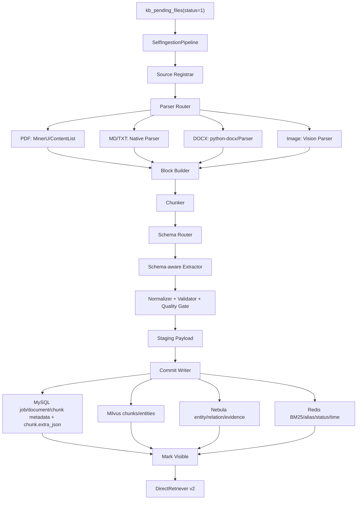

# 自研多模态 RAG 入库实现方案

> **运维快速上手** → [self_ingestion_quickstart.md](./self_ingestion_quickstart.md)  
> **落地审计** → [入库实现方案审查.md](./入库实现方案审查.md)

## 0. 目标与边界

本方案定义一套**全新的自研入库流程**，不再调用 LightRAG 的 `insert`、`ainsert`、`adelete_by_doc_id`、`doc_status`、`chunks_vdb`、`entities_vdb`、`relationships_vdb` 等写入协议。可以参考 LightRAG / RAGAnything 的解析、切块、多模态上下文、实体关系抽取和索引组织方式，但最终数据必须由本项目自己的 Ingestion Pipeline 写入 MySQL、Milvus、NebulaGraph、Redis。

检索端以当前 `DirectRetriever` 为基础改造。查询链路允许修改，但必须保留四路并行召回思想：

1. 实体向量召回。
2. Redis/BM25/关键词召回。
3. Chunk 向量召回。
4. NebulaGraph 图扩展。

新入库数据必须满足：

1. 每个文档、块、实体、关系、图片、表格、公式都可追溯到原文件。
2. 支持学科 Schema 约束。
3. 支持幂等入库、重复文件识别、版本化提交、软删除。
4. 支持失败补偿，避免半成品被检索召回。
5. 支持 DirectRetriever 只召回 `active + visible + committed + schema compatible` 的数据。

---

## 1. 当前项目对接点

### 1.0 兼容性硬约束

新入库和新查询必须以**双轨模式**上线，不能直接替换现有知识库链路。

**核心策略：旧库保留 + 长期双轨 + 新建可选。**

```text
1. 旧知识库一律保留，不删除、不强制迁移、不原地改写，默认继续使用 legacy_lightrag 入库和查询。
2. 双轨制是长期目标状态，不是过渡期临时方案；legacy 与 self_ingestion 长期并存。
3. 新建知识库在创建时由用户显式选择入库后端（legacy_lightrag 或 self_ingestion），前端提供下拉选择。
4. 新自研入库必须由知识库级配置 + 全局灰度开关共同启用，未显式选择的新库默认仍 legacy_lightrag。
5. 现有 kb_pending_files(status=1) 不能被新 worker 无条件消费。
6. 现有 DirectRetriever / LightRAG fallback 查询不能被删除。
7. 新增数据库字段必须 nullable 或有默认值，不能阻断旧数据读取。
8. 新 Milvus collection、Nebula tag/edge、Redis key 必须带 v2 命名空间，不能覆盖旧索引。
9. 删除、重入库、统计、图谱可视化都必须按 backend 路由到 legacy 或 self_ingestion。
10. 旧知识库迁移到新链路是"可选操作"，需管理员显式触发，绝不自动进行。
```

新增两个知识库级配置：

```text
ingestion_backend = legacy_lightrag | self_ingestion
retrieval_backend = legacy_lightrag | self_ingestion | hybrid
```

上线默认值：

```text
历史知识库（已存在）：
    一律保留原链路，回填 ingestion_backend = legacy_lightrag，retrieval_backend = legacy_lightrag。
    不做任何数据迁移，不重建索引。

新建知识库（用户在创建弹窗选择）：
    选项 A：legacy_lightrag（默认，与旧库一致）
    选项 B：self_ingestion（自研入库，需全局开关开启）
    用户选择写入 knowledge_bases.ingestion_backend / retrieval_backend。
    若选择 self_ingestion 但全局开关未开启，入库任务被阻塞（blocked），不回退 legacy，防止新库污染旧索引。
```

同时增加全局开关：

```text
SELF_INGESTION_ENABLED=false
SELF_RETRIEVER_ENABLED=false
SELF_INGESTION_KB_ALLOWLIST=kb_code1,kb_code2
SELF_RETRIEVER_KB_ALLOWLIST=kb_code1,kb_code2
```

只有同时满足：

```text
SELF_INGESTION_ENABLED=true
and kb.ingestion_backend=self_ingestion
and kb_code in allowlist 或 allowlist 为空
```

新 worker 才能消费该知识库的待入库任务。

### 1.0.1 当前实现状态与仍需重点验证的问题

当前代码已经按双轨模式做了第一轮落地改造：

```text
1. kb_pending_files 的 worker 消费路径已按 ingestion_backend 路由。
2. 知识库创建/更新、上传、启动入库已带入 backend 配置和任务快照。
3. 查询服务已按 retrieval_backend 路由 legacy/self/hybrid，旧知识库默认仍走 LightRAG。
4. 删除接口已按文档 ingestion_backend 分流，自研删除只处理 kb_self_* 与 v2 索引。
5. 管理端图谱接口已增加 self_ingestion/hybrid 分支，优先读自研实体/关系，空结果退回 chunk 序列图。
6. 新增字段和新表均为兼容式迁移，历史知识库默认 legacy_lightrag。
7. 自研入库已支持 md/txt/pdf/docx/图片 -> block -> 结构+语义混合分块 -> LLM/VLM 抽取 -> MySQL 元数据、Milvus 向量、NebulaGraph 图谱、Redis BM25 的最小闭环。
8. DirectRetriever v2 已具备四路最小融合：Milvus 实体向量召回、Redis BM25 + MySQL chunk 关键词回退、Milvus chunk 向量召回、NebulaGraph relation_v2 图扩展。
9. Milvus v2 写入已改成 staging invisible -> MySQL commit -> mark visible，并提供 repair/cleanup 入口。
10. MySQL 不再保存自研图谱事实或质量事实；实体、关系、证据、candidate、dropped payload 进入 NebulaGraph v2 / staging payload / job metrics，MySQL 仅保留 job、chunk、文档等可见性与溯源元数据；block/page/bbox/section_path 随 chunk.extra_json 和 staging payload 保存。
```

但以下问题仍然必须在上线前显式验证或继续增强，否则容易影响自研链路质量或运维闭环：

```text
1. 迁移脚本必须先在测试库执行；当前实现尚未自动执行 migration。
2. 自研实体/关系抽取默认走 schema-aware LLM/VLM；`simple` 仅作为显式配置下的回退或测试模式。
3. Path-A 主路径为 Milvus `{kb_code}_entities_v2`，Path-D 主路径为 NebulaGraph `relation_v2` nGQL；MySQL 图谱表已移除，不能再作为图谱召回主路径。
4. Milvus 可见性采用 delete+insert 方式模拟更新，需在目标 Milvus 版本上做压力与一致性验证。
5. 图片、复杂表格、公式还未完整实现，仅方案保留扩展路径；首期代码支持 md/txt/pdf/docx，docx 表格会转成 markdown-like 文本。
6. Hybrid 查询只适合灰度和评测，不能作为首期默认线上策略。
7. 旧数据迁移必须 shadow rebuild，不能原地改写旧索引。
8. 回滚必须只靠配置开关完成，不能依赖回滚数据库结构。
9. 上线前必须做三组回归：旧知识库入库/查询、新知识库自研入库/查询、旧知识库在新查询入口下的兼容查询。
```

### 1.1 保留的入口

继续使用现有知识库和待入库队列入口：

```text
knowledge_bases
kb_documents
kb_pending_files
ingest_worker
MinIO pending/{kb_id}/{file_id}/{file_name}
```

上传 API 仍然先写 `kb_pending_files`，worker 仍然轮询 `status=1` 的任务。但 worker 不再调用 `RAGService.process_multimodal()` 或 `RAGService.process_md_content()`，而是调用新的：

```python
backend.rag.ingestion.pipeline.SelfIngestionPipeline.ingest_pending_file(file_id)
```

注意：这只适用于 `ingestion_backend=self_ingestion` 的知识库。`legacy_lightrag` 知识库继续走现有 `PendingIngestProcessor -> RAGService` 链路。

### 1.2 废弃的入库依赖

新流程禁止在入库阶段调用：

```text
lightrag.insert / ainsert
lightrag.adelete_by_doc_id
lightrag.doc_status
lightrag.full_docs
lightrag.text_chunks
lightrag.full_entities
lightrag.full_relations
lightrag.chunks_vdb / entities_vdb / relationships_vdb 写入
RAGAnything.insert_content_list 写入
MDIngestor._insert_to_rag 写入
```

允许复用或参考：

```text
MinerU 解析 PDF 得到 markdown / content list
RAGAnything 的多模态 content_list 结构思想
LightRAG 的 chunk/entity/relation 组织思想
当前 embedding / LLM / VLM 调用封装
当前 MinIO、Milvus、Nebula、Redis 连接配置
当前 DirectRetriever 的融合和图扩展框架
```

---

## 2. 新总体架构



核心原则：

```text
解析器只产出 Intermediate Schema，不直接写三库。
抽取器只产出证据化 JSON，不直接写三库。
CommitWriter 是唯一写入 MySQL/Milvus/Nebula/Redis 的入口。
MySQL 只保存可见性、任务、文档、chunk 等关系型元数据；block/page/bbox/section_path 等块级溯源保存在 `kb_self_chunks.extra_json` 和 staging payload；实体、关系、证据、图谱质量事实不再落 MySQL。
DirectRetriever v2 只读 committed + visible 数据。
```

---

## 3. 推荐目录结构

```text
backend/rag/ingestion/
    __init__.py
    pipeline.py
    models.py
    ids.py
    hashing.py
    state_machine.py
    source_registry.py
    parser_router.py
    block_builder.py
    chunker.py
    staging_manager.py
    commit_writer.py
    repair_worker.py
    delete_service.py

backend/rag/ingestion/parsers/
    base.py
    mineru_pdf_parser.py
    markdown_parser.py
    text_parser.py
    docx_parser.py
    image_parser.py

backend/rag/ingestion/schema/
    discipline_schema.py
    schema_loader.py
    schema_validator.py
    relation_validator.py
    quality_gate.py
    schemas/
        groundwater.yaml
        nuclear_electronics.yaml

backend/rag/ingestion/extraction/
    prompts.py
    json_repair.py
    text_extractor.py
    vision_extractor.py
    table_extractor.py
    formula_extractor.py

backend/rag/ingestion/normalization/
    entity_registry.py
    alias_normalizer.py
    synonym_store.py
    unit_normalizer.py

backend/rag/ingestion/storage/
    mysql_writer.py
    milvus_writer.py
    nebula_writer.py
    redis_writer.py

backend/rag/retriever_v2/
    direct_retriever.py
    chunk_searcher.py
    entity_recall.py
    graph_expander.py
    filters.py
```

---

## 4. 数据库模型调整

所有数据库变更必须遵循“先兼容、后收紧”的迁移原则：

```text
第一阶段：只新增 nullable 字段或有默认值字段，不修改旧字段语义。
第二阶段：后台回填历史数据。
第三阶段：代码读取兼容 NULL。
第四阶段：确认无旧数据后，才考虑 NOT NULL 或唯一约束。
```

禁止首个 migration 直接添加会破坏旧数据的 `NOT NULL` 字段。

### 4.1 扩展 `kb_pending_files`

保留现有字段，新增：

```text
source_hash              VARCHAR(64) NULL
object_bucket            VARCHAR(128) NULL
object_key               VARCHAR(1024) NULL
original_uri             VARCHAR(1024) NULL
ingestion_backend        VARCHAR(32) NULL
upload_started_at        DATETIME NULL
upload_finished_at       DATETIME NULL
ingest_job_id            VARCHAR(36) NULL
last_ingest_started_at   DATETIME NULL
last_ingest_finished_at  DATETIME NULL
```

用途：

```text
source_hash 用于重复文件检测。
object_bucket/object_key 明确 MinIO 地址。
ingest_job_id 关联细粒度任务。
```

### 4.2 扩展 `kb_documents`

保留现有字段，新增：

```text
source_hash              VARCHAR(64) NULL
object_bucket            VARCHAR(128) NULL
object_key               VARCHAR(1024) NULL
object_storage_uri       VARCHAR(1200) NULL
mime_type                VARCHAR(128) NULL
file_ext                 VARCHAR(32) NULL

doc_status               VARCHAR(32) NOT NULL DEFAULT 'active'
ingestion_backend        VARCHAR(32) NOT NULL DEFAULT 'legacy_lightrag'
retrieval_backend        VARCHAR(32) NOT NULL DEFAULT 'legacy_lightrag'
parser_version           VARCHAR(64) NULL
schema_version           VARCHAR(64) NULL
commit_version           INT NOT NULL DEFAULT 1
latest_job_id            VARCHAR(36) NULL

uploaded_at              DATETIME NULL
stored_at                DATETIME NULL
ingest_started_at        DATETIME NULL
ingest_finished_at       DATETIME NULL
committed_at             DATETIME NULL
visible_at               DATETIME NULL
deleted_at               DATETIME NULL
archived_at              DATETIME NULL

lineage_json             JSON NULL
extra_metadata_json      JSON NULL
```

关键索引：

```text
INDEX(kb_id, ingestion_backend)
INDEX(kb_id, retrieval_backend)
INDEX(kb_id, doc_status, visible_at)
INDEX(kb_id, source_hash)
INDEX(kb_id, commit_version)
INDEX(kb_id, uploaded_at)
INDEX(kb_id, committed_at)
```

重复文件约束不建议第一阶段做数据库唯一索引，因为 MySQL 对“只约束 active 状态”的部分唯一索引支持有限，且历史数据可能没有 `source_hash`。首期由 `SourceRegistry` 在事务内加锁判断。

### 4.2.1 扩展 `knowledge_bases`

在知识库表增加：

```text
ingestion_backend        VARCHAR(32) NOT NULL DEFAULT 'legacy_lightrag'
retrieval_backend        VARCHAR(32) NOT NULL DEFAULT 'legacy_lightrag'
self_ingestion_enabled   BOOLEAN NOT NULL DEFAULT false
self_retriever_enabled   BOOLEAN NOT NULL DEFAULT false
```

历史知识库 migration 必须统一填：

```text
ingestion_backend='legacy_lightrag'
retrieval_backend='legacy_lightrag'
self_ingestion_enabled=false
self_retriever_enabled=false
```

### 4.3 新增 `kb_ingest_jobs`

当前第一阶段代码已按 v2 命名空间落地为：

```text
kb_self_ingest_jobs
kb_self_chunks
```

下文 `kb_ingest_jobs` 是领域模型名，实际 migration 与 ORM 以 `kb_self_ingest_jobs` 为准，避免和旧索引、后续多套实验索引混淆。当前运行时 MySQL 只直接保存 job 与 chunk；block/page/bbox/section_path 等块级溯源写入 `kb_self_chunks.extra_json` 和 staging payload。实体、关系、证据、quality candidate/dropped 不再创建 MySQL 表，统一写入 NebulaGraph v2、Milvus entities_v2、Redis 辅助索引和 staging payload。

```sql
CREATE TABLE kb_ingest_jobs (
  job_id VARCHAR(36) PRIMARY KEY,
  kb_id VARCHAR(36) NOT NULL,
  kb_code VARCHAR(50) NOT NULL,
  file_id VARCHAR(64) NULL,
  doc_id VARCHAR(64) NOT NULL,
  source_hash VARCHAR(64) NOT NULL,
  commit_version INT NOT NULL,
  subject VARCHAR(50) NULL,

  status VARCHAR(32) NOT NULL,
  current_stage VARCHAR(64) NOT NULL,
  retry_count INT NOT NULL DEFAULT 0,
  max_retry INT NOT NULL DEFAULT 3,
  error_message TEXT NULL,

  staging_uri VARCHAR(1200) NULL,
  commit_log_json JSON NULL,
  metrics_json JSON NULL,

  parser_version VARCHAR(64) NULL,
  schema_version VARCHAR(64) NULL,
  prompt_version VARCHAR(64) NULL,
  extractor_version VARCHAR(64) NULL,

  created_at DATETIME NOT NULL,
  updated_at DATETIME NOT NULL,
  started_at DATETIME NULL,
  finished_at DATETIME NULL,

  INDEX idx_ingest_job_kb_status (kb_id, status),
  INDEX idx_ingest_job_file (file_id),
  INDEX idx_ingest_job_doc (kb_id, doc_id),
  INDEX idx_ingest_job_hash (kb_id, source_hash)
);
```

状态枚举：

```text
SelfIngestJob.status:
pending
processing
committing
completed
partial_success
failed
repairing

SelfIngestJob.stage:
started
parsing
chunking
extracting
embedding
staging
committing
committing_mysql
committing_milvus
committing_nebula
committing_redis
marking_visible
committed
failed
```

### 4.4 Block 元数据与图谱事实存储边界

当前 MySQL 强制保留的自研入库表只有：

```text
kb_self_ingest_jobs      入库任务、阶段、commit log、staging_uri
kb_self_chunks           可检索 chunk 内容、可见性、block_type、索引状态、extra_json 块级溯源
```

不再创建或依赖以下 MySQL 图谱/质量表：

```text
kb_self_blocks
kb_self_entities
kb_self_entity_occurrences
kb_self_relations
kb_self_relation_evidences
kb_self_quality_candidates
kb_self_quality_dropped
```

对应事实的落点为：

```text
实体向量：Milvus {kb_code}_entities_v2
图谱关系与证据：NebulaGraph entity_v2 / relation_v2 / evidence_v2
关键词辅助：Redis entity_corpus / entity_alias / BM25 postings
质量审计明细：staging payload 的 candidates / dropped_logs；管理 API 保留但不再从 MySQL 查询
```

---

## 5. 核心 ID 规则

### 5.1 文档 ID

自研入库必须使用稳定文档 ID，不再每次随机生成。

```python
source_hash = sha256(file_bytes)
doc_id = "doc-" + sha1(kb_id + ":" + source_hash)[:32]
```

同一知识库内同一文件内容重复上传：

```text
如果已有 active doc 且 source_hash 相同：默认跳过入库，返回 existing_doc。
如果用户选择强制重入库：复用 doc_id，commit_version + 1。
```

文件内容变化：

```text
source_hash 变化。
如果按“同名更新”策略识别为同一业务文档，则复用 doc_id 并 commit_version + 1。
如果不启用同名更新，则生成新 doc_id。
```

### 5.2 Block ID

```python
block_id = "blk-" + sha1(
    doc_id + ":" + str(commit_version) + ":" + block_type + ":" +
    "/".join(section_path) + ":" + str(page_num or 0) + ":" + str(order_index)
)[:32]
```

### 5.3 Chunk ID

```python
content_hash = sha256(normalized_chunk_text)
stable_chunk_fingerprint = sha256(block_type + ":" + normalized_chunk_text)

chunk_id = "chk-" + sha1(
    doc_id + ":" + str(commit_version) + ":" + str(chunk_index) + ":" + content_hash
)[:32]
```

### 5.4 实体与关系 ID

```python
canonical_id = "ent-" + sha1(kb_code + ":" + entity_type + ":" + canonical_name)[:32]
occurrence_id = "eoc-" + sha1(canonical_id + ":" + doc_id + ":" + block_id + ":" + surface_name)[:32]

canonical_relation_id = "rel-" + sha1(src_id + ":" + relation_type + ":" + dst_id)[:32]
relation_evidence_id = "rev-" + sha1(canonical_relation_id + ":" + doc_id + ":" + block_id)[:32]
```

所有 ID 必须幂等，CommitWriter 可以安全重试。

---

## 6. Intermediate Schema

### 6.1 SourceDocument

```python
class SourceDocument(BaseModel):
    doc_id: str
    file_id: str | None
    job_id: str
    kb_id: str
    kb_code: str
    subject: str | None

    original_file_name: str
    file_ext: str
    mime_type: str
    file_size: int
    source_hash: str

    object_bucket: str
    object_key: str
    object_storage_uri: str
    local_cache_path: str | None
    parser_output_uri: str | None

    uploaded_at: datetime | None
    received_at: datetime
    stored_at: datetime | None
    ingest_started_at: datetime

    parser_version: str
    schema_version: str
    commit_version: int
    doc_status: Literal["active", "failed", "deleted", "archived"]
```

### 6.2 IngestBlock

```python
class IngestBlock(BaseModel):
    block_id: str
    doc_id: str
    job_id: str
    kb_id: str
    kb_code: str
    commit_version: int

    block_type: Literal["text", "image", "table", "formula"]
    content: str
    section_path: list[str]
    page_num: int | None
    bbox: list[float] | None
    order_index: int

    source_hash: str
    original_file_name: str
    object_storage_uri: str
    parser_output_uri: str | None

    content_hash: str
    stable_block_fingerprint: str
    metadata: dict
```

### 6.3 IngestChunk

```python
class IngestChunk(BaseModel):
    chunk_id: str
    block_id: str
    doc_id: str
    job_id: str
    kb_id: str
    kb_code: str
    commit_version: int

    chunk_index: int
    content: str
    content_hash: str
    stable_chunk_fingerprint: str
    block_type: str
    token_count: int

    original_file_name: str
    object_storage_uri: str
    file_path: str
    page_num: int | None
    bbox: list[float] | None
    section_path: list[str]

    schema_version: str
    parser_version: str
    is_active: bool
    is_visible: bool
    commit_status: Literal["staged", "writing", "committed", "failed"]
    doc_status: Literal["active", "deleted", "archived", "failed"]

    created_at: datetime
    embedded_at: datetime | None
    committed_at: datetime | None
    visible_at: datetime | None
```

---

## 7. Parser Router

### 7.1 路由规则

```python
if ext == ".pdf":
    parser = MinerUPdfParser()
elif ext in [".md", ".markdown"]:
    parser = MarkdownParser()
elif ext in [".txt"]:
    parser = TextParser()
elif ext in [".docx"]:
    parser = DocxParser()
elif ext in [".png", ".jpg", ".jpeg"]:
    parser = ImageParser()
else:
    raise UnsupportedFileType
```

### 7.2 Parser 输出协议

所有 parser 统一输出：

```python
class ParsedDocument(BaseModel):
    source_document: SourceDocument
    blocks: list[IngestBlock]
    parser_artifacts: dict
    warnings: list[str]
```

Parser 不做实体关系抽取，不写 Milvus/Nebula/Redis。

### 7.3 PDF 解析

首期仍可调用 MinerU，但只取解析结果：

```text
PDF -> MinerU -> markdown/content_list -> BlockBuilder
```

必须保存：

```text
MinerU task_id
md_url / parser_output_uri
page_num
bbox
image path
table body
formula latex
```

### 7.4 MD 解析

自研 MarkdownParser 需支持：

```text
标题层级 -> section_path
普通段落 -> text block
markdown image / html img -> image block
markdown table -> table block
latex block / inline equation -> formula block
```

图片只保存地址和上下文，base64 只在 VLM 调用时临时生成。

---

## 8. Chunking 策略

参考 LightRAG 的 chunk 思路，但由自研 `Chunker` 产出。

### 8.1 文本 Chunk

默认参数：

```text
chunk_size_tokens = 800
chunk_overlap_tokens = 120
respect_section_boundary = true
```

切块优先级：

```text
标题边界
段落边界
句子边界
token 长度兜底
```

### 8.2 多模态 Chunk

图片、表格、公式必须生成可召回文本：

```text
image chunk = caption + alt_text + surrounding_context + vision_summary
table chunk = caption + markdown_table + table_summary + units
formula chunk = latex + variable_explanation + surrounding_context
```

这些 chunk 的 `block_type` 分别为 `image/table/formula`，方便查询侧加权。

---

## 9. 学科 Schema

每个知识库通过 `knowledge_bases.subject` 选择 schema：

```text
groundwater -> backend/rag/ingestion/schema/schemas/groundwater.yaml
nuclear_electronics -> backend/rag/ingestion/schema/schemas/nuclear_electronics.yaml
unknown -> generic.yaml
```

Schema 内容：

```yaml
subject: nuclear_electronics
version: nuclear_electronics_v1.0

entity_types:
  - name: DEVICE
    aliases: ["设备", "仪器"]
    required_fields: ["name"]
  - name: CIRCUIT_MODULE
    required_fields: ["name"]
  - name: SIGNAL
    required_fields: ["name"]
    allowed_units:
      amplitude: ["V", "mV"]
      rise_time: ["ns", "us", "ms"]
  - name: PARAMETER
    required_fields: ["name"]

relation_types:
  - name: CONTAINS
    src_types: ["DEVICE", "CIRCUIT_MODULE"]
    dst_types: ["CIRCUIT_MODULE", "PARAMETER"]
  - name: GENERATES
    src_types: ["DEVICE", "CIRCUIT_MODULE"]
    dst_types: ["SIGNAL"]
  - name: HAS_PARAMETER
    src_types: ["DEVICE", "CIRCUIT_MODULE", "SIGNAL"]
    dst_types: ["PARAMETER"]

forbidden_relations:
  - src_type: PARAMETER
    relation: CONTAINS
    dst_type: DEVICE
```

抽取器输出的实体类型和关系类型必须来自 schema；不在 schema 内的结果进入 candidate 或 dropped。

---

## 10. Schema-aware Extractor

### 10.1 输入

```python
ExtractorInput:
    source_document
    chunk
    schema
    neighboring_chunks
    media_context
```

### 10.2 输出

```json
{
  "entities": [
    {
      "surface_name": "ADC",
      "canonical_hint": "ADC",
      "entity_type": "CIRCUIT_MODULE",
      "description": "模数转换模块",
      "evidence_text": "ADC将模拟脉冲转换为数字采样点",
      "confidence": 0.91,
      "attributes": {},
      "source": "text",
      "block_id": "blk-xxx",
      "chunk_id": "chk-xxx",
      "page_num": 3
    }
  ],
  "relations": [
    {
      "src": "ADC",
      "src_type": "CIRCUIT_MODULE",
      "dst": "模拟脉冲",
      "dst_type": "SIGNAL",
      "relation_type": "MEASURES",
      "evidence_text": "ADC采样模拟脉冲信号",
      "confidence": 0.86,
      "source": "text",
      "block_id": "blk-xxx",
      "chunk_id": "chk-xxx",
      "page_num": 3
    }
  ]
}
```

### 10.3 JSON 修复

LLM 输出不合法时：

```text
raw output -> json repair -> schema validate -> retry extractor once -> dropped log
```

---

## 11. 实体规范化

### 11.1 规范化流程

```text
surface_name
-> trim / case normalize
-> domain synonym dictionary
-> unit normalize
-> alias hash exact match
-> entity vector top-k
-> LLM semantic judge when ambiguous
-> canonical_id
```

### 11.2 EntityNode

```python
class EntityNode(BaseModel):
    canonical_id: str
    kb_code: str
    canonical_name: str
    entity_type: str
    aliases: list[str]
    description: str

    confidence: float
    support_count: int
    status: Literal["active", "weak_evidence", "candidate", "inactive", "orphaned"]

    first_seen_doc_id: str
    last_seen_doc_id: str
    first_seen_at: datetime
    last_seen_at: datetime

    schema_version: str
    commit_version: int
    is_visible: bool
```

---

## 12. 质量门控

```text
confidence >= 0.80:
    active，写入正式索引。

0.65 <= confidence < 0.80:
    weak_evidence，写入正式索引，但查询降权。

0.45 <= confidence < 0.65:
    candidate，只进入 staging payload / job metrics 审计，不进入 Milvus/Nebula 正式检索。

confidence < 0.45:
    dropped，只进入 staging payload / job metrics 审计。
```

candidate / dropped 是自动质量审计结果，不是人工审核队列；入库任务不会等待人工确认，也不会再写入 MySQL 质量表。
自动处理策略为：

```text
低于 candidate 阈值或命中 forbidden/missing endpoint:
    auto_dropped_not_indexed，只留 staging dropped 审计，不进入正式检索。

实体低于正式阈值但达到 candidate 阈值:
    auto_audit_only_not_visible，只留 staging candidate 审计，不进入正式检索。

关系低于正式阈值但达到 candidate 阈值:
    auto_weak_evidence_visible，作为 weak_evidence 写入正式关系索引，查询侧降权。
```

质量门控还必须检查：

```text
entity_type 是否存在于 schema
relation_type 是否存在于 schema
src_type/dst_type 是否满足 schema
是否命中 forbidden_relations
evidence_text 是否非空
evidence_text 是否能在 chunk/block/context 中找到或近似匹配
```

---

## 13. Staging

### 13.1 Staging 位置

大对象不放 Redis。推荐：

```text
MinIO: staging/{kb_id}/{job_id}/payload.json
MySQL: kb_self_ingest_jobs.staging_uri
Redis: {kb_code}:v2:commit_log:{job_id}
```

### 13.2 StagingPayload

```python
class StagingPayload(BaseModel):
    job_id: str
    kb_id: str
    kb_code: str
    doc_id: str
    commit_version: int

    source_document: SourceDocument
    blocks: list[IngestBlock]
    chunks: list[IngestChunk]
    vectors: list[list[float]]
    entity_vectors: list[list[float]]
    extraction: ExtractionResult
    extraction_audit: dict
    quality_audit: dict
    candidates: list[dict]
    dropped_logs: list[dict]

    metrics: dict
    created_at: datetime
```

StagingPayload 是 CommitWriter 的唯一输入。

---

## 14. CommitWriter

### 14.1 核心策略

三库无分布式事务，因此使用：

```text
幂等 ID
写入状态字段
Commit Log
先不可见后可见
Repair Worker
```

核心可见性策略：

```text
MySQL chunk/doc 先 staged / invisible
Milvus chunk 先 invisible
MySQL mark visible 是核心提交点
Milvus visible、Milvus entities、Redis、Nebula 属于可补偿外部索引
```

### 14.2 提交流程

```text
0. PendingIngestUseCase 已持有 Redis 锁 kb_ingest_lock:{file_id}
1. stage=committing_mysql：写 kb_self_chunks 为 staged/is_visible=false
2. stage=committing_milvus：写 Milvus chunks_v2，visible=false
3. stage=marking_visible：MySQL 标记新 chunk/document 为 visible，旧版本为 superseded，更新 kb_documents 与 kb_pending_files.status=2
4. 并行执行外部索引补全：
   - milvus_mark_visible：Milvus chunk 标记可见
   - milvus_entities_v2：写 Milvus entities_v2
   - committing_redis：写 Redis BM25、entity metadata、alias、doc->chunks、时间索引
   - committing_nebula：写 NebulaGraph entity_v2/relation_v2/evidence_v2
5. 无外部失败：kb_self_ingest_jobs.status=completed, stage=committed
6. 有外部失败：kb_self_ingest_jobs.status=partial_success, stage=marking_visible，并记录 external_failures
```

如果第 4 步部分失败：

```text
MySQL 已可见，基础检索可通过 MySQL/已成功路径工作
失败外部索引进入 metrics_json.external_failures
repair_worker 根据 staging_uri 重放失败阶段
```

---

## 15. Milvus 设计

不再使用 LightRAG collection。使用自研 collection：

```text
{kb_code}_chunks_v2
{kb_code}_entities_v2
```

命名隔离要求：

```text
旧 collection 示例：{kb_code}_chunks、{kb_code}_entities、rag_{kb_code}_keyword_index
新 collection 固定：{kb_code}_chunks_v2、{kb_code}_entities_v2
禁止新 writer 写入旧 collection。
禁止旧同步任务 RAGIndexSyncManager 扫描或重建 *_v2 collection。
```

### 15.1 chunks_v2 字段

```text
id                      VarChar primary key
vector                  FloatVector
content                 VarChar

kb_id                   VarChar
kb_code                 VarChar
doc_id                  VarChar
job_id                  VarChar
block_id                VarChar
chunk_index             Int64
block_type              VarChar

file_name               VarChar
file_path               VarChar
object_storage_uri      VarChar
page_num                Int64
section_path            VarChar JSON string

content_hash            VarChar
source_hash             VarChar
schema_version          VarChar
parser_version          VarChar
commit_version          Int64

doc_status              VarChar
is_active               Bool
is_visible              Bool
commit_status           VarChar

created_at_ts           Int64
uploaded_at_ts          Int64
committed_at_ts         Int64
visible_at_ts           Int64
deleted_at_ts           Int64
```

必须建立标量索引：

```text
doc_id
block_id
block_type
doc_status
is_active
is_visible
commit_status
schema_version
commit_version
uploaded_at_ts
committed_at_ts
```

### 15.2 entities_v2 字段

```text
id                      canonical_id primary key
vector                  FloatVector
canonical_name          VarChar
entity_type             VarChar
description             VarChar
aliases_json            VarChar

kb_id
kb_code
support_count           Int64
confidence              Float
status                  VarChar
schema_version          VarChar
commit_version          Int64
is_visible              Bool

first_seen_doc_id
last_seen_doc_id
first_seen_at_ts
last_seen_at_ts
```

---

## 16. NebulaGraph 设计

不再依赖 LightRAG schema。新建或迁移当前 space schema：

```sql
CREATE TAG IF NOT EXISTS entity_v2 (
  canonical_id string,
  canonical_name string,
  entity_type string,
  description string,
  aliases_json string,
  support_count int,
  confidence double,
  status string,
  schema_version string,
  commit_version int,
  is_visible bool,
  first_seen_doc_id string,
  last_seen_doc_id string,
  first_seen_at timestamp,
  last_seen_at timestamp
);

CREATE EDGE IF NOT EXISTS relation_v2 (
  canonical_relation_id string,
  relation_type string,
  description string,
  confidence double,
  weight double,
  support_count int,
  status string,
  schema_version string,
  commit_version int,
  is_visible bool,
  first_seen_doc_id string,
  last_seen_doc_id string,
  first_seen_at timestamp,
  last_seen_at timestamp
);

CREATE TAG IF NOT EXISTS evidence_v2 (
  evidence_id string,
  evidence_type string,
  doc_id string,
  block_id string,
  chunk_id string,
  text string,
  source string,
  file_name string,
  object_storage_uri string,
  page_num int,
  confidence double,
  status string,
  commit_version int,
  is_visible bool,
  created_at timestamp
);
```

查询侧只走 `entity_v2/relation_v2`。旧 `entity/relation` 可保留用于兼容旧数据，但 DirectRetriever v2 默认不读旧 tag。

Schema 隔离要求：

```text
1. 可以复用现有 Nebula space，但必须新增 entity_v2/relation_v2/evidence_v2。
2. 不能修改旧 entity/relation 字段语义。
3. 旧知识库图谱 API 继续读取 entity/relation。
4. 新知识库图谱 API 读取 entity_v2/relation_v2。
5. hybrid 查询可同时读取两套 tag/edge，但必须标记 source_backend。
```

---

## 17. Redis 设计

Redis 用于轻量检索和状态，不存大 payload。

```text
{kb_code}:doc:{doc_id}:metadata
{kb_code}:v2:doc:{doc_id}:metadata
{kb_code}:v2:doc:{doc_id}:chunks
{kb_code}:v2:doc:{doc_id}:entities
{kb_code}:v2:entity_alias:{alias_hash}
{kb_code}:v2:entity:{canonical_id}:metadata
{kb_code}:v2:relation:{canonical_relation_id}:metadata
{kb_code}:v2:relation:{canonical_relation_id}:evidences

{kb_code}:v2:bm25:entity_corpus
{kb_code}:v2:bm25:chunk_corpus
{kb_code}:v2:docs:uploaded_at
{kb_code}:v2:docs:committed_at
{kb_code}:v2:docs:visible_at
{kb_code}:v2:commit_log:{job_id}
{kb_code}:v2:staging_pointer:{job_id}
```

Redis 写入必须带 `commit_status` 和 `is_visible`，BM25 构建只使用 committed 数据。

注意：旧关键词索引目前使用 `{kb_code}:keyword_index` 相关 key，新入库不能复用该前缀，避免污染旧查询。

---

## 18. DirectRetriever v2 改造

### 18.0 查询路由

新增统一查询路由器：

```python
class RetrievalRouter:
    async def retrieve(kb_id, query, options):
        kb = await kb_repo.get(kb_id)
        backend = resolve_backend(kb, options)
        if backend == "legacy_lightrag":
            return await legacy_direct_retriever.retrieve(...)
        if backend == "self_ingestion":
            return await self_direct_retriever_v2.retrieve(...)
        if backend == "hybrid":
            return await hybrid_retriever.retrieve(...)
```

路由规则：

```text
1. 历史知识库默认 legacy_lightrag。
2. self_ingestion 知识库默认 self_ingestion。
3. retrieval_backend=hybrid 时，同时查旧索引和新索引。
4. 请求参数可以临时指定 backend，但只能在管理员或评测接口开放。
5. v2 查询异常时：
   - self_ingestion 知识库：返回明确错误或按配置 fallback。
   - hybrid 知识库：保留 legacy 结果，并记录 v2 失败。
   - legacy_lightrag 知识库：不调用 v2。
```

兼容输出协议：

```text
RawRetrievalData.entities / relationships / chunks 字段保持现有结构。
新增字段 source_backend = legacy_lightrag | self_ingestion。
新增字段 source_index = chunks_vdb | chunks_v2 | entity | entity_v2 等。
旧下游 reranker、content_filter、answer generator 不应因新增字段报错。
```

Hybrid 合并要求：

```text
1. 按 doc_id + chunk_id 去重。
2. 旧 chunk_id 和新 chunk_id 可能不同，需同时用 content_hash 辅助去重。
3. 分数先在各 backend 内归一化，再融合。
4. 同一证据同时来自 legacy 和 self_ingestion 时，优先保留 self_ingestion 的溯源字段。
5. 最终结果必须标明 source_backend，方便排查。
```

### 18.1 统一过滤器

新增：

```python
class RetrievalFilter(BaseModel):
    kb_id: str
    kb_code: str
    doc_status: str = "active"
    is_active: bool = True
    is_visible: bool = True
    commit_status: str = "committed"
    compatible_schema_versions: list[str]
    uploaded_at_gte: int | None = None
    uploaded_at_lte: int | None = None
    committed_at_gte: int | None = None
    committed_at_lte: int | None = None
```

所有路径必须接收同一个 `RetrievalFilter`。

### 18.2 Path-C Chunk 向量召回

Milvus search 必须加 filter：

```text
kb_code == "{kb_code}"
and doc_status == "active"
and is_active == true
and is_visible == true
and commit_status == "committed"
and schema_version in [...]
```

输出字段改为：

```text
id
content
doc_id
block_id
block_type
file_name
file_path
object_storage_uri
page_num
section_path
commit_version
schema_version
created_at_ts
```

### 18.3 Path-A 实体向量召回

从 `{kb_code}_entities_v2` 搜索，不再使用旧 keyword_index collection。

过滤：

```text
status in ["active", "weak_evidence"]
and is_visible == true
and schema_version compatible
```

`weak_evidence` 分数乘以 `0.65`。

### 18.4 Path-B Redis/BM25

Redis BM25 corpus 必须只包含 visible 数据。每次提交成功后增量更新：

```text
chunk BM25: chunk_id -> content
entity BM25: canonical_id -> canonical_name + aliases + description
```

删除或版本切换时从 BM25 移除旧 chunk。

### 18.5 Path-D Nebula 图扩展

GraphExpander 改查：

```ngql
GO FROM $seed_ids OVER relation_v2 BIDIRECT
YIELD
  id($^) AS src,
  id($$) AS dst,
  properties(edge).relation_type AS relation_type,
  properties(edge).weight AS weight,
  properties(edge).status AS status,
  properties(edge).is_visible AS is_visible,
  properties(edge).schema_version AS schema_version
```

过滤：

```text
edge.is_visible = true
edge.status in ["active", "weak_evidence"]
node.is_visible = true
node.status in ["active", "weak_evidence"]
schema_version compatible
```

### 18.6 Chunk 回填

实体和关系 evidence 中必须记录 `chunk_id`。DirectRetriever v2 优先从 NebulaGraph `evidence_v2` / `relation_v2.evidence_chunk_ids` 与 Redis 辅助索引回填关联 chunk_id，再批量从 Milvus/MySQL 拉 chunk 内容；MySQL 不再保存 entity/relation evidence 表。

---

## 19. 删除与版本切换

删除接口必须按 `kb.ingestion_backend` 和文档实际来源路由，不能统一调用 LightRAG 删除。

```python
if doc.ingestion_backend == "legacy_lightrag":
    await rag_service.delete_doc_by_id(doc_id, kb_id=kb_id)
elif doc.ingestion_backend == "self_ingestion":
    await self_delete_service.soft_delete(doc_id, kb_id=kb_id)
```

如果知识库是 `hybrid` 查询，但文档来自旧链路，仍必须走旧删除；文档来自新链路，走新删除。

### 19.1 软删除

删除文档不直接物理删除共享实体：

```text
1. kb_documents.doc_status = deleted
2. kb_documents.deleted_at = now
3. chunks_v2: doc_id 对应数据 is_active=false, doc_status=deleted
4. entity_occurrences/relation_evidences: doc_id 对应证据 status=inactive
5. 重新计算 entity/relation support_count
6. support_count=0 的 entity/relation status=orphaned
7. Redis BM25 移除该 doc 的 chunk
8. DirectRetriever 立即不可召回该 doc
```

### 19.2 版本切换

新 commit 成功前，旧版本保持 visible。

新 commit 完成后：

```text
old commit_version: is_active=false
new commit_version: is_active=true, is_visible=true
kb_documents.commit_version = new version
```

这样可以避免入库期间查询空窗。

---

## 19.3 管理端图谱与统计兼容

当前管理端图谱 API 读取旧 Nebula `entity/relation`。新方案必须提供 backend-aware 图谱查询：

```text
legacy_lightrag:
    读取 entity/relation。

self_ingestion:
    读取 entity_v2/relation_v2/evidence_v2。

hybrid:
    同时读取两套图谱，节点和边都带 source_backend。
```

统计口径：

```text
kb_documents.doc_count:
    active 文档数，包含 legacy + self。

entity_count / relation_count:
    legacy_lightrag 后端按旧统计逻辑。
    self_ingestion 后端按 entity_v2/relation_v2 且 is_visible=true/status in active,weak_evidence 统计。
    hybrid 需要分别展示 legacy_count 和 self_count，避免简单相加造成重复实体。
```

文档列表：

```text
必须显示 ingestion_backend、retrieval_backend、commit_version、doc_status。
旧文档这些字段可为空或显示 legacy_lightrag/default。
```

---

## 20. Worker 改造

`backend.worker.components.ingest_pending_processor.PendingIngestProcessor` 不能直接替换为新逻辑，而要改造成双轨路由：

```python
class PendingIngestProcessor:
    async def process_file(self, file_id: str) -> bool:
        lock = f"kb_ingest_lock:{file_id}"
        pending = await load_pending_file(file_id)
        kb = await load_knowledge_base(pending.kb_id)

        if should_use_self_ingestion(kb):
            pipeline = SelfIngestionPipeline()
            result = await pipeline.ingest_pending_file(file_id)
            return result.success

        return await legacy_pending_ingest_processor.process_file(file_id)
```

对 `self_ingestion` 知识库，`ingest_pending_processor` 不再负责：

```text
生成随机 doc_id
判断 MD 后直接调用 RAGService
PDF 后调用 RAGService.process_multimodal
```

这些职责全部进入 `SelfIngestionPipeline`。

对 `legacy_lightrag` 知识库，现有行为必须保持不变。

### 20.1 StartupTaskProcessor 风险

当前项目除了独立 `ingest_worker`，还有启动时任务处理器会扫描 `kb_pending_files(status=1)`。新方案必须同步改造或关闭它，否则同一条 pending file 可能被旧链路消费。

要求：

```text
1. 所有消费 kb_pending_files(status=1) 的地方都必须调用同一个 backend router。
2. Redis 锁 key 保持 file_id 维度，避免新旧 worker 并发处理同一文件。
3. 日志中必须打印 file_id、kb_id、kb_code、ingestion_backend、worker_name。
4. 自研链路灰度期间建议只启一个 worker 类型，避免排查复杂度。
```

### 20.2 PendingFile 启动任务语义

`kb_pending_files.status=1` 当前表示“用户已启动入库”。新增 `ingestion_backend` 后：

```text
pending.ingestion_backend 为空：
    读取 knowledge_bases.ingestion_backend。

pending.ingestion_backend 有值：
    以 pending 为准，支持同一知识库灰度单文件。

pending.ingestion_backend=self_ingestion 但全局开关未启用：
    不消费，标记 blocked 或保持 status=1，并写清晰错误。
```

---

## 21. SelfIngestionPipeline 伪代码

```python
class SelfIngestionPipeline:
    async def ingest_pending_file(self, file_id: str) -> IngestResult:
        pending = await pending_repo.get(file_id)
        kb = await kb_repo.get(pending.kb_id)

        file_bytes = await minio.read(pending.minio_path)
        source_hash = sha256(file_bytes)
        doc_id, commit_version, action = await source_registry.register(
            kb=kb,
            pending=pending,
            source_hash=source_hash,
        )

        if action == "skip_existing":
            await pending_repo.mark_completed(file_id)
            return IngestResult(success=True, doc_id=doc_id, skipped=True)

        job = await job_repo.create(...)
        local_path = await cache.write(file_bytes)

        try:
            await job_repo.stage(job, "PARSING")
            parsed = await parser_router.parse(local_path, source_document)

            await job_repo.stage(job, "CHUNKING")
            chunks = chunker.build(parsed.blocks)

            await job_repo.stage(job, "EXTRACTING")
            extracted = await extractor.extract(chunks, schema)

            await job_repo.stage(job, "NORMALIZING")
            normalized = await normalizer.normalize(extracted)

            await job_repo.stage(job, "QUALITY_GATING")
            gated = quality_gate.apply(normalized, schema)

            await job_repo.stage(job, "STAGING")
            staging_uri = await staging_manager.save(...)

            await job_repo.stage(job, "COMMITTING")
            await commit_writer.commit(staging_uri)

            return IngestResult(success=True, doc_id=doc_id)
        except Exception as exc:
            await job_repo.fail(job, exc)
            await pending_repo.mark_failed(file_id, str(exc))
            raise
        finally:
            cache.cleanup(local_path)
```

---

## 22. 落地阶段

本节把方案拆成可执行的阶段任务。Phase-1 目标是上线前闭环，Phase-2 目标是补齐实体关系与图谱质量核心，Phase-3 进入多模态和暂存重放，Phase-4 强化修复与观测，Phase-5 做生产加固和双轨长期共存。

### 22.0 Phase-1 收尾：上线前闭环

Phase-1 加强版代码已形成最小闭环，但上线前仍必须完成迁移、索引重建、开关配置和回归验证。

| # | 任务 | 涉及文件/组件 | 执行要求 | 验收标准 |
|---|---|---|---|---|
| 1 | 执行迁移脚本 | `scripts/migrations/add_self_ingestion_compat_columns.sql`、`fix_self_ingestion_doc_status_staged.sql`、`add_self_ingest_job_audit_fields.sql`、`backfill_legacy_backend_marker.sql` | 测试库按顺序执行，确认幂等后再进入生产窗口 | `knowledge_bases`、`kb_documents`、`kb_pending_files`、`kb_self_ingest_jobs` 字段完整；历史 KB 标记为 `legacy_lightrag` |
| 2 | Milvus collection 重建 | 运维操作 | 已存在的 `*_chunks_v2` collection 字段不齐全时，先 `drop_collection`，再由新写入按新 schema 自动创建 | 新 collection 包含 `content_hash`、`is_visible`、`doc_status`、`schema_version`、`source_backend` 等标量字段和索引 |
| 3 | 配置全局开关 | `.env` / 部署配置 | 设置 `SELF_INGESTION_ENABLED=true`、`SELF_RETRIEVER_ENABLED=true`，并配置白名单 | 新建 KB 可选择 `self_ingestion`；旧 KB 默认仍为 `legacy_lightrag` |
| 4 | 三组回归测试 | 手动/脚本 | 覆盖旧库入库+查询、新库自研入库+查询、旧库在新查询入口下兼容查询 | 旧链路不受影响；新链路可完成 chunk 入库、召回、删除不可见；兼容入口不串库 |

Phase-1 收尾测试必须覆盖 §23.0 的旧服务回归场景。测试不通过时，不允许打开全量 self_ingestion 入口。

### 22.1 Phase-1：基础自研入库闭环

目标：不依赖 LightRAG 完成文本 chunk 入库和 DirectRetriever v2 召回。

范围：

```text
MySQL job/document/chunk metadata（block 溯源在 chunk.extra_json/staging）
PDF/MD/TXT parser
Text chunker
Milvus chunks_v2
Redis chunk BM25
DirectRetriever Path-C + Path-B 改造
软删除 doc
```

验收：

```text
上传 PDF/MD -> worker 入库 -> chunks_v2 有数据
DirectRetriever v2 可召回 chunk
删除文档后不可召回
重复上传同 hash 不重复入库
```

### 22.2 Phase-2：实体关系与图谱能力补齐

目标：让自研链路的实体/关系质量和检索能力真正超过 legacy，使新知识库选择 self_ingestion 具备业务收益。

优先级定义：

```text
P0：LLM 抽取链路前置依赖或核心质量能力，建议立即推进。
P1：直接提升图谱召回质量，Phase-2 主体能力。
P2：增强过滤、融合、审计和迁移完整性，可随 P1 并行或紧随其后。
```

范围：

| # | 任务 | 方案章节 | 优先级 | 交付内容 | 验收标准 |
|---|---|---|---|---|---|
| 5 | 学科 Schema 模块 | §9 | P0 | `schema/schemas/*.yaml`、`schema_loader.py`、`schema_validator.py`，按 `kb.subject` 路由，默认回退 `generic` | schema 可加载、版本可识别、实体/关系类型可校验；未知 subject 不阻断入库 |
| 6 | LLM schema-aware 抽取器 | §10 / 附录 F | P0 | `extraction/llm_extractor.py`、`json_repair.py`、Prompt 模板，替换或灰度替代 `simple_extractor` | 抽取输出实体/关系/evidence/confidence；非法 JSON 可修复；越 schema 类型进入 candidate/dropped |
| 7 | 质量门控 | §12 | P1 | `quality_gate.py`、confidence 分级、candidate/dropped 表、`forbidden_relations` 校验，管理端查询/统计 API 已补齐 | 低置信结果不进入正式 Milvus/Nebula；candidate/dropped 仅自动审计、不阻断入库；forbidden relation 必须 dropped |
| 8 | 实体规范化 | §11 | P1 | `normalization/` 目录，包含同义词、单位、别名、向量聚合、LLM 裁决 | 同一实体的别名可归并；冲突实体不误合并；规范化结果保留原始 mention |
| 9 | `entities_v2` Milvus | §15.2 / §18.3 | P1 | `MilvusEntityWriter`、`{kb_code}_entities_v2` collection、Path-A 向量召回 | 实体向量可召回；Path-A 不再依赖 MySQL `ilike`；召回结果能回填 evidence chunk |
| 10 | Nebula Path-D nGQL | §16 / §18.5 / 附录 G | P1 | `GraphExpander` 查询 `relation_v2`，使用 `has_entity_evidence` / `has_relation_evidence` 连接边 | 图扩展可返回关系路径和证据；空结果可降级 MySQL v2；查询必须带 `kb_id/kb_code` 约束 |
| 11 | Redis key 补齐 | §17 | P2 | `entity_corpus`、`entity_alias`、`docs:uploaded_at`、`docs:committed_at`、`docs:visible_at`，全部写入 `{kb_code}:v2:*` 新命名空间 | 关键词召回可利用实体语料；文档时间过滤有 Redis 快路径；不复用 legacy `{kb_code}:keyword_index` |
| 12 | RetrievalFilter 统一过滤器 | §18.1 | P2 | `RetrievalFilter` 已接入 DirectRetriever v2，统一注入可见性、doc_status、commit_status、schema_version、时间范围与 self backend 过滤 | Path-A/B/C/D 最终拉取 chunk 时共享过滤口径；旧库 legacy 查询不构造该过滤器 |
| 13 | Hybrid 检索去重 | §18.0 / §24.2 | P2 | 独立 `HybridRetriever` 已完成，支持 `content_hash` 去重、backend 内分数归一化、`source_backend` 标记，暂未接管线上 hybrid 路由 | legacy/self 混合候选可离线融合去重；同证据冲突时优先保留 self 溯源 |
| 14 | Phase-2 迁移脚本 | §29 | P2 | candidate/dropped 表 DDL、schema 字段、回滚脚本 | 迁移可重复执行；回滚不破坏 Phase-1 数据 |

推荐立即推进的 4 项：

```text
1. 学科 Schema YAML + schema_loader
   LLM 抽取器的前置依赖，先定义可控输出空间。

2. LLM schema-aware 抽取器
   直接决定实体/关系质量，先以 feature flag 灰度替换 simple_extractor。

3. 质量门控
   承接 LLM 输出，按自动策略把不确定结果放入 candidate/dropped 审计或 weak_evidence，避免污染正式索引且不等待人工审核。

4. entities_v2 Milvus + Path-A 向量召回
   让实体召回脱离 MySQL ilike，形成真实实体语义召回能力。
```

验收：

```text
实体向量可召回
图扩展可返回关系
关系 evidence 可回到 chunk
weak_evidence 降权
candidate 不进入检索
```

### 22.3 Phase-3：多模态与暂存机制

目标：把入库从纯文本 chunk 扩展到图片、表格、公式等结构化 block，并引入可重放的 staging payload 与完整 CommitWriter 状态机。

| # | 任务 | 方案章节 | 交付内容 | 验收标准 |
|---|---|---|---|---|
| 15 | Parser Router + Block Builder | §7 / 附录 C/E | `parsers/` 目录、`block_builder.py`，产出 `IngestBlock(text/image/table/formula)` | 同一文件可生成多类型 block；block 保留 `page_num/bbox/object_storage_uri` |
| 16 | 图片 chunk + VLM | §8.2 / 附录 E.3/F.3 | `ImageParser` 调 VLM 生成 `vision_summary` | 图片内容可被文本检索召回；VLM 失败时可降级为 caption/context chunk |
| 17 | 表格 chunk | §8.2 / 附录 F.2 | `TableBlock` 转 markdown + summary + 单位标准化 | 表格标题、列名、单位、关键行可召回；单位规范化可审计 |
| 18 | 公式 chunk | §8.2 | `FormulaBlock` 转 LaTeX + `variable_explanation` | 公式和变量含义可召回；证据能回溯页码和 bbox |
| 19 | 多模态 chunk 加权 | §8.2 | 检索侧按 `block_type` 调整权重 | 图片/表格/公式 chunk 不被文本 chunk 淹没；权重可配置 |
| 20 | Staging payload | §13 | `staging_manager.py`、MinIO `staging/{kb_id}/{job_id}/payload.json`、`SelfIngestJob.staging_uri` | 解析与提交解耦；提交失败可从 payload 重放 |
| 21 | 完整 CommitWriter 状态机 | §14 / 附录 H | 独立 `commit_writer.py`，从 `StagingPayload` 重放，支持断点续传 | 任一存储阶段失败后可精确 repair；未 visible 数据不可召回 |
| 22 | MinerU content_list | 附录 E.4 | PDF 解析读取 `content_list`，保留 `page_num/bbox` | PDF 中图片、表格、公式位置可追溯 |

验收：

```text
图片/表格/公式均生成可召回 chunk
证据能回溯 object_storage_uri/page/bbox
图片失败可降级为 caption/context chunk
```

### 22.4 Phase-4：版本、修复、观测

目标：把自研链路从“能跑”推进到“能修、能查、能告警”，降低生产故障处理成本。

| # | 任务 | 方案章节 | 交付内容 | 验收标准 |
|---|---|---|---|---|
| 23 | repair 断点续传 | §26.4 | 从 `staging_uri` 重放 `StagingPayload` 到具体存储阶段 | 可修复 MySQL/Milvus/Nebula/Redis 任一阶段失败；重复执行幂等 |
| 24 | embedding retry worker | §26.1 / 附录 D.2 | 批量重试、指数退避、全失败降级 MySQL-only | embedding 服务短暂失败后自动恢复；持续失败时任务状态可解释 |
| 25 | 旧版本 inactive 异步清理 | §19.2 | 新版本 visible 后清理旧版本向量/索引 | 新版本成功前旧版本仍可召回；清理失败不影响当前版本 |
| 26 | Prometheus 指标 | §25.2 | `self_ingestion_total`、`duration_seconds`、`errors_total`、`retry_total`，覆盖检索/存储侧 | 可按 `kb_code/stage/backend/error_type` 聚合 |
| 27 | Grafana 面板 | §25.3 | 入库耗时、失败率、队列深度、检索延迟面板 | 运维可直接观察 P95/P99、错误趋势和积压 |
| 28 | 健康检查端点 | §25.4 | `GET /api/v1/health/self-ingestion`，返回组件状态和 `queue_depth` | MySQL/Milvus/Nebula/Redis/MinIO/embedding 状态可见 |
| 29 | 结构化日志规范 | §25.1 | `kb_id/file_id/job_id/backend/stage/duration_ms` 必备字段 | 生产日志可按任务串联排障 |

验收：

```text
模拟 Milvus 成功 Nebula 失败，半成品不可召回
repair 后 visible
新版本成功前旧版本仍可召回
```

### 22.5 Phase-5：生产加固 + 双轨长期共存

目标：在 self_ingestion 稳定后，补齐管理、性能、评测和数据巡检能力，同时保持 legacy 与 self 长期双轨并存。

| # | 任务 | 方案章节 | 交付内容 | 验收标准 |
|---|---|---|---|---|
| 30 | 管理 API | §28.2 | `/admin/self-ingestion/jobs` 查询/重试、`/repair` 触发、`/stats`、`/switch-backend` | 管理员可定位失败任务、触发修复、查看统计；切换后端有权限和审计 |
| 31 | 连接池优化 | §30.4 | Milvus connection 池化、Redis `max_connections=20` | 高并发检索下连接数稳定；P95 不随并发线性恶化 |
| 32 | RedisSearch 倒排索引 | §32.1 | 用 `FT.CREATE` 替换内存 BM25 词袋 | 大 KB 关键词召回性能可控；索引可按 KB 隔离 |
| 33 | 旧库可选迁移工具 | §24.4 | 管理员显式触发的 shadow rebuild 工具 | 迁移不影响 legacy 在线查询；迁移结果可灰度对比 |
| 34 | A/B 测试框架 | §32.2 | legacy vs self 召回质量对比 | 支持同 query 对比命中率、证据质量、延迟和用户反馈 |
| 35 | 数据一致性校验工具 | §32.2 | MySQL/Milvus/Nebula/Redis 跨库巡检 | 可发现孤儿向量、缺失 evidence、可见性不一致和 Redis 漏写 |
| 36 | legacy 归档工具 | §24.4 | 业务确认某 KB 不再需要 legacy 后清理旧索引 | 只清理明确确认的 KB；归档过程可审计、可回滚到备份 |

Phase-5 不代表 legacy 下线。legacy 归档只能作为单个 KB 的管理员显式操作，不能作为系统级自动任务。

---

## 23. 测试计划

### 23.0 旧服务回归测试

每个阶段上线前必须先跑旧服务回归，确保没有影响现有知识库。

```text
旧入库回归：
1. 选择 retrieval_backend=legacy_lightrag、ingestion_backend=legacy_lightrag 的知识库。
2. 上传 PDF/MD。
3. 启动入库。
4. 验证仍由旧 PendingIngestProcessor -> RAGService 处理。
5. 验证旧 Milvus collection、旧 Redis keyword_index、旧 Nebula entity/relation 有数据。
6. 验证 *_v2 collection/tag/key 没有被写入。

旧查询回归：
1. 对旧知识库执行现有 RAG 查询。
2. 验证仍可构建当前 DirectRetriever。
3. 验证 DirectRetriever 失败时仍可 fallback LightRAG。
4. 验证答案、上下文、图谱接口与改造前一致。

旧删除回归：
1. 删除旧链路文档。
2. 验证仍调用 legacy delete_doc_by_id。
3. 验证不会调用 self_delete_service。
4. 验证旧知识库文档列表和统计正常。
```

### 23.1 重复入库

```text
同一文件上传 3 次。
期望：
1. source_hash 相同。
2. 默认只保留一个 active doc。
3. chunks_v2 active 数量不增加。
4. Redis BM25 不重复。
```

### 23.2 提交失败

```text
模拟 Milvus 写入成功、Nebula 写入失败。
期望：
1. job=PARTIAL_SUCCESS。
2. Milvus 数据 is_visible=false。
3. DirectRetriever v2 不召回。
4. repair 后 is_visible=true。
```

### 23.3 删除

```text
删除文档。
期望：
1. kb_documents.doc_status=deleted。
2. chunks_v2 doc_status=deleted / is_active=false。
3. BM25 移除该 doc chunk。
4. Path-A/B/C/D 均不返回该 doc。
```

### 23.4 版本切换

```text
同名文档内容变化后强制重入库。
期望：
1. commit_version + 1。
2. 新版本成功前旧版本可查。
3. 新版本 visible 后旧版本 inactive。
4. DirectRetriever 只返回最新 active version。
```

### 23.5 Schema 校验

```text
构造 forbidden relation。
期望：
1. 不进入 Nebula/Milvus 正式索引。
2. 自动写入 candidate 或 dropped 审计，不需要人工审核。
3. dropped log 有原因。
```

---

## 24. 与旧数据兼容

新旧数据并行期（长期双轨）：

```text
DirectRetriever v1 读 LightRAG 旧 collection/tag。
DirectRetriever v2 读自研 chunks_v2/entities_v2/entity_v2/relation_v2。
两者长期并存，各自服务各自的知识库，互不干扰。
```

知识库级别增加配置：

```text
ingestion_backend = legacy_lightrag | self_ingestion
retrieval_backend = legacy_lightrag | self_ingestion | hybrid
```

新建知识库由用户在创建弹窗显式选择后端；旧知识库保留 legacy_lightrag 不变。旧知识库迁移是**可选操作**，需管理员显式触发，详见 §24.4。迁移时离线重建：

```text
旧 full_docs/text_chunks -> 自研 IngestBlock/IngestChunk
旧 entity/relation -> 尽力迁移 EntityNode/RelationEdge
无法补齐 evidence 的标记 migrated_legacy
```

### 24.1 旧知识库查询兼容策略

旧知识库必须继续支持当前查询能力：

```text
1. 当前 DirectRetriever 构建方式不删除。
2. 当前 LightRAG fallback 不删除。
3. 当前 RAGIndexSyncManager 不改为扫描 v2 collection。
4. 旧 Redis keyword_index 不被 v2 BM25 覆盖。
5. 旧 Nebula entity/relation 不被 v2 writer 修改。
```

### 24.2 Hybrid 查询兼容策略

Hybrid 仅用于迁移、评测和灰度，不建议首期作为默认线上模式。

Hybrid 风险：

```text
1. 旧新两套索引实体 ID 不一致，图扩展可能重复。
2. 旧 chunk_id 与新 chunk_id 不一致，需要 content_hash 去重。
3. 旧数据溯源字段较少，和新数据一起展示时字段不齐。
4. 两套分数分布不同，必须归一化后融合。
```

Hybrid 验收要求：

```text
1. 单查 legacy 与当前线上结果一致。
2. 单查 self 与 v2 结果一致。
3. hybrid 不丢 legacy 高分结果。
4. hybrid 不重复显示同一段文本。
5. 每条结果都能看到 source_backend。
```

### 24.3 回滚策略

任何阶段必须可以快速回滚：

```text
1. 设置 SELF_INGESTION_ENABLED=false，停止新入库消费。
2. 设置 SELF_RETRIEVER_ENABLED=false，所有查询走 legacy。
3. 已写入 v2 的数据保留但不可见或不被路由访问。
4. 不删除旧 collection、旧 Redis key、旧 Nebula tag。
5. migration 只做 additive change，不能要求回滚 DDL 才能恢复服务。
```

### 24.4 迁移策略（可选，不强制）

**重要原则：旧知识库迁移是可选操作，不是默认演进路径。** 旧库可以永久停留在 legacy_lightrag，双轨制长期并存。

迁移仅在以下场景由管理员**显式触发**：

```text
触发条件（任一）：
    1. 旧知识库需要自研链路的高级能力（版本化、证据溯源、学科 Schema、多模态）。
    2. 旧知识库召回质量不达标，希望通过自研抽取器重抽实体/关系。
    3. 业务决定将该知识库升级到自研链路。

不迁移的合法状态：
    旧知识库永久使用 legacy_lightrag 入库 + 查询，不受任何限制。
    旧 LightRAG collection / Nebula entity tag / Redis keyword_index 长期保留可用。
```

迁移流程（仅在管理员显式决定后执行，离线重建，不原地改写）：

```text
1. 对旧知识库创建 self_ingestion shadow index（不触碰旧索引）。
2. 从原文件或旧 full_docs/text_chunks 重建 chunks_v2。
3. 自研 extractor 重抽 entity_v2/relation_v2。
4. 对比 legacy 与 self 的召回覆盖率。
5. 通过后将 retrieval_backend 从 legacy_lightrag 改为 hybrid（灰度验证）。
6. hybrid 稳定后将 ingestion_backend/retrieval_backend 改为 self_ingestion。
7. 旧 legacy 索引保留归档，不主动删除（除非业务确认不再需要）。
```

旧知识库迁移期间，旧入库和旧查询继续可用，互不影响。

**legacy 下线不是目标**：

```text
本方案不设 legacy 强制下线时间点。
legacy 与 self_ingestion 长期并存，各自服务各自的知识库。
仅当业务侧主动决定某知识库不再需要 legacy 索引时，才考虑清理该 KB 的旧索引。
```

---

## 附录 A. kb_self_* 核心表 DDL

### A.1 kb_self_chunks

```sql
CREATE TABLE kb_self_chunks (
  id              BIGINT AUTO_INCREMENT PRIMARY KEY,
  kb_id           VARCHAR(36)   NOT NULL COMMENT '知识库ID',
  doc_id          VARCHAR(64)   NOT NULL COMMENT '稳定文档ID',
  chunk_id        VARCHAR(128)  NOT NULL COMMENT '稳定 Chunk ID',
  job_id          VARCHAR(64)   NULL     COMMENT '入库任务ID',

  file_name       VARCHAR(255)  NOT NULL,
  file_path       VARCHAR(500)  NULL,
  chunk_index     INT           NOT NULL,
  block_type      VARCHAR(32)   NOT NULL DEFAULT 'text',
  content         LONGTEXT      NOT NULL,
  content_hash    VARCHAR(64)   NOT NULL,
  stable_chunk_fingerprint VARCHAR(64) NOT NULL,
  token_count     INT           NOT NULL DEFAULT 0,
  char_start      INT           NULL,
  char_end        INT           NULL,

  source_hash     VARCHAR(64)   NULL,
  document_date   DATE          NULL     COMMENT '文档业务日期',
  category_path   VARCHAR(500)  NULL,
  commit_version  INT           NOT NULL DEFAULT 1,

  is_visible      BOOLEAN       NOT NULL DEFAULT FALSE,
  is_active       BOOLEAN       NOT NULL DEFAULT TRUE,
  doc_status      VARCHAR(32)   NOT NULL DEFAULT 'staged',
  embedding_status VARCHAR(32)  NULL     DEFAULT 'pending',
  milvus_collection VARCHAR(128) NULL,

  visible_at      DATETIME      NULL,
  deleted_at      DATETIME      NULL,
  created_at      DATETIME      NOT NULL DEFAULT CURRENT_TIMESTAMP,
  updated_at      DATETIME      NOT NULL DEFAULT CURRENT_TIMESTAMP ON UPDATE CURRENT_TIMESTAMP,

  INDEX idx_self_chunk_kb_doc      (kb_id, doc_id),
  INDEX idx_self_chunk_doc_status  (kb_id, doc_id, doc_status, is_visible),
  INDEX idx_self_chunk_content_hash(kb_id, content_hash),
  INDEX idx_self_chunk_fingerprint (kb_id, stable_chunk_fingerprint),
  INDEX idx_self_chunk_source_hash (kb_id, source_hash),
  INDEX idx_self_chunk_visible     (kb_id, is_visible, is_active),
  INDEX idx_self_chunk_job         (job_id),
  UNIQUE KEY uk_self_chunk_id      (kb_id, chunk_id, commit_version),
  FOREIGN KEY (kb_id) REFERENCES knowledge_bases(kb_id)
) COMMENT='自研入库 Chunk 表';
```

### A.2 已移除的 MySQL 图谱 / 质量表

以下表已从自研入库 MySQL schema 中移除，迁移脚本必须保证它们不存在：

```text
kb_self_entities
kb_self_entity_occurrences
kb_self_relations
kb_self_relation_evidences
kb_self_quality_candidates
kb_self_quality_dropped
```

删除原因：

```text
1. Path-A 实体召回应走 Milvus {kb_code}_entities_v2，避免退化为 MySQL ilike。
2. Path-D 图扩展应走 NebulaGraph relation_v2 / evidence_v2，避免退化为关系表 in 查询。
3. candidate/dropped 属于自动质量审计明细，不进入正式检索，不再作为 MySQL 长期事实表。
4. MySQL 只负责事务、可见性、chunk/block 溯源和任务状态，图谱事实由图数据库承载。
```

对应迁移：

```bash
venv314/bin/python scripts/migrations/drop_self_ingestion_mysql_graph_tables.py
venv314/bin/python scripts/migrations/verify_self_ingestion_schema.py
```

---

## 附录 B. Source Registry 详细设计

Source Registry 负责在入库前完成文档注册、去重判定和版本计算，确保 doc_id 稳定且入库幂等。

### B.1 职责边界

```text
1. 根据 (kb_id, source_hash) 计算稳定 doc_id。
2. 查询 MySQL 判断该 doc_id 是否已存在 active 文档。
3. 根据判定结果返回动作指令：
   - skip_existing：完全相同的文件已入库，跳过。
   - update_version：复用 doc_id，commit_version + 1。
   - new_document：首次入库。
4. 预写 kb_documents 和 kb_self_ingest_jobs 的初始状态。
```

### B.2 去重策略

```python
class SourceRegistry:
    async def register(
        self,
        session: AsyncSession,
        kb_id: str,
        kb_code: str,
        source_hash: str,
        file_name: str,
        force_reingest: bool = False,
    ) -> tuple[str, int, str]:
        """
        返回 (doc_id, commit_version, action)
        action: "skip_existing" | "update_version" | "new_document"
        """
        doc_id = stable_doc_id(kb_id, source_hash)

        existing = await session.execute(
            select(KnowledgeBaseDocument)
            .where(
                KnowledgeBaseDocument.kb_id == kb_id,
                KnowledgeBaseDocument.doc_id == doc_id,
                KnowledgeBaseDocument.doc_status != "deleted",
            )
        )
        existing_doc = existing.scalar_one_or_none()

        if existing_doc:
            if existing_doc.source_hash == source_hash and not force_reingest:
                return doc_id, existing_doc.commit_version, "skip_existing"
            next_version = (existing_doc.commit_version or 1) + 1
            return doc_id, next_version, "update_version"

        return doc_id, 1, "new_document"
```

### B.3 同名更新策略

当文件内容变化（source_hash 不同）但文件名相同时：

```text
默认行为：
    生成新 doc_id（因为 source_hash 变了）。
    旧文档保持 active，新文档独立入库。

可选"同名替换"模式（通过知识库配置启用）：
    按 file_name 查找现有 active 文档。
    如果找到，复用该 doc_id 并 commit_version + 1。
    旧版本 chunks 标记 is_active=false。
    新版本成功后才对外 visible。
```

### B.4 并发安全

```text
1. Redis 分布式锁：kb_ingest_lock:{file_id}，TTL=600s。
2. MySQL 事务内 SELECT FOR UPDATE 检查 doc_id 是否已被并发创建。
3. 锁获取失败时：等待 5s 后重试，最多 3 次。
4. 锁超时释放：即使 worker 崩溃，600s 后锁自动释放。
```

---

## 附录 C. Block Builder 详细设计

Block Builder 负责将 Parser 输出的原始文本或结构化内容转换为标准化的 `IngestBlock` 列表。

### C.1 当前实现状态

Phase-1 代码中 Block Builder 被简化为内联逻辑：

```text
Parser 直接输出拼合文本 -> Chunker 直接切分。
没有独立的 Block 中间层。
所有内容的 block_type 硬编码为 "text"。
```

### C.2 目标设计

Phase-2/3 需要实现完整的 Block Builder：

```python
class BlockBuilder:
    def build(
        self,
        parsed: ParsedDocument,
    ) -> list[IngestBlock]:
        """
        将 Parser 的原始输出转为标准 Block 列表。

        对 MinerU content_list：
            遍历每个 content_item，根据 type 创建对应 block。
            text -> TextBlock
            image -> ImageBlock (保留 img_path, caption)
            table -> TableBlock (保留 table_body, markdown)
            equation -> FormulaBlock (保留 latex)

        对 MarkdownParser：
            按标题层级拆分 section。
            解析内嵌 image/table/formula 标记。
            每个逻辑段落或多模态元素生成一个 block。

        对 DocxParser：
            段落 -> TextBlock
            表格 -> TableBlock (已转 markdown)
            嵌入图片 -> ImageBlock

        对 TextParser：
            整个文件作为一个或多个 TextBlock。
        """
```

### C.3 Block 到 Chunk 的映射

```text
TextBlock:
    直接进入 Chunker 按 token 切分。
    继承 section_path, page_num。

ImageBlock (Phase-3):
    调用 VLM 生成 vision_summary。
    chunk.content = caption + alt_text + surrounding_context + vision_summary
    chunk.block_type = "image"
    chunk.bbox 保留原始位置。

TableBlock (Phase-3):
    chunk.content = caption + markdown_table + table_summary
    chunk.block_type = "table"
    对超长表格按行分片。

FormulaBlock (Phase-3):
    chunk.content = latex + variable_explanation + surrounding_context
    chunk.block_type = "formula"
```

---

## 附录 D. Embedding 向量化策略

### D.1 当前实现

`backend/rag/ingestion/embedding.py` 提供两种模式：

```text
1. Mock 模式：
   当 EMBEDDING_API_BASE 或 EMBEDDING_MODEL 未配置时使用。
   基于 SHA-256 哈希生成确定性伪向量（开发调试用）。
   维度默认 384，可通过 EMBEDDING_DIM 配置。

2. 远程 API 模式：
   调用 OpenAI-compatible /embeddings 接口。
   支持 api_base, api_key, model 配置。
   超时 120s。
```

### D.2 批量策略

```text
当前实现：
    一次性将所有 chunk 的 content 发送到 embedding API。
    单次请求可能包含数十到数百条文本。

目标改进（Phase-2）：
    按 SELF_INGESTION_EMBEDDING_BATCH_SIZE（默认 32）分批。
    批间加 100ms 间隔，避免打满 GPU。
    单批失败时独立重试 2 次（指数退避 1s/2s）。
    全部失败后降级为 MySQL-only 检索。

伪代码：
    async def embed_texts_batched(texts, batch_size=32):
        results = []
        for i in range(0, len(texts), batch_size):
            batch = texts[i:i+batch_size]
            for attempt in range(3):
                try:
                    vectors = await embed_texts(batch)
                    results.extend(vectors)
                    break
                except Exception:
                    if attempt == 2:
                        raise
                    await asyncio.sleep(2 ** attempt)
            await asyncio.sleep(0.1)
        return results
```

### D.3 向量维度管理

```text
维度必须在知识库生命周期内保持一致：
    首次创建 Milvus collection 时确定 dim。
    后续写入的 vector 维度必须匹配。
    切换 embedding 模型时必须重建 collection。

建议在 kb_documents 或 knowledge_bases 中记录：
    embedding_model: str
    embedding_dim: int
    embedding_version: str
```

### D.4 实体向量化（Phase-2）

```text
实体写入 entities_v2 前，也需要 embedding：
    entity_embedding_text = canonical_name + " " + description + " " + " ".join(aliases)
    entity_vector = await embed_texts([entity_embedding_text])

实体向量用于 Path-A 实体向量召回。
当前 Phase-1 仅做 MySQL ilike 召回，不需要实体向量。
```

---

## 附录 E. Parser 详细设计

### E.1 TXT Parser

```text
输入：UTF-8 / GB18030 文本文件字节流。
处理：
    1. 按 utf-8 -> utf-8-sig -> gb18030 -> utf-8(replace) 顺序尝试解码。
    2. 整个文件内容作为单个 TextBlock。
    3. section_path = []，page_num = null。

输出：
    ParsedDocument(
        blocks=[IngestBlock(block_type="text", content=decoded_text)],
        parser_artifacts={},
        warnings=[],
    )
```

### E.2 DOCX Parser

当前已在 `pipeline.py._parse_docx_to_markdown` 中实现基础版：

```text
输入：.docx 字节流。
处理：
    1. 使用 python-docx 读取 Document。
    2. 遍历 paragraphs，提取文本。
    3. 遍历 tables，转换为 markdown 格式表格。
    4. 段落和表格交替拼合为 markdown 文本。

输出：拼合后的 markdown 字符串。

Phase-2 增强：
    1. 识别段落样式（Heading 1-6 -> section_path）。
    2. 表格单独生成 TableBlock，不再拼入文本。
    3. 嵌入图片提取为 ImageBlock（通过 docx.opc.part 获取图片）。
    4. 保留段落编号和列表结构。

Phase-2 输出示例：
    blocks = [
        IngestBlock(block_type="text", section_path=["第一章", "概述"], content="..."),
        IngestBlock(block_type="table", section_path=["第一章", "概述"], content="| col1 | col2 |..."),
        IngestBlock(block_type="text", section_path=["第二章"], content="..."),
        IngestBlock(block_type="image", section_path=["第二章"], content="[嵌入图片]", metadata={"img_path": "..."}),
    ]
```

### E.3 Image Parser（Phase-3）

```text
输入：PNG / JPG / JPEG 图片文件字节流。
处理：
    1. 图片上传至 MinIO，记录 object_storage_uri。
    2. 调用 VLM（如 GPT-4o / InternVL）生成 vision_summary。
    3. 提取 EXIF 元数据（分辨率、拍摄时间等）。

输出：
    ParsedDocument(
        blocks=[
            IngestBlock(
                block_type="image",
                content=vision_summary,
                metadata={
                    "object_storage_uri": "minio://bucket/path",
                    "width": 1920,
                    "height": 1080,
                    "vision_model": "gpt-4o",
                },
            )
        ],
    )

降级策略：
    VLM 不可用时，使用文件名作为最基本的可检索文本。
    chunk.content = f"[图片] {file_name}"
```

### E.4 PDF Parser 补充说明

当前 MinerU 调用流程细节：

```text
1. 将 PDF 字节写入本地临时文件。
2. 调用 MinerU HTTP API 提交解析任务。
3. 轮询等待解析完成（超时由 LLM_TIMEOUT 控制，默认 900s）。
4. 获取解析结果的 markdown 文本。
5. 清理临时文件和 MinerU 客户端。

Phase-2 增强：
    取 MinerU content_list 而非仅 markdown。
    content_list 中每个 item 带有 type (text/image/table/equation)。
    通过 BlockBuilder 将 content_list 转换为多类型 Block。
    保留 page_num, bbox 信息用于追溯。
```

---

## 附录 F. LLM Extractor Prompt 设计（Phase-2）

### F.1 文本实体/关系抽取 Prompt

```text
System Prompt:
你是一个专业的知识图谱抽取助手。请从给定文本中提取实体和关系。

严格遵循以下学科 Schema 约束：
{schema_yaml}

输出要求：
1. 仅输出 JSON，不要包含其他文字。
2. entities 中的 entity_type 必须来自 schema 的 entity_types。
3. relations 中的 relation_type 必须来自 schema 的 relation_types。
4. 每个实体和关系都必须提供 evidence_text（原文引用）。
5. 提供 0.0~1.0 的 confidence 评分。

User Prompt:
以下是知识库文档的一段内容，请提取实体和关系：

---
{chunk_content}
---

上下文参考（前后相邻 chunk）：
前文：{prev_chunk_content_truncated}
后文：{next_chunk_content_truncated}

请以如下 JSON 格式输出：
{
  "entities": [
    {
      "surface_name": "原文中出现的名称",
      "canonical_hint": "标准化名称建议",
      "entity_type": "来自 schema 的类型",
      "description": "一句话描述",
      "evidence_text": "原文中包含该实体的句子",
      "confidence": 0.85,
      "attributes": {}
    }
  ],
  "relations": [
    {
      "src": "源实体名称",
      "src_type": "源实体类型",
      "dst": "目标实体名称",
      "dst_type": "目标实体类型",
      "relation_type": "来自 schema 的关系类型",
      "evidence_text": "原文中描述该关系的句子",
      "confidence": 0.80
    }
  ]
}
```

### F.2 表格抽取 Prompt（Phase-3）

```text
System Prompt:
你是一个专业的表格分析助手。请从给定的 markdown 表格中提取结构化信息。

User Prompt:
以下是一个文档中的表格：

{markdown_table}

表格标题/上下文：{surrounding_context}

请提取：
1. 表格的总结描述（1-2 句话）。
2. 表格中涉及的实体（设备、参数、物质等）。
3. 表格中体现的关系（包含、测量、对比等）。
4. 单位标准化（将所有物理量标注标准单位）。

输出 JSON：
{
  "table_summary": "...",
  "entities": [...],
  "relations": [...],
  "units": {"参数名": {"value": 3.14, "unit": "m/s", "si_unit": "m/s"}}
}
```

### F.3 图片描述 Prompt（Phase-3）

```text
System Prompt:
你是一个专业的科技文档图片分析助手。请描述图片内容并提取关键信息。

User Prompt（多模态 VLM 输入）:
[图片附件]

图片出现的上下文：
- 文件名：{file_name}
- 标题/caption：{caption}
- 前文：{before_text}
- 后文：{after_text}

请提供：
1. vision_summary：图片内容的详细文字描述（100-300 字）。
2. entities：图中涉及的实体列表。
3. 图片类型：示意图 / 照片 / 图表 / 流程图 / 公式截图。

输出 JSON：
{
  "vision_summary": "...",
  "image_type": "diagram",
  "entities": [
    {"name": "...", "type": "...", "description": "..."}
  ]
}
```

### F.4 JSON 修复流程

```text
当 LLM 输出不合法 JSON 时：

1. 正则清洗：
   - 移除 markdown 代码块标记（```json...```）。
   - 移除前后非 JSON 文字。
   - 修复常见问题：尾逗号、单引号、未闭合括号。

2. json_repair 库修复：
   - 使用 json-repair 或手写修复器尝试解析。

3. Schema 校验：
   - 校验 entities[].entity_type 是否在 schema 内。
   - 校验 relations[].relation_type 是否在 schema 内。
   - 校验 src_type/dst_type 组合是否满足约束。
   - 校验 forbidden_relations。
   - 不合法的结果移入 dropped_logs。

4. 重试策略：
   - JSON 完全不可修复时，重试一次（temperature 降低到 0.1）。
   - 仍然失败则该 chunk 的抽取结果进入 dropped_logs。
   - 不阻塞整个入库流程。
```

---

## 附录 G. NebulaGraph evidence_v2 连接设计

evidence_v2 已修正为 TAG（顶点），需要定义它与 entity_v2/relation_v2 的连接关系。

### G.1 新增连接边

```sql
-- 实体到证据的连接
CREATE EDGE IF NOT EXISTS has_entity_evidence (
  evidence_type STRING DEFAULT 'entity_evidence',
  created_at TIMESTAMP
);

-- 关系到证据的连接（通过源实体和目标实体间的边关联）
CREATE EDGE IF NOT EXISTS has_relation_evidence (
  relation_id STRING,
  evidence_type STRING DEFAULT 'relation_evidence',
  created_at TIMESTAMP
);

CREATE EDGE INDEX IF NOT EXISTS has_entity_evidence_idx ON has_entity_evidence();
CREATE EDGE INDEX IF NOT EXISTS has_relation_evidence_idx ON has_relation_evidence(relation_id);
```

### G.2 图模型结构

```text
顶点类型：
    entity_v2      实体顶点（VID = entity_id）
    evidence_v2    证据顶点（VID = evidence_id）

边类型：
    relation_v2           实体->实体 关系边
    has_entity_evidence   实体->证据 关联边
    has_relation_evidence 实体->证据 关联边（附带 relation_id）

数据流向：
    entity_v2(A) --relation_v2--> entity_v2(B)
    entity_v2(A) --has_entity_evidence--> evidence_v2(ev_1)
    entity_v2(A) --has_relation_evidence{rel_id}--> evidence_v2(ev_2)

查询证据链：
    GO FROM "entity_A" OVER has_entity_evidence
    YIELD id($$) AS evidence_id, $$.evidence_v2.evidence_text AS text

查询关系的证据：
    GO FROM "entity_A" OVER has_relation_evidence
    WHERE properties(edge).relation_id == "rel-xxx"
    YIELD id($$) AS evidence_id, $$.evidence_v2.evidence_text AS text
```

### G.3 写入时序

```text
1. INSERT VERTEX entity_v2 (A 和 B)
2. INSERT EDGE relation_v2 (A -> B)
3. INSERT VERTEX evidence_v2 (ev_1, ev_2, ...)
4. INSERT EDGE has_entity_evidence (A -> ev_1)
5. INSERT EDGE has_relation_evidence (A -> ev_2, 附带 relation_id)
```

### G.4 对 nebula_writer.py 的改造方向

```text
当前 _insert_relations 方法已将 evidence 改为 INSERT VERTEX。
后续需要补充：
    1. 在插入 evidence_v2 顶点后，插入 has_entity_evidence / has_relation_evidence 边。
    2. _insert_entities 方法中，对每个 entity 的 evidence 也创建证据顶点和连接边。
    3. 删除文档时，需要同步删除对应的 evidence_v2 顶点及其连接边。
```

---

## 附录 H. State Machine 状态机设计

### H.1 入库任务状态机

```text
                    ┌──────────────────────────────────────┐
                    │                                      │
    ┌───────┐  register  ┌──────────┐  parse  ┌────────┐  │
    │PENDING├───────────>│FILE_REG. ├────────>│PARSING │  │
    └───────┘            └──────────┘         └───┬────┘  │
                                                  │       │
                              ┌────────┐  chunk   │       │
                              │CHUNKING│<─────────┘       │
                              └───┬────┘                  │
                                  │                       │
                      ┌───────────┤                       │
                      │  extract  │                       │
                      v           │                       │
                ┌──────────┐      │                       │
                │EXTRACTING│      │                       │
                └───┬──────┘      │                       │
                    │ normalize   │                       │
                    v             │                       │
              ┌───────────┐      │                       │
              │NORMALIZING│      │                       │
              └───┬───────┘      │                       │
                  │ validate     │                       │
                  v              │                       │
            ┌───────────────┐   │                       │
            │QUALITY_GATING │   │                       │
            └───┬───────────┘   │                       │
                │ stage         │                       │
                v               │                       │
          ┌─────────┐          │                       │
          │ STAGING │          │                       │
          └───┬─────┘          │                       │
              │ commit         │                       │
              v                │                       │
     ┌─────────────────┐      │                       │
     │COMMITTING_MYSQL │──┐   │                       │
     └─────────────────┘  │   │                       │
     ┌─────────────────┐  │   │                       │
     │COMMITTING_MILVUS│<─┘   │                       │
     └─────────────────┘  │   │                       │
     ┌─────────────────┐  │   │                       │
     │COMMITTING_NEBULA│<─┘   │                       │
     └─────────────────┘  │   │                       │
     ┌─────────────────┐  │   │                       │
     │COMMITTING_REDIS │<─┘   │                       │
     └─────────────────┘      │                       │
              │                │                       │
              v                │                       │
     ┌────────────────┐       │                       │
     │MARKING_VISIBLE │       │                       │
     └───┬────────────┘       │                       │
         │                    │                       │
    ┌────┴────┐        ┌──────┴────────┐              │
    │ SUCCESS │        │PARTIAL_SUCCESS│──repair──────┘
    └─────────┘        └───────────────┘
                              │
                         max_retry
                              │
                        ┌─────┴───┐
                        │ FAILED  │
                        └─────────┘
```

### H.2 文档状态机

```text
                 upload        ingest         commit
    ┌────────┐ ────────> ┌──────────┐ ────────> ┌─────────┐ ──────> ┌─────────┐
    │uploaded│           │processing│           │committed│         │ visible │
    └────────┘           └──────────┘           └─────────┘         └────┬────┘
                               │                                        │
                          fail │                                  delete │
                               v                                        v
                         ┌──────────┐                            ┌──────────┐
                         │  failed  │                            │ deleted  │
                         └──────────┘                            └──────────┘

kb_documents.doc_status 值域：
    active      正常可检索
    visible     Phase-1 简化值（等同 active）
    staged      已写入但未 visible
    failed      入库失败
    deleted     已软删除
    archived    已归档
    superseded  被新版本替代
```

### H.3 Chunk 可见性状态

```text
新写入：
    is_visible=false, is_active=true, doc_status="staged"

MySQL commit 成功：
    is_visible=true, is_active=true, doc_status="visible"

被新版本替代：
    is_visible=false, is_active=false, doc_status="superseded"

文档删除：
    is_visible=false, is_active=false, doc_status="deleted"

DirectRetriever 只查询：
    is_visible=true AND is_active=true AND doc_status IN ("active", "visible")
```

---

## 25. 运维观测与日志规范

### 25.1 结构化日志规范

所有入库和检索链路的日志必须包含以下结构化字段，方便 ELK/Loki 聚合查询：

```text
必备字段：
    kb_id, kb_code, file_id, doc_id, job_id
    ingestion_backend (legacy_lightrag | self_ingestion)
    stage (PARSING | CHUNKING | EXTRACTING | COMMITTING_* | ...)
    worker_name (PendingIngestProcessor | StartupTaskProcessor)
    duration_ms
    status (success | failed | skipped | partial)

可选字段：
    chunk_count, entity_count, relation_count
    error_type, error_message
    commit_version
    source_hash
    retry_count
```

日志级别规范：

```text
INFO:  任务开始、阶段切换、任务完成
WARN:  非致命异常（如 Milvus 写入跳过但 MySQL 正常）
ERROR: 任务失败、数据不一致、需要 repair
DEBUG: 组件级别细节（Redis scan 耗时、Milvus search 参数等）
```

### 25.2 Prometheus 指标

入库侧指标：

```text
self_ingestion_total{kb_code, status, file_ext}         Counter  入库任务总数
self_ingestion_duration_seconds{kb_code, stage}          Histogram 各阶段耗时
self_ingestion_chunks_total{kb_code}                     Counter  累计写入 chunk 数
self_ingestion_entities_total{kb_code}                   Counter  累计写入实体数
self_ingestion_relations_total{kb_code}                  Counter  累计写入关系数
self_ingestion_errors_total{kb_code, stage, error_type}  Counter  各阶段错误数
self_ingestion_retry_total{kb_code}                      Counter  重试总数
self_ingestion_repair_total{kb_code, action}             Counter  修复动作数
self_ingestion_queue_depth{kb_code}                      Gauge    待处理队列深度
```

检索侧指标：

```text
self_retriever_total{kb_code, path}                      Counter  各路召回调用数
self_retriever_duration_seconds{kb_code, path}           Histogram 各路召回耗时
self_retriever_chunks_returned{kb_code}                  Histogram 每次返回 chunk 数
self_retriever_fallback_total{kb_code}                   Counter  降级到 fallback 次数
self_retriever_errors_total{kb_code, path, error_type}   Counter  各路召回错误数
```

存储侧指标：

```text
milvus_v2_write_duration_seconds{kb_code, operation}     Histogram Milvus 写入耗时
milvus_v2_search_duration_seconds{kb_code}               Histogram Milvus 搜索耗时
nebula_v2_write_duration_seconds{kb_code, operation}     Histogram Nebula 写入耗时
redis_v2_scan_duration_seconds{kb_code}                  Histogram Redis scan 耗时
redis_v2_corpus_size{kb_code}                            Gauge    BM25 语料库大小
```

### 25.3 告警规则

```text
Critical:
    self_ingestion_errors_total rate > 5/min 持续 3min  → 入库异常激增
    self_retriever_errors_total rate > 10/min 持续 2min → 检索异常
    redis_v2_corpus_size > 50000                        → BM25 语料库过大

Warning:
    self_ingestion_duration_seconds p99 > 300s           → 入库耗时异常
    self_retriever_duration_seconds p99 > 5s             → 检索延迟高
    self_ingestion_queue_depth > 100 持续 10min          → 队列堆积
    self_ingestion_repair_total rate > 1/min             → 频繁触发修复
```

### 25.4 健康检查端点

```text
GET /api/v1/health/self-ingestion
响应：
{
    "status": "healthy | degraded | unhealthy",
    "components": {
        "mysql": { "status": "ok", "latency_ms": 2 },
        "milvus": { "status": "ok", "latency_ms": 15 },
        "nebula": { "status": "ok", "latency_ms": 8 },
        "redis": { "status": "ok", "latency_ms": 1 }
    },
    "queue_depth": 3,
    "last_success_at": "2025-01-01T12:00:00Z",
    "last_failure_at": null
}
```

当任一组件 status 非 ok 时，整体状态降级为 degraded。当 MySQL 不可用时为 unhealthy。

---

## 26. 错误处理与重试策略

### 26.1 阶段级重试

每个 pipeline 阶段独立处理异常，支持精确重试而非整体回退：

```text
阶段               可重试     最大重试次数   退避策略           失败处理
PARSING            是         2              指数 2s/4s         标记 FAILED，保留原文件
CHUNKING           否         0              -                  标记 FAILED
EXTRACTING         是         2              指数 3s/6s         默认 require_llm=true 时失败；仅 simple/非强制模式可规则回退
NORMALIZING        否         0              -                  跳过规范化，使用原始名称
QUALITY_GATING     否         0              -                  全部标记 candidate
COMMITTING_MYSQL   是         3              指数 1s/2s/4s      标记 FAILED
COMMITTING_MILVUS  是         3              指数 2s/4s/8s      标记 PARTIAL_SUCCESS
COMMITTING_NEBULA  是         3              指数 2s/4s/8s      标记 PARTIAL_SUCCESS
COMMITTING_REDIS   是         2              指数 1s/2s         标记 PARTIAL_SUCCESS
MARKING_VISIBLE    是         3              固定 2s            repair_worker 补偿
```

### 26.2 幂等保证

重试安全依赖以下幂等设计：

```text
1. 所有 ID 由确定性哈希生成（doc_id, chunk_id, entity_id, relation_id）。
2. MySQL 写入使用 INSERT ... ON DUPLICATE KEY UPDATE。
3. Milvus 写入前先 delete 旧 doc_id 数据再 insert。
4. NebulaGraph INSERT VERTEX/EDGE 天然支持覆盖写入。
5. Redis HSET/ZADD 天然幂等。
6. job_id 贯穿全流程，重试仍使用同一 job_id。
```

### 26.3 部分失败处理

当三库写入出现部分成功时：

```text
MySQL 可见点之后 + Milvus/Redis/Nebula 外部索引失败：
    job.status = PARTIAL_SUCCESS
    MySQL 新版本已 visible，kb_pending_files.status=2
    失败阶段写入 metrics_json.external_failures
    repair_worker 从 staging_uri 重放 milvus_visible / milvus_entities / redis / nebula 等失败阶段
    期间 DirectRetriever 可通过 MySQL visible chunk 和已成功路径提供基础召回

MySQL 成功 + Nebula 失败：
    job.status = PARTIAL_SUCCESS
    Path-D 图扩展不可用，Path-A/B/C 正常
    repair_worker 补写 Nebula

MySQL 成功 + Redis 失败：
    job.status = PARTIAL_SUCCESS
    BM25 路不可用，向量路正常
    repair_worker 补写 Redis

MySQL 失败：
    整体 FAILED，不继续写其他组件
    已写入 Milvus 的数据通过 cleanup 删除
```

### 26.4 repair_worker 调度

```text
调度方式：定时任务（默认 5 分钟间隔）
扫描条件：
    kb_self_ingest_jobs.status IN ('partial_success', 'failed')
    AND retry_count < max_retry
    AND updated_at < now() - interval 2 min  (避免抢占正在重试的任务)

修复流程：
    1. 从 staging_uri 加载 StagingPayload
    2. 检查各组件当前写入状态
    3. 仅补写缺失的组件
    4. 全部成功后补齐外部索引可见性
    5. 更新 job.status = completed

放弃条件：
    retry_count >= max_retry 时标记 FAILED
    人工介入清理或通过管理 API 触发强制重入库
```

---

## 27. 配置参考

### 27.1 环境变量

```text
# 全局开关
SELF_INGESTION_ENABLED=false                    是否启用自研入库
SELF_RETRIEVER_ENABLED=false                    是否启用自研检索
SELF_INGESTION_KB_ALLOWLIST=                    允许的 kb_id/kb_code 列表（逗号分隔，空表示全部）
SELF_RETRIEVER_KB_ALLOWLIST=                    允许的 kb_id/kb_code 列表
SELF_INGESTION_ALLOWLIST=                       兼容别名，逻辑同 SELF_INGESTION_KB_ALLOWLIST
SELF_RETRIEVER_ALLOWLIST=                       兼容别名，逻辑同 SELF_RETRIEVER_KB_ALLOWLIST
DEFAULT_INGESTION_BACKEND=legacy_lightrag       新建知识库默认入库后端
DEFAULT_RETRIEVAL_BACKEND=legacy_lightrag       新建知识库默认检索后端

# 入库参数
RAG_CHUNK_TOKEN_SIZE=600                        legacy 默认文本 chunk 大小；self pipeline 可由 chunking_config 覆盖
RAG_CHUNK_OVERLAP_TOKEN_SIZE=120                legacy 默认文本 chunk 重叠；self pipeline 可由 chunking_config 覆盖
SELF_EXTRACTION_MODE=llm                        抽取模式 (simple | schema_aware | llm)
SELF_EXTRACTION_LLM_MODEL=                      文本/表格/公式抽取模型；为空时尝试 ingestion_llm_provider
SELF_EXTRACTION_REQUIRE_LLM=true                默认要求模型抽取，缺模型则失败而非静默 simple 回退
SELF_EXTRACTION_FAILED_BATCH_RETRIES=3          失败 batch 拆分/重试次数
SELF_EXTRACTION_MAX_BATCH_FAILURE_RATIO=0.25    抽取 batch 最大失败比例
SELF_EXTRACTION_ORPHAN_LINKING=true             是否启用孤儿实体链接
SELF_INGESTION_EMBEDDING_BATCH_SIZE=32          embedding 批处理大小
SELF_INGESTION_REQUIRE_EMBEDDING=1              是否要求 embedding 成功
SELF_INGESTION_COMMIT_EXTERNAL_PARALLEL=true    MySQL 可见后外部索引是否并行提交
SELF_REDIS_BM25_MODE=inverted                   Redis BM25 模式：inverted / redisearch / scan
SELF_REDIS_BM25_PIPE_BATCH=2000                 Redis BM25 pipeline 批量
SELF_VISION_MODEL=                              图片 VLM 模型；为空时图片块抽取能力受限

# 检索参数
SELF_RETRIEVER_TOP_K=12                         默认召回 top_k
SELF_RETRIEVER_ENTITY_WEIGHT=0.25               实体路权重
SELF_RETRIEVER_KEYWORD_WEIGHT=0.25              关键词路权重
SELF_RETRIEVER_VECTOR_WEIGHT=0.35               向量路权重
SELF_RETRIEVER_GRAPH_WEIGHT=0.15                图扩展路权重
SELF_MULTIMODAL_BLOCK_TYPE_WEIGHTS=...          text/image/table/formula chunk 加权 JSON

# 修复参数
SELF_INGESTION_REPAIR_INTERVAL=300              repair_worker 调度间隔（秒）
SELF_INGESTION_REPAIR_MAX_RETRY=3               最大重试次数
SELF_INGESTION_REPAIR_BATCH_SIZE=10             每次修复批量
```

### 27.2 知识库级配置

```text
knowledge_bases.ingestion_backend:
    legacy_lightrag     使用旧 LightRAG 入库
    self_ingestion      使用自研入库

knowledge_bases.retrieval_backend:
    legacy_lightrag     使用旧检索
    self_ingestion      使用自研检索
    hybrid              同时使用两套检索

knowledge_bases.subject:
    groundwater             地下水学科 Schema
    nuclear_electronics     核电子学 Schema
    generic                 通用 Schema（默认）
```

---

## 28. API 接口变更

### 28.1 入库相关接口

现有接口不做破坏性变更，仅在内部路由层分流。以下接口行为根据 `ingestion_backend` 自动选择链路：

```text
POST /api/v1/uploads/batch              批量上传并写入 kb_pending_files
POST /api/v1/uploads/init               分块上传初始化
POST /api/v1/uploads/complete/{id}      分块上传完成并写入 kb_pending_files
POST /api/v1/uploads/ingest             标记待入库文件 status=1，worker 消费时路由
GET  /api/v1/uploads/ingest/status/{id} 基于 kb_pending_files 的粗粒度状态轮询
DELETE /api/v1/uploads/pending/{file_id} 删除待处理文件
```

### 28.2 新增管理接口

```text
GET  /api/v1/admin/self-ingestion/jobs
    查询自研入库任务列表
    参数：kb_id, status, limit, offset
    返回：job_id, kb_id, file_id, doc_id, status, stage, retry_count, staging_uri, created_at, finished_at

GET  /api/v1/admin/self-ingestion/jobs/stats
    job 状态统计
    参数：kb_id

POST /api/v1/admin/self-ingestion/jobs/{job_id}/repair
    手动触发单任务修复
    返回：repair_worker.repair_job(job_id) 结果

POST /api/v1/admin/self-ingestion/repair/scan
    手动触发全局修复扫描
    参数：batch_size

GET  /api/v1/admin/self-ingestion/quality-facts
GET  /api/v1/admin/self-ingestion/quality-facts/stats
    从 SelfIngestJob.metrics_json/extraction 返回 candidate/dropped 审计明细与统计

POST /api/v1/admin/self-ingestion/kb/{kb_id}/switch-backend
    切换知识库入库/检索后端
    参数：ingestion_backend, retrieval_backend
    约束：
        不允许从 self_ingestion 切回 legacy_lightrag（数据无法回退）
        hybrid -> self_ingestion 允许
        legacy_lightrag -> self_ingestion 允许（需确认迁移完成）
```

### 28.3 检索接口变更

```text
POST /api/v1/rag/retrieve
    不变（内部按 retrieval_backend 路由）
    响应新增字段：
        source_backend: "legacy_lightrag" | "self_ingestion"
        source_index: "chunks_vdb" | "chunks_v2" | "keyword_index" | "bm25_v2" 等
    旧下游兼容：新增字段为可选，不影响现有消费者

GET /api/v1/knowledge_bases/{kb_id}/graph
    不变（内部按 backend 分流图谱数据源）
    self_ingestion 知识库返回 entity_v2/relation_v2 数据
    响应结构不变，仅数据来源不同
```

---

## 29. 迁移脚本规范

### 29.1 数据库迁移原则

```text
1. 每个迁移脚本必须可独立执行、可重复执行（幂等）。
2. 每个迁移脚本必须有对应的回滚脚本。
3. 迁移脚本命名：{seq}_{description}.sql (例如 001_add_kb_self_tables.sql)。
4. 禁止在迁移中 DROP COLUMN / MODIFY COLUMN NOT NULL / DELETE 旧数据。
5. 所有新增字段必须 nullable 或有默认值。
6. 迁移脚本必须先在测试库执行并验证。
7. 生产执行前必须备份。
```

### 29.2 迁移脚本清单

Phase-1 已落地迁移：

```text
add_self_ingestion_compat_columns.sql
    knowledge_bases 表新增 ingestion_backend, retrieval_backend 等字段
    kb_documents 表新增 source_hash, doc_status, commit_version 等字段
    kb_pending_files 表新增 ingestion_backend, ingest_job_id 等字段
    创建 kb_self_ingest_jobs
    创建 kb_self_chunks
    添加索引

fix_self_ingestion_doc_status_staged.sql
    修正自研入库文档状态 staged/visible 兼容字段与默认值
    避免旧查询路径误读未提交数据

add_self_ingest_job_audit_fields.sql
    kb_self_ingest_jobs 新增 retry_count, commit_log_json, metrics_json 等审计字段
    支撑 PARTIAL_SUCCESS、repair_worker 和细粒度阶段流转

backfill_legacy_backend_marker.sql
    历史知识库填充 ingestion_backend='legacy_lightrag'
    历史文档填充 doc_status='active', commit_version=1

drop_self_ingestion_mysql_graph_tables.py
    删除已废弃的 MySQL 图谱/质量表：
    kb_self_entities, kb_self_entity_occurrences, kb_self_relations,
    kb_self_relation_evidences, kb_self_quality_candidates, kb_self_quality_dropped

add_self_ingest_staging_uri.sql / run_all_self_ingestion_migrations.py 内置补丁
    kb_self_ingest_jobs 补齐 staging_uri
    run_all 会删除已废弃的 kb_self_blocks，block 溯源改由 chunk.extra_json 与 staging payload 承载

add_self_ingestion_fact_trace_columns.py
    kb_self_chunks 补齐抽取/证据追踪所需的兼容字段

expand_self_ingestion_content_columns.py
    扩展自研 chunk 内容字段长度，避免长表格/公式摘要截断
```

执行顺序必须为：

```text
venv314/bin/python scripts/migrations/run_all_self_ingestion_migrations.py
venv314/bin/python scripts/migrations/verify_self_ingestion_schema.py
```

当前 `verify_self_ingestion_schema.py` 的验收标准：

```text
必需存在：kb_self_ingest_jobs / kb_self_chunks
kb_self_ingest_jobs 必需列：staging_uri / retry_count / max_retry / commit_log_json / metrics_json
knowledge_bases 必需列：ingestion_backend / retrieval_backend / self_ingestion_enabled / self_retriever_enabled
必需不存在：kb_self_blocks
必需不存在：kb_self_entities / kb_self_entity_occurrences / kb_self_relations /
          kb_self_relation_evidences / kb_self_quality_candidates / kb_self_quality_dropped
```

已取消的旧 Phase-3 表设计：

```text
kb_self_ingest_blocks / kb_self_media_assets / kb_self_table_blocks / kb_self_formula_blocks
    当前不创建；多模态 block 保留在 staging payload，检索所需的 block_id/block_type/page_num/bbox_json 写入 kb_self_chunks.extra_json。
```

### 29.3 Milvus / NebulaGraph / Redis 迁移

```text
Milvus:
    自动创建：collection 在首次写入时由 MilvusChunkWriter._ensure_collection 自动创建。
    无需手动迁移脚本。
    清理：旧 *_v2 collection 的残留数据通过 repair_worker 的 cleanup 方法处理。

NebulaGraph:
    自动创建：TAG/EDGE/INDEX 在首次写入时由 NebulaGraphV2Writer._ensure_schema 自动创建。
    前提：Nebula space 必须已经存在。
    如果使用新 space：需要管理员手动 CREATE SPACE。

Redis:
    无需迁移。新 key 使用 v2 命名空间，自动隔离。
    清理：旧自研数据的 Redis key 可通过 SCAN + DEL 批量清理。
```

---

## 30. 性能基线与 SLA

### 30.1 入库性能目标

```text
文件类型        大小范围        入库耗时目标 (P95)      说明
TXT/MD         < 100KB         < 15s                   含 embedding
TXT/MD         100KB ~ 1MB     < 45s                   含 embedding
PDF            < 5MB           < 120s                  含 MinerU OCR + embedding
PDF            5MB ~ 50MB      < 600s                  含 MinerU OCR + embedding
DOCX           < 5MB           < 60s                   含 python-docx 解析 + embedding
```

### 30.2 检索性能目标

```text
指标                  目标值              说明
单路召回 P95          < 500ms             任一 Path 单独耗时
四路融合 P95          < 2s                包含所有路并发 + 融合 + chunk 回填
四路融合 P99          < 5s                极端情况
Milvus search P95     < 200ms             top_k=60
Redis BM25 P95        < 300ms             scan 上限 5000 条
MySQL keyword P95     < 200ms             ilike 查询
```

### 30.3 存储容量规划

```text
组件          每万文档预估存储          说明
MySQL         ~2GB                     chunks + entities + relations + jobs
Milvus        ~5GB                     chunks_v2 (1536d 向量)
NebulaGraph   ~500MB                   entity_v2 + relation_v2 + evidence_v2
Redis         ~1GB                     BM25 corpus + metadata + alias
MinIO         原始文件大小             不额外膨胀
```

### 30.4 并发与吞吐

```text
入库并发：
    建议单 worker 实例同时处理 1~3 个文件。
    多 worker 通过 Redis 锁互斥同一 file_id。
    建议灰度期间最多 2 个 worker 实例。

检索并发：
    DirectRetriever v2 无状态，可水平扩展。
    Milvus connection 建议使用连接池或 alias 复用。
    Redis 连接池建议 max_connections=20。
    四路并发使用 asyncio.gather，不阻塞主线程。
```

---

## 31. 安全与权限

### 31.1 数据隔离

```text
1. 知识库之间数据完全隔离：
   - MySQL: 所有查询必须带 kb_id 条件
   - Milvus: collection 按 kb_code 隔离
   - NebulaGraph: 同一 space 内通过 entity_id 前缀隔离
   - Redis: key 前缀包含 kb_code

2. 租户隔离：
   - 当前为单租户架构，知识库归属于组织
   - 管理接口需要管理员权限
   - 入库/检索接口通过现有权限体系控制

3. 新旧数据隔离：
   - v2 collection/tag/key 与 legacy 完全独立
   - 禁止跨命名空间读写
```

### 31.2 敏感数据处理

```text
1. 文件内容不额外缓存：
   - 解析完成后删除本地临时文件
   - MinIO 中保留原始文件（与现有行为一致）
   - staging_payload 不持久化原始文件内容

2. 日志脱敏：
   - 日志中不打印完整 chunk 内容
   - 日志中不打印完整实体/关系详情
   - 只打印 ID、数量、状态等元信息

3. Redis 数据：
   - BM25 corpus 中的 chunk 内容截断至 4000 字符
   - 不存储完整文件内容
   - key 设置合理的 TTL（建议 30 天，commit 时刷新）
```

---

## 32. 当前已知限制与后续演进

### 32.1 Phase-1 已知限制

```text
1. 实体/关系抽取强制走模型：
   - 文本/表格/公式 chunk → LLM（SELF_EXTRACTION_LLM_MODEL 或 ingestion_llm_provider 模型）
   - 图片 chunk → VLM（SELF_VISION_MODEL），无字节时回退同模型文本通道
   - SELF_EXTRACTION_REQUIRE_LLM=true（默认）时禁止 simple 规则回退
   - 评测：python scripts/eval_self_extraction.py --mode llm

2. Path-A 与 Path-D 已实现 Milvus entities_v2 与 Nebula nGQL 主路径；MySQL 图谱表已移除，不再作为实体/图谱召回 fallback。
   后续：在目标环境做 Milvus/Nebula 真实回归与召回质量评测。

3. Redis BM25 默认使用倒排索引（`SELF_REDIS_BM25_MODE=inverted`，token -> chunk_id  postings）；
   可选 `redisearch`（需 RediSearch 模块）或 `scan`（全量 HSCAN 回退）。
   后续：大 KB 压测与 RedisSearch 生产部署。

4. 多模态 Parser/BlockBuilder 已实现：md/txt/pdf/docx/图片，MinerU content_list 支持 text/image/table/formula block。
   图片 VLM 需配置 `SELF_VISION_MODEL`；PDF 内嵌多模态依赖 MinerU 输出质量。

5. Staging + CommitWriter 状态机已实现：MinIO staging payload、七阶段四库写入、repair_worker 可从 staging 重放。

6. 实体规范化：Unicode/空白/大小写/同类型同名合并；后续补同义词字典与 LLM 裁决。

7. 质量门控：schema 校验、confidence 分级、forbidden_relations、candidate/dropped 进入 staging 审计；管理端质量表 API 保留兼容但不再读取 MySQL。

8. Block 溯源与分块优化：不再使用 `kb_self_blocks` 表；page_num/bbox/section_path/block_type 等随 `kb_self_chunks.extra_json` 与 staging payload 保存。BlockBuilder 采用结构段落 + 语义窗口混合分块，过滤目录/页码/重复页眉页脚等噪声，短文本块按 80 token 或 80 字符阈值向相邻块合并（满足“最小 50 字符，不足则合并”的要求）。

9. 运维：Prometheus 指标（`/metrics`）、健康检查（`/api/v1/health/self-ingestion`）、
   switch-backend（`POST /api/v1/admin/self-ingestion/kb/{kb_id}/switch-backend`）、
   shadow rebuild 由 `POST /api/v1/admin/self-ingestion/shadow-rebuild` 提供；命令行侧已有 `scripts/reingest_self_kb.py`、`scripts/reingest_from_staging_payload.py`、`scripts/repair_self_ingestion.py`、`scripts/check_self_ingestion_consistency.py`、`scripts/benchmark_milvus_visibility.py`。
```

### 32.2 长期路线图

```text
Phase-2 (实体关系与图谱能力补齐):
    - LLM schema-aware 抽取器骨架（已完成，待生产评测与 Prompt 强化）
    - 学科 Schema YAML 配置加载与校验（已完成 generic / nuclear_electronics / hydrogeology 初版）
    - 实体规范化（基础规范化与同类型合并已完成，待同义词字典 + 向量聚合 + LLM 裁决）
    - 质量门控（confidence 过滤 + schema 校验 + forbidden 检查 + candidate/dropped staging 审计已完成）
    - Milvus entities_v2 写入与检索（已完成 writer + Path-A 召回骨架，待真实 Milvus 回归）
    - NebulaGraph nGQL 图扩展检索（已完成 Path-D 读取骨架；MySQL 图谱表已移除）
    - candidate / dropped_log 审计（staging payload 留痕；无需人工审核，不再持久化到 MySQL）

Phase-3 (多模态与暂存机制):
    - IngestBlock 中间表
    - 图片 VLM 描述生成
    - 表格结构化解析与 summary
    - 公式变量提取
    - 多模态 chunk 加权
    - MinIO staging payload
    - CommitWriter 状态机

Phase-4 (版本、修复、观测):
    - commit repair worker 完善
    - embedding retry worker
    - 旧版本 inactive 切换
    - Prometheus 指标接入
    - Grafana 面板

Phase-5 (生产加固 + 双轨长期共存):
    - 管理 API（jobs 查询/retry/repair/switch-backend）
    - 连接池与资源管理优化
    - RedisSearch 倒排索引替换 BM25 词袋
    - 旧知识库**可选**迁移工具（管理员显式触发，不自动）
    - A/B 测试框架（legacy vs self 召回质量对比）
    - 数据一致性校验工具
    - legacy 索引归档工具（仅当业务确认某 KB 不再需要 legacy 时执行）
```

**双轨制长期共存原则**：legacy 与 self_ingestion 长期并存，各自服务各自的知识库。本方案不设 legacy 强制下线时间点，旧库保留是合法的终态。

---

## 33. 最终结论

本方案将入库侧从 LightRAG/RAGAnything 写入协议中完全解耦，形成项目自有的：

```text
Parser Router
Intermediate Schema
Schema-aware Extractor
Entity Normalizer
Quality Gate
Staging Payload
CommitWriter
Repair Worker
DirectRetriever v2
```

LightRAG/RAGAnything 只作为设计参考和部分解析能力来源，不再拥有数据写入协议和索引结构控制权。新流程的核心落地点是：稳定 ID、版本化提交、显式可见性、证据级溯源、查询侧强过滤。这样既能支撑后续学科 Schema、多模态抽取和质量门控，也能兼容并增强当前项目已经构建的四路并行查询方案。

**落地策略：旧库保留 + 长期双轨 + 新建可选。**

```text
1. 旧知识库一律保留，永久使用 legacy_lightrag，不强制迁移、不删除旧索引。
2. 新建知识库在创建时由用户选择入库后端（legacy_lightrag 或 self_ingestion）。
3. 选择 self_ingestion 的新库走自研链路；选择 legacy_lightrag 的新库与旧库一致。
4. 旧库迁移是可选操作，需管理员显式触发，绝不自动进行。
5. legacy 与 self_ingestion 长期并存，互不影响，各自独立索引与查询。
```

当前 Phase-1 加强版已完成最小闭环验证。在审查报告中发现的关键缺陷已完成修复：

```text
✅ NameError Bug：content=content 已修正为 content=row.content
✅ Redis BM25 性能：默认已替换为 inverted postings 索引；`scan`/HSCAN 仅作为显式回退模式
✅ Milvus 可见性：增加 vector 字段缺失保护
✅ NebulaGraph evidence_v2：从 EDGE 修正为 TAG
✅ Path-A/D 退化为 MySQL：已修复，Path-A 走 Milvus entities_v2，Path-D 走 NebulaGraph relation_v2；MySQL 图谱表已删除
```

**Phase-1 质量缺口已补齐**：

```text
✅ 两阶段可见性提交（staged→visible）+ 失败回滚
✅ 版本切换无查询空窗
✅ 并发去重 SELECT FOR UPDATE
✅ Milvus chunks_v2 完整 schema + 标量索引
✅ 稳定 ID 对齐方案（entity_id/relation_id）
✅ 状态枚举常量化
✅ 新旧路径严格隔离（blocked 语义，防止新库污染旧索引）
✅ SelfIngestJob 审计字段（retry_count/commit_log_json/metrics_json）
✅ PARTIAL_SUCCESS 语义 + repair_worker 限界重试
✅ 细粒度阶段流转 + commit_log 审计链
✅ 删除时 Nebula orphaned 实体隐藏
✅ 前端创建知识库可选入库/检索后端
✅ 旧知识库显式标记 legacy_lightrag
✅ Phase-2 P0 骨架：学科 Schema YAML + schema_loader/schema_validator
✅ Phase-2 P0 骨架：LLM schema-aware extractor + JSON repair + simple fallback
✅ Phase-2 P1 骨架：schema-based quality gate（confidence / candidate / forbidden_relations 内存门控）
✅ Phase-2 P1 骨架：Milvus entities_v2 writer + DirectRetriever v2 Path-A 实体向量召回
✅ Phase-2 P1 骨架：candidate/dropped staging 审计 + self pipeline 写入
✅ Phase-2 P1 骨架：candidate/dropped 管理 API 保留兼容（MySQL 存储已禁用）
✅ Phase-2 P1 骨架：实体基础规范化与同类型实体合并
✅ Phase-2 P1 骨架：NebulaGraph relation_v2 Path-D nGQL 读取；MySQL 图谱 fallback 已移除
✅ Phase-2 P2 骨架：Redis v2 entity_corpus/entity_alias/docs 时间索引补齐
✅ Phase-2 P2 骨架：RetrievalFilter 统一过滤器接入 DirectRetriever v2
✅ Phase-2 P2 骨架：独立 HybridRetriever + content_hash 去重 + backend 分数归一化
✅ self_ingestion 自动质量策略：candidate/dropped 仅审计留痕，入库全流程不等待人工审核
```

下一步应按照 Phase-2 路线优先补齐实体规范化增强、真实 Milvus/Nebula/Redis 回归与 Hybrid 线上路由灰度接入，
并继续验证自动质量审计策略，以显著提升自研链路的检索质量。旧知识库在此期间继续稳定运行 legacy 链路，不受影响。
