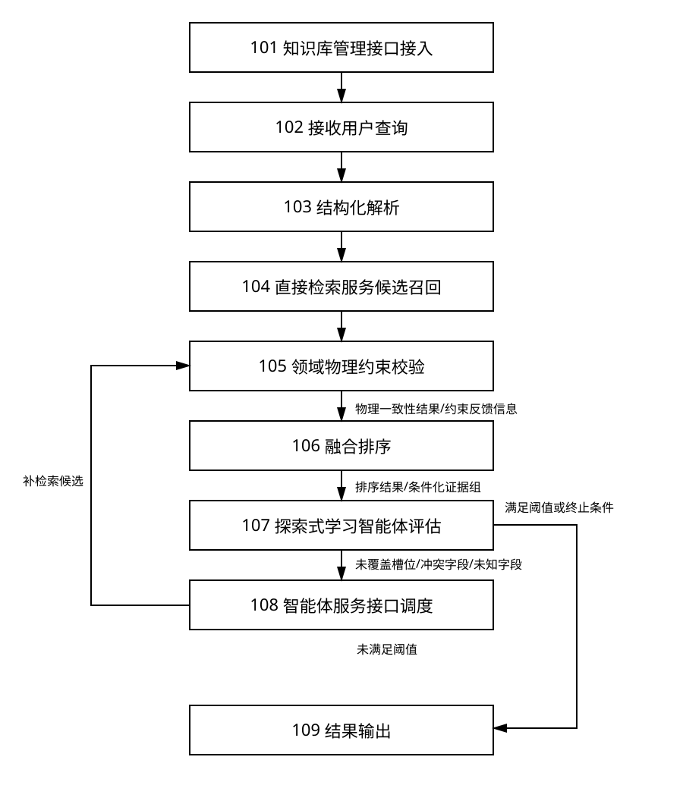
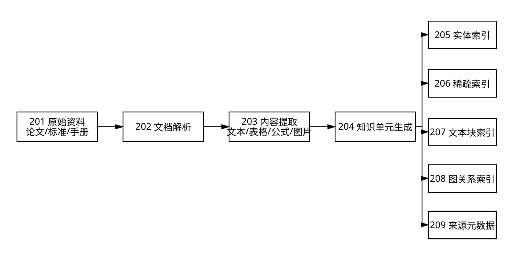
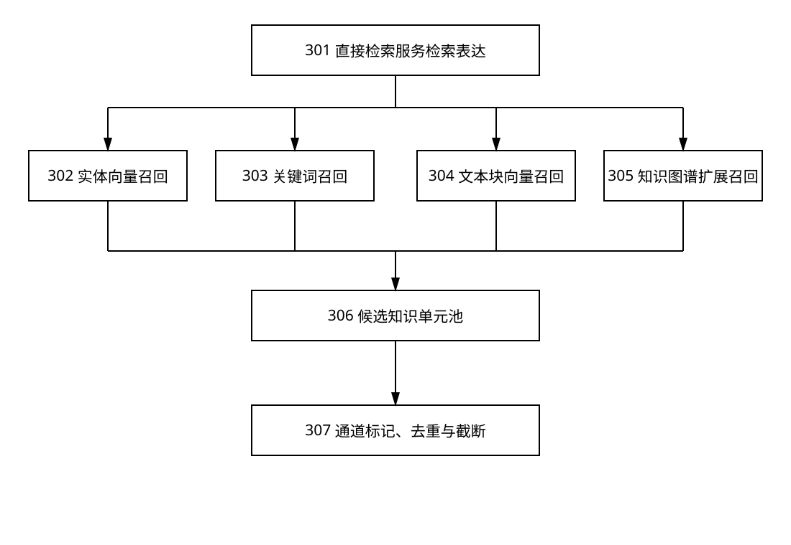
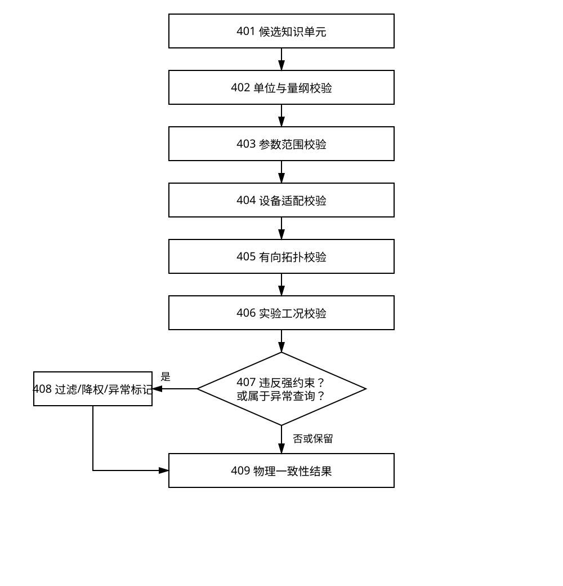
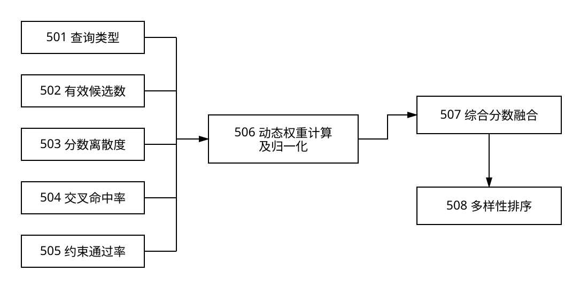
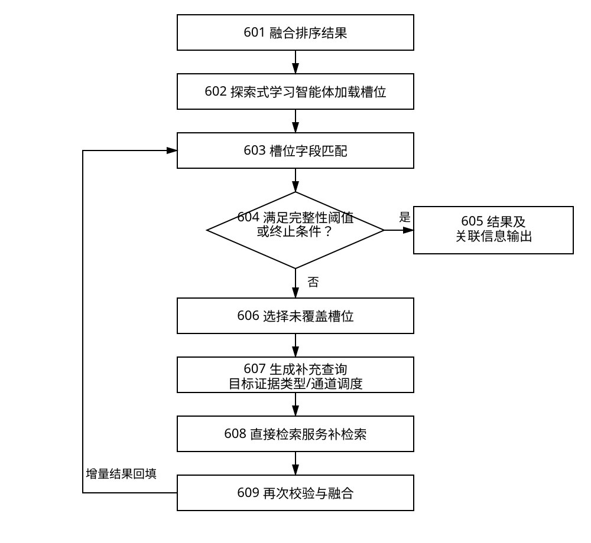

# 发明专利申请文件（正式提交稿）

---

## 一、发明名称

**一种面向核电子学知识库的物理约束增强检索方法、系统、设备及存储介质**

---

## 二、摘要

本发明公开一种面向核电子学知识库的物理约束增强检索方法、系统、设备及存储介质。该方法对用户查询进行结构化解析并多通道召回候选知识单元，执行领域物理约束校验以生成物理一致性结果和约束反馈信息；融合排序根据物理一致性、约束反馈、通道有效性和证据槽位覆盖状态动态确定权重；当证据覆盖不足时，基于未覆盖槽位、已覆盖证据及约束反馈信息构造补充查询并调度补检索，对补检索结果再次校验、排序和评估，直至满足完整性阈值或终止条件。本发明形成物理约束驱动的排序—证据补全闭环，能够降低伪相关率和物理冲突率，提高检索完整性及可追溯性。

## 三、摘要附图

图1

---

## 四、权利要求书

### 权利要求1

一种计算机实现的、面向核电子学知识库的物理约束增强检索方法，其特征在于，包括：

获取用户查询，并对所述用户查询进行结构化解析，得到结构化查询对象；其中，所述结构化查询对象包括查询类型，以及从所述用户查询中识别出的领域实体、参数信息、单位信息、设备信息和实验工况信息中的至少一种；

根据所述结构化查询对象生成多个检索表达，并在核电子学知识库中执行多通道召回，得到候选知识单元集合及其相关元数据；

对所述候选知识单元集合进行领域物理约束校验，得到物理一致性结果和约束反馈信息；其中，所述约束反馈信息包括物理冲突字段、未知状态字段、异常证据标记、约束命中记录和适用条件缺失信息中的至少一种；

根据所述查询类型、召回结果信息、物理一致性结果、约束反馈信息和来源相关信息，对候选知识单元进行融合排序，得到排序结果；其中，所述融合排序的权重至少根据所述物理一致性结果和所述约束反馈信息动态确定，并结合召回通道有效性和证据槽位覆盖状态中的至少一种进行调整；

根据所述查询类型对应的证据槽位模板，将所述排序结果中的结构化字段、来源相关信息以及所述约束反馈信息进行匹配，并建立所述约束反馈信息与证据槽位之间的关联关系，确定证据覆盖情况；

在所述证据覆盖情况满足预设完整性阈值时，输出所述排序结果及其关联输出信息；

在所述证据覆盖情况未满足预设完整性阈值时，基于未覆盖证据槽位、已覆盖证据中的至少部分信息以及所述约束反馈信息，构造补充查询并确定补检索策略；其中，所述补检索策略包括调整召回通道权重、调整候选规模、调整知识图谱扩展深度、保持原召回策略和改变目标证据类型中的至少一种；

执行补检索，并将补检索得到的候选知识单元再次进行领域物理约束校验、融合排序和证据覆盖情况更新，直至满足所述预设完整性阈值或者满足预设终止条件后，输出排序结果及其关联输出信息；

其中，所述关联输出信息包括知识内容、适用条件、评分信息、物理一致性结果、约束反馈信息和来源追踪信息中的至少一种。

### 权利要求2

根据权利要求1所述的方法，其特征在于，所述查询类型包括概念查询、参数查询、机理查询、对比查询、故障查询、异常分析查询和操作查询中的一种；所述结构化解析包括利用领域术语表、实体别名字典、参数符号表和单位换算表，对缩写、别名、上下位概念、参数符号及单位表达进行归一化，并保留归一化前表达与归一化后表达之间的映射关系。

### 权利要求3

根据权利要求1所述的方法，其特征在于，所述候选知识单元包括文档文本块、表格记录、公式说明、图片说明、实体节点、实体关系或实验记录片段中的一种或多种；所述相关元数据包括召回结果信息、结构化字段信息和来源相关信息中的至少一种，所述来源追踪信息包括文档标识、知识单元标识、文件路径、页码、章节、表格编号、公式编号、版本和适用条件中的至少一种。

### 权利要求4

根据权利要求1所述的方法，其特征在于，所述领域物理约束包括单位或量纲约束、参数范围约束、设备适配约束、信号链拓扑约束和实验工况约束中的至少一种。

### 权利要求5

根据权利要求1所述的方法，其特征在于，在各召回通道正常可用时，所述多通道召回包括以下召回方式中的至少两种：实体向量召回、关键词召回、文本块向量召回和知识图谱扩展召回；在部分召回通道不可用时，使用所述召回方式中的至少一种可用召回方式执行降级召回。

### 权利要求6

根据权利要求5所述的方法，其特征在于，所述实体向量召回分别利用用户查询向量和核心关键词向量执行近邻检索，所述关键词召回分别利用原始查询和核心关键词扩展查询执行稀疏检索。

### 权利要求7

根据权利要求5或6所述的方法，其特征在于，对同一召回方式产生的多个召回列表采用倒数排序融合、加权排序融合或其组合生成该召回方式对应的候选排序列表。

### 权利要求8

根据权利要求5所述的方法，其特征在于，在召回或内容过滤阶段对基于多通道召回候选构建的局部子图进行邻域扩展以扩大候选覆盖范围，并根据种子实体计算个性化PageRank图相关性分数，对扩展得到的实体节点、关系路径或关联知识单元执行过滤、截断或重排；在领域物理约束校验阶段，基于表征核电子学信号传递方向的有向拓扑图，对候选知识单元中的连接关系、影响关系或上下游关系进行方向合法性判断；
其中，所述根据种子实体计算个性化PageRank图相关性分数，包括以下至少一种：
通过双源种子权重融合，将关键词提取阶段得到的种子权重与检索召回阶段获得的初始融合分数按照设定比例混合，生成个性化概率分布向量以作为个性化PageRank计算的初始游走概率；
基于三维度自适应优化机制调整个性化PageRank的计算参数；所述自适应优化机制包括：根据查询类型及局部子图的平均度动态调整阻尼系数，其中对于局部型的参数查询或设备查询增加阻尼系数以探索局部深层子图，对于全局型的概念查询或对比查询降低阻尼系数以扩大游走范围，对于高平均度的稠密子图降低阻尼系数以防游走陷入高连接度节点，对于低平均度的稀疏子图增加阻尼系数以扩大扩展范围；以及在构建有向游走子图时，反向边权重根据源节点与目标节点的实体描述文本嵌入向量的余弦相似度动态缩放，以利用语义相似度对反向游走流进行动态调整；
在所述局部子图中的实体数量或关系数量小于预设兜底阈值时，触发一跳邻域兜底机制，保留种子实体在所述局部子图中的直属前驱节点、直属后继节点及邻居节点，以防止图结构稀疏时过滤裁剪导致的召回不足。

### 权利要求9

根据权利要求4所述的方法，其特征在于，所述物理一致性结果包括物理一致性分数，所述物理一致性分数根据量纲一致性分数、参数范围一致性分数、设备适配一致性分数、信号链拓扑一致性分数和实验工况一致性分数中的至少一种计算得到；根据查询类型，将违反领域物理约束的候选知识单元执行过滤、降权或异常标记处理。

### 权利要求10

根据权利要求9所述的方法，其特征在于，所述领域物理约束校验包括以下至少一种处理：将候选知识单元和用户查询中的参数值转换至预设标准单位，并比较二者的量纲和参数范围中的至少一种；基于探测器、前置放大器、成形放大器、模数转换器和数据采集系统中的至少两种之间的兼容关系进行设备适配判断；基于有向信号链进行方向合法性判断；以及基于偏置电压、温度、辐射源、计数率、能量范围、采样率和成形时间中的至少一种进行实验工况判断；当查询类型为故障查询或异常分析查询时，将违反正常参数范围但与故障现象、异常工况或维修记录相关的候选知识单元标记为异常证据并参与融合排序；对于候选知识单元中缺失的非关键设备字段、非关键实验工况字段或非关键参数字段，将对应字段标记为未知状态，并分配介于完全匹配分数与物理冲突分数之间的预设惩罚分数，而不直接判定所述候选知识单元违反领域物理约束。

### 权利要求11

根据权利要求1所述的方法，其特征在于，所述融合排序包括：对参与召回的实体向量召回分数、关键词召回分数、文本块向量召回分数和知识图谱扩展召回分数中的至少一种，以及物理一致性分数和来源相关信息分数中的至少一种进行融合计算；各项权重至少根据物理一致性分数和约束反馈信息动态确定，并结合查询类型和召回通道有效性中的至少一种进行调整；当对应召回通道未参与召回、未返回有效候选或缺少对应评分信息时，将该召回通道或评分信息对应分数置为零，或者从融合计算中移除并对剩余权重重新归一化。

### 权利要求12

根据权利要求11所述的方法，其特征在于，当同一参数的多个候选知识单元给出不同参数值时，按照设备型号、文档版本、实验工况、来源类型和适用范围建立条件化证据组，并分别计算各条件化证据组的综合分数。

### 权利要求13

根据权利要求1所述的方法，其特征在于，通过将候选知识单元的结构化字段及来源相关信息与证据槽位模板进行匹配，确定证据完整性得分；所述预设终止条件包括补检索轮次达到上限、新增有效证据量低于预设增益阈值和补检索时间达到预设时限中的至少一种；所述补检索包括选取未覆盖证据槽位，将其对应的槽位模板与排序结果中的核心实体、设备型号、实验工况或因果关系组合为补充查询；所述补检索策略包括调整召回通道权重、调整候选规模、调整知识图谱扩展深度、保持原召回策略和改变目标证据类型中的至少一种。

### 权利要求14

根据权利要求1所述的方法，其特征在于，所述领域物理约束校验、融合排序和补检索之间形成闭环反馈机制，包括：

将领域物理约束校验得到的物理一致性结果和约束反馈信息输入融合排序过程，以调整候选知识单元的综合分数、排序权重或条件化证据组；

将融合排序得到的排序结果与证据槽位模板进行匹配，以确定未覆盖证据槽位以及与所述未覆盖证据槽位相关的物理冲突字段、未知状态字段或适用条件缺失信息；

根据所述未覆盖证据槽位以及与其关联的物理冲突字段、未知状态字段或适用条件缺失信息，生成补充查询，并确定目标证据类型和目标召回通道；

将补检索得到的候选知识单元再次输入领域物理约束校验和融合排序过程，以更新物理一致性结果、约束反馈信息和证据覆盖情况。

### 权利要求15

根据权利要求1所述的方法，其特征在于，所述约束反馈信息与证据槽位模板之间建立约束—槽位—通道映射关系；所述约束—槽位—通道映射关系用于将物理冲突字段、未知状态字段或适用条件缺失信息映射为目标证据槽位、目标证据类型和目标召回通道；其中，所述目标召回通道包括实体向量召回、关键词召回、文本块向量召回和知识图谱扩展召回中的至少一种。

### 权利要求16

一种面向核电子学知识库的物理约束增强检索系统，其特征在于，包括：知识库管理接口，用于接入核电子学知识库，并提供向量索引、稀疏索引、知识图谱索引和来源元数据中的至少一种的访问能力；检索编排服务，用于接收用户查询，调用查询解析服务生成结构化查询对象，并编排候选召回、领域物理约束校验、融合排序、证据完整性评估和结果输出；直接检索服务，用于根据所述结构化查询对象，在检索执行阶段直接调用实体向量索引、关键词索引、文本块向量索引和知识图谱索引中的一种或多种进行候选召回，得到候选知识单元集合及其相关元数据；领域物理约束校验服务，用于对候选知识单元执行领域物理约束校验并生成物理一致性结果和约束反馈信息；融合排序服务，用于根据查询类型、召回结果信息、物理一致性结果、约束反馈信息和来源相关信息对候选知识单元进行融合排序；探索式学习智能体，用于执行证据槽位缺失判断、补充查询生成、目标证据类型确定、召回通道调度和知识图谱扩展控制中的至少一种，并根据查询类型对应的证据槽位模板以及约束反馈信息判断排序结果的证据覆盖情况；智能体服务接口，用于向所述探索式学习智能体提供结构化查询对象、排序结果、证据覆盖情况、约束反馈信息和召回通道状态中的至少一种，并接收补检索调度信息或终止信息；所述检索编排服务还用于根据所述补检索调度信息调用直接检索服务，并将补检索得到的候选知识单元再次送入领域物理约束校验服务和融合排序服务，以更新物理一致性结果、约束反馈信息和证据覆盖情况；结果输出服务，用于在证据覆盖情况满足预设完整性阈值或者满足预设终止条件后，输出排序结果及其关联输出信息；其中，所述关联输出信息包括知识内容、适用条件、评分信息、物理一致性结果、约束反馈信息和来源追踪信息中的至少一种。

### 权利要求17

一种电子设备，包括存储器、处理器以及存储在所述存储器中并可在所述处理器上运行的计算机程序，其特征在于，所述处理器执行所述计算机程序时实现权利要求1至15任一项所述的方法。

### 权利要求18

一种计算机可读存储介质，其上存储有计算机程序，其特征在于，所述计算机程序被处理器执行时实现权利要求1至15任一项所述的方法。

---

## 五、说明书

### 1. 技术领域

本发明涉及核电子学、知识图谱、信息检索及计算机数据处理技术领域，具体涉及一种利用核电子学领域的量纲、参数范围、设备适配关系、信号链拓扑和实验工况等物理约束，对实体向量召回、关键词召回、文本块向量召回和知识图谱扩展召回的候选结果进行校验、融合、证据补全及来源追踪的知识库检索方法、系统、设备及存储介质。

### 2. 背景技术

核电子学知识通常分散于学术论文、国家标准和行业标准、探测器及电子学设备手册、实验报告、故障维修记录、电路图、公式以及参数表格中。不同资料在术语表达、设备型号、实验条件和文档结构方面存在明显差异，例如“前放”与“前置放大器”、“HPGe”与“高纯锗探测器”、“整形时间”与“成形时间”可能指向相同或相关概念；本文统一采用“成形时间”，并将“整形时间”作为归一化处理的同义表达。同一参数还可能因探测器类型、前置放大器结构、计数率和温度不同而具有不同适用值。

现有知识库检索方法主要存在以下三类技术缺陷：第一，关键词检索能够精确命中设备型号、标准编号和参数符号，但对专业缩写、别名和上下位概念的召回能力不足；第二，语义向量检索或检索增强生成方法能够召回语义相近内容，却可能将量纲不同、设备不兼容或实验工况不一致的参数作为相关结果；第三，知识图谱检索能够扩展实体关系，但检索所用的邻接关系不等同于真实电路中的物理信号方向，为增加覆盖率而进行的双向扩展可能产生方向不成立的候选路径。

此外，现有混合检索往往采用固定权重，无法针对参数、概念、机理、对比、故障和操作等不同类型问题调整检索重点。检索到的若干文本块也可能只包含结论而缺少参数对象、单位、适用设备、实验条件、变量定义或处置措施。若仅重复执行原始查询，通常只能得到更多同质结果，不能有效补齐缺失证据。部分系统仅返回文档名称而缺少知识单元、页码、章节、表格或公式位置，也不利于结果复核。

进一步地，即使现有方法尝试将领域规则、混合排序或补充检索分别引入知识库检索过程，上述技术手段通常仍作为彼此独立的处理环节使用。领域规则多用于单次过滤或简单降权，未将冲突字段、未知字段和异常证据标记反馈至排序权重和补检索策略；融合排序多依据召回分数或来源可信度计算综合分数，未根据证据槽位覆盖状态和物理约束命中情况动态改变候选组织方式；补充检索多基于原始查询扩展或缺失槽位关键词生成，未结合物理冲突原因、设备工况条件和信号链拓扑方向生成补充查询。因此，现有方法难以通过多个环节的反馈协同同时解决伪相关过滤、异常证据保留和证据完整性补齐的问题。

因此，需要一种不以单纯提高语义相似度为目标，而是将核电子学物理规则、融合排序和证据补检索进行闭环耦合的技术方案，使物理约束校验结果能够反向驱动候选排序和补检索策略，在提高召回覆盖率的同时排除物理条件不成立的伪相关结果，并保留具有解释价值的异常证据。

### 3. 发明内容

#### 3.1 要解决的技术问题

本发明旨在解决：在核电子学知识库检索中，单独采用语义召回、领域物理规则过滤、固定权重融合排序或缺失槽位补检索时，难以同时兼顾候选覆盖率、物理一致性和证据完整性的问题。

具体而言，现有方法即使能够通过多通道召回提高候选覆盖率，也可能引入量纲不一致、设备不适配、信号链方向错误或实验工况不匹配的伪相关候选；若仅采用物理规则进行过滤，又可能误删故障查询、异常工况查询中具有解释价值的异常证据；若仅采用融合排序，则难以判断检索结果是否覆盖参数对象、适用设备、实验工况、机理链条或处理措施等关键证据槽位；若仅根据缺失槽位进行补检索，又可能继续召回与当前物理条件不一致的同质证据。

因此，需要一种将领域物理约束校验、融合排序和证据补检索进行闭环耦合的检索方法，使物理约束校验结果不仅用于过滤候选，还用于生成约束反馈信息；使融合排序能够根据物理一致性、约束反馈和证据槽位覆盖状态动态调整候选排序；使补检索能够围绕未覆盖证据槽位、物理冲突字段、未知状态字段和适用条件缺失信息构造补充查询，并将补检索结果再次送入物理约束校验和融合排序过程，从而在提高召回覆盖率的同时降低伪相关率和物理冲突率，并提高证据完整性。

#### 3.2 技术方案概述

本发明接入预先构建的核电子学知识库或相应索引服务。作为可选预处理方式，可将原始文档解析为文本块、实体、关系、参数、条件和来源元数据，并建立稀疏索引、向量索引和图索引；该预处理方式不构成检索方法必须依次执行的步骤。接收用户查询后，形成结构化查询对象，生成多通道检索表达并执行协同召回。召回候选经过去重和通道分数归一化后，进入领域物理约束校验层。领域物理约束校验层将用于扩大召回范围的语义关系与用于判断技术合法性的物理关系分离：前者可双向扩展，后者依据量纲、设备兼容表和有向信号链作严格或柔性判断。

本发明中，领域物理约束校验、融合排序和补检索不是彼此独立的串行步骤。领域物理约束校验输出的物理一致性结果和约束反馈信息同时作为融合排序和证据完整性评估的输入；融合排序结果不仅用于结果输出，还用于识别高置信候选、条件化证据组和证据槽位缺失状态；补检索不是简单重复原始查询，而是根据未覆盖证据槽位、物理冲突字段、未知状态字段、适用条件缺失信息和召回通道状态生成补充查询及补检索策略；补检索得到的新候选再次进入领域物理约束校验和融合排序，从而形成“约束校验—排序组织—槽位评估—补检索—再校验”的闭环反馈。

领域物理约束校验后的候选按照查询类型、通道有效性、约束反馈信息和证据槽位覆盖状态进行自适应融合，并通过多样性重排降低重复证据。系统再根据查询类型建立证据槽位集合，计算检索结果的槽位覆盖率。满足完整性阈值时直接输出排序结果；未满足完整性阈值时，围绕缺失槽位以及约束反馈信息构造补充查询，并确定是否调整对应通道的权重、候选规模或知识图谱扩展深度，再次执行领域物理约束校验、融合排序和完整性评估，直至满足完整性阈值或终止条件后输出。关联输出信息可包括知识内容、适用条件、评分信息、物理一致性结果、约束反馈信息和来源追踪信息中的一种或多种。本发明限定于知识检索和证据组织过程，不以大语言模型答案生成为必要步骤。

#### 3.3 有益效果

与现有技术相比，本发明至少具有以下有益效果：

1. 通过将领域物理约束校验输出的物理一致性结果和约束反馈信息同时用于融合排序及补检索策略生成，使候选过滤、排序增强和证据补齐不再相互独立，能够在保留异常查询有效证据的同时排除物理条件不成立的伪相关候选，并减少补检索阶段继续召回同类错误证据的概率；
2. 通过实体向量、关键词、文本块向量和知识图谱扩展四类互补通道，提高核电子学缩写、别名、型号、参数和复杂关系的召回能力；
3. 通过量纲、参数范围、设备适配、信号链拓扑和实验工况校验，减少“语义相近但技术条件不成立”的伪相关结果；
4. 将召回阶段的双向知识图谱扩展召回与校验阶段的有向信号链拓扑分离，在保持多跳召回率的同时避免信号方向错误；
5. 根据查询类型、通道有效性、物理一致性结果和约束反馈信息动态调整融合权重，降低固定权重对不同问题类型造成的系统性偏差；
6. 利用证据槽位识别缺失前提、变量、条件或措施，并通过补检索而非简单重复检索提高证据完整性；
7. 对冲突参数建立条件化证据组，避免脱离设备型号、工况和版本对不同结论进行错误平均；
8. 保留文档、文本块、章节、页码、表格、公式、版本和适用条件等来源信息，便于核验和追溯；
9. 通过强约束过滤、候选池截断和缺失槽位驱动的补检索，减少无效候选数量及后续计算开销；
10. 引入自适应阻尼系数、语义反向边权重和双源种子融合的个性化PageRank图过滤机制，能够有效抑制因图拓扑扩展导致的“主题漂移”与噪声候选，并在图结构稀疏时通过一跳邻域兜底回退保护关键实体，保证检索系统的图过滤兼具高准确率与鲁棒性。

与仅采用物理约束过滤的方法相比，本发明能够通过异常证据标记和未知状态惩罚避免误删故障或异常工况证据；与仅采用融合排序的方法相比，本发明能够利用证据槽位覆盖情况发现关键前提缺失；与仅采用补检索的方法相比，本发明能够利用物理冲突字段和适用条件缺失信息生成定向补充查询，从而提高补检索有效证据增益。

上述技术效果可通过伪相关率、物理冲突率、证据槽位覆盖率、单轮及多轮补检索的有效证据增益、平均检索时延，以及部分召回通道失效时的降级可用性进行评价。其中，领域物理约束校验用于降低伪相关率和物理冲突率，约束反馈驱动的融合排序及补检索闭环用于提高证据槽位覆盖率，通道有效性驱动的权重重归一化用于维持通道失效情况下的检索可用性。

### 4. 附图说明

图1为本发明方法的总体流程图；

图2为可选的核电子学异构知识库预处理流程图；

图3为多通道协同召回及候选池融合示意图；

图4为领域物理约束校验流程图；

图5为查询类型及通道有效性驱动的融合排序流程图；

图6为证据完整性评估及补检索流程图。

图1中，101表示通过知识库管理接口接入核电子学知识库或索引服务，102表示接收用户查询，103表示结构化解析，104表示直接检索服务执行候选召回，105表示领域物理约束校验，106表示融合排序，107表示探索式学习智能体执行证据完整性评估，108表示通过智能体服务接口进行补检索调度，109表示结果输出；步骤105向步骤106传递物理一致性结果和约束反馈信息，步骤106向步骤107传递排序结果和条件化证据组，步骤107向步骤108传递未覆盖证据槽位、冲突字段或未知字段，步骤108向步骤105返回补检索候选；证据覆盖满足完整性阈值时进入步骤109，未满足完整性阈值时进入步骤108。

图2中，201表示原始资料，202表示文档解析，203表示内容提取，204表示知识单元生成，205至208分别表示实体索引、稀疏索引、文本块索引和知识图谱索引，209表示来源元数据；图2所示流程为可选的知识库预处理实施方式。图3中，301表示直接检索服务接收的结构化查询及检索表达，302至305分别表示实体向量召回、关键词召回、文本块向量召回和知识图谱扩展召回，306表示候选知识单元池，307表示通道标记、去重及候选池截断。

图4中，401表示候选知识单元，402至406依次表示单位与量纲、参数范围、设备适配、有向拓扑和实验工况校验，407表示强约束及异常查询判断，408表示过滤、降权或异常标记，409表示物理一致性结果。图5中，501至505分别表示查询类型、有效候选数、分数离散度、交叉命中率和约束通过率，506表示动态权重计算及归一化，507表示综合分数融合，508表示多样性排序。

图6中，601表示融合排序结果，602表示探索式学习智能体加载证据槽位模板，603表示槽位字段匹配，604表示完整性阈值或终止条件判断，605表示结果及关联输出信息输出，606表示选择未覆盖证据槽位，607表示探索式学习智能体生成补充查询、目标证据类型和通道调度信息，608表示直接检索服务执行补检索，609表示再次领域物理约束校验和融合；满足完整性阈值或终止条件时进入步骤605，否则进入步骤606，步骤609的增量结果返回步骤603重新评估。

### 5. 具体实施方式

以下结合附图和实施例对本发明作进一步说明。应理解，所述实施方式用于说明本发明，而非将保护范围限定为特定数据库、模型、阈值或中间件。

#### 5.1 可选的核电子学异构知识库预处理

本发明的检索执行链可以接入既有核电子学知识库或调用既有索引服务，而不要求在每次检索前执行知识库构建。在一个可选预处理实施方式中，知识库接收PDF、Word、Markdown、表格和图片等资料，对文档执行版面解析、文本提取、表格识别、公式保留、图片说明生成和语义分块。每个知识单元表示为：

<i>K</i> = {content, entity, relation, parameter, condition, evidence, version}

其中，content为文本块内容；entity为关联实体；relation为实体关系；parameter为参数名称、数值、单位及量纲；condition为适用设备及实验工况；evidence为来源证据；version为文档或数据版本。

实体类型可包括探测器、核素、电子学器件、电路模块、信号、参数、故障、处理方法、实验条件、文献和标准。关系类型可包括“连接于”“输出至”“影响”“测量”“产生”“适用于”“参数属于”“故障表现为”和“通过……校正”等。

系统为文本块建立稠密向量索引，为实体名称及实体描述建立实体向量索引，为实体名称、型号、核素、参数符号和标准编号建立稀疏索引，并将实体和关系写入异构知识图谱。一个具体实施方式采用对象存储保存原文件、关系数据库保存知识库和文档记录、向量数据库保存实体及文本块向量、键值数据库保存文本块和BM25索引、图数据库保存实体关系；上述存储介质可由功能等效组件替换。

所述稠密向量索引、稀疏倒排索引和图索引可以由数据库索引、内存索引、文件索引、搜索引擎索引或其功能等效的数据结构实现；各类索引可以集中部署或分布式部署。所述查询类型识别可以由规则模型、机器学习模型或语言模型实现，所述近邻检索、稀疏检索和知识图谱扩展召回也可由具有等效候选召回功能的算法实现。

每个知识单元的来源元数据优选包括：知识库标识、文档标识、文档名称或路径、文本块标识、块序号、页码或页面索引、章节标题、段落序号、表格编号、公式编号、文档版本和创建时间。若源文档解析阶段仅能得到文档路径和文本块标识，则先保存已有字段，并在版面解析结果具备页码、章节或对象编号时增量补齐。

当新增文档、标准发生修订或设备手册版本变化时，系统可对新增或变化内容执行增量解析、增量索引和来源元数据更新，并保留新旧版本之间的版本关系；检索时根据版本状态和查询时间条件选择当前版本，或者将不同版本组织为条件化证据组。

#### 5.2 查询结构化解析

系统接收用户查询后形成结构化对象：

<i>Q</i> = {<i>E</i>, <i>P</i>, <i>U</i>, <i>C</i>, <i>T</i>, <i>I</i>}

解析过程包括：

1. 识别探测器、前置放大器、成形电路、ADC、核素、信号和故障等实体；
2. 识别参数名称、参数符号、数值、区间、比较符和不确定度；
3. 识别时间、能量、电容、电压、频率、温度和计数率等单位及量纲；
4. 识别设备型号、前放类型、偏置电压、温度、辐射源、计数率、能量范围、采样率和成形时间等条件；
5. 利用规则分类器、统计分类器或语言模型识别查询类型；
6. 根据术语表和别名字典生成保留原始表达的归一化结果。

在一个实施方式中，查询类型包括通用、参数、概念、设备和对比类型；可选地，进一步包括机理、故障、异常分析和操作类型。查询类型识别失败时可回退为通用类型，不阻断后续检索。

所述结构化解析、查询类型识别、候选排序和证据槽位匹配可以由规则方法、机器学习模型、语言模型或其组合实现；语言模型仅作为可选实现方式，并非实现本发明的必要技术特征。本发明的检索结果可直接提供给用户或其他计算机程序，不以语言模型生成自然语言答案为必要步骤。

#### 5.3 多通道检索表达生成

根据结构化查询生成以下表达：

1. 实体语义表达：由原始查询、核心实体别名及高层关键词组成；
2. 关键词表达：由原始查询、设备型号、核素、参数符号、标准编号和缩写组成；
3. 文本块向量召回表达：由原始查询和检索意图组成完整语义句；
4. 图谱表达：由种子实体、允许的实体类型、扩展深度和关系权重阈值组成。

例如，查询“HPGe前放的成形时间与能量分辨率有什么关系”经归一化后，可同时保留“HPGe”“高纯锗探测器”“前放”“前置放大器”“成形时间”和“能量分辨率”等表达，使精确匹配和语义匹配均能发挥作用。

#### 5.4 四路协同召回

第一通道为实体向量召回。系统分别使用完整查询向量和若干核心关键词向量搜索实体向量索引，并将各向量召回列表通过倒数排序融合得到实体候选。

第二通道为关键词召回。系统以原始查询搜索稀疏索引，并以预定数量的核心关键词执行扩展检索。各排序列表通过倒数排序融合：

倒数排序融合分数<i>S</i>RRF(<i>d</i>)可按下式计算：

<i>S</i>RRF(<i>d</i>) = Σc∈C[ρc / (<i>k</i> + <i>r</i>c(<i>d</i>))]

其中，C为参与融合的排序通道集合，ρc为通道系数，k为用于抑制排序前部波动的可配置平滑超参数，rc(d)为候选d在通道c中的排序位置。平滑超参数可根据候选列表深度、通道数量或验证数据确定，不限定为特定数值。

第三通道为文本块向量召回。系统绕过实体层，利用查询向量直接搜索文本块向量索引，以召回未被实体抽取覆盖但语义上直接回答问题的段落、公式说明和表格描述。

第四通道为知识图谱扩展召回。系统融合第一、第二通道结果形成种子实体，以查询类型确定一跳或多跳深度。对于参数或设备查询优选一跳扩展，对于概念、机理或对比查询可采用两跳或更高的受限扩展。知识图谱扩展召回只保留边权重达到阈值且关系描述非空的关系，并限制种子数量和每个种子的邻居数量。

在一个实施方式中，系统在内容过滤阶段使用个性化PageRank (PPR) 过滤算法，对第一阶段四路并行召回得到的候选实体与关系进行深度图过滤。该PPR过滤算法利用三维度自适应优化机制和双源种子权重融合来优化局部子图的关联评分，有效抑制了传统PageRank的“主题漂移”和稀疏图截断导致的召回不足问题。其具体实施步骤如下：

(1) 局部有向子图构建与语义反向边权重计算
系统根据多通道召回的实体及其关系列表，在内存中构建局部有向子图 $G_d = (V_d, E_d)$。为了防止无向图在计算PageRank时导致相关性沿非对称物理语义无限制传播，系统引入有向图结构，其中，正向边 $(v_i, v_j)$ 的权重采用知识图谱中原始关系权重（默认设为1.0）；反向边 $(v_j, v_i)$ 的权重则通过节点语义嵌入（Embedding）进行动态缩放：
反向边权重 $w_{rev}(v_j, v_i) = w_{base\_rev} \cdot f(cos\_sim(e_j, e_i))$
其中，$w_{base\_rev}$ 为设定的反向边权重基础值（例如0.2），$e_i$ 和 $e_j$ 分别为实体 $v_i$ 和 $v_j$ 的描述文本（例如实体名称拼接其前80个字符的详细描述）通过文本嵌入函数（Embedding Function）计算得到的嵌入向量。余弦相似度 $cos\_sim(e_j, e_i)$ 映射到 $[0, 1]$ 区间后，通过幂次（$\gamma$ 参数，例如2.0）和阈值下限（Similarity Floor，例如0.25）进行过滤与非线性缩放，以获得最终的反向边权重。余弦相似度极高（映射值大于阈值下限）的反向边将获得接近基础值的权重，而余弦相似度低于阈值下限的反向边则被赋予极小权重（例如0.02的最低缩放系数），从而避免弱相关或噪声实体反向传播能量。

(2) 阻尼系数的自适应调整
PageRank中的阻尼系数（Damping Factor，$\alpha$）控制随机游走的概率分布。本实施例摒弃了固定阻尼系数（如0.85）的做法，采用自适应阻尼机制，根据查询类型（Query Type）和局部有向子图的平均度（即图密度 $d_{avg} = 2|E|/|V|$）进行动态调整，其公式为：
$\alpha_{final} = \text{clip}(\alpha_{base} + \Delta_{query} + \Delta_{density}, 0.70, 0.95)$
其中，$\alpha_{base}$ 默认设为0.85；偏置量 $\Delta_{query}$ 根据识别出的查询类型进行个性化补偿，例如对于局部探究型的参数查询（PARAMETER）或设备查询（EQUIPMENT），设置 $\Delta_{query} = +0.05$ 以鼓励随机游走深入探索局部的多跳关联实体，而对于全局泛化型的概念查询（CONCEPT）或对比查询（COMPARISON），设置 $\Delta_{query} = -0.08$ 以降低阻尼系数，防止游走过于集中在初始种子周围；偏置量 $\Delta_{density}$ 根据局部有向子图的拓扑稠密性进行动态补偿，当平均度 $d_{avg} > 10$ 时表明子图极其稠密，为防止游走频繁陷入高连接度的“枢纽”（Hub）节点而导致相关性稀释，系统分配 $\Delta_{density} = -0.04$ 以增加跳出概率，当 $d_{avg} < 3$ 时表明子图稀疏，为了扩大探索范围分配 $\Delta_{density} = +0.03$。

(3) 双源种子权重融合与个性化向量初始化
在PPR游走的个性化向量（Personalization Vector）构建上，系统采用双源融合机制，将关键词召回阶段由提取所得核心实体计算出的种子权重 $w_{kw}(e)$，与直接检索阶段由实体向量相似度和图扩展分数得到的召回分数 $w_{ret}(e)$（即实体的最终融合分数 `_fused_score`）进行动态合并：
$w_{seed}(e) = (1 - \beta) \cdot w_{kw}(e) + \beta \cdot w_{ret}(e)$
其中，$\beta$ 为检索分数占比（例如0.5），$w_{kw}(e)$ 和 $w_{ret}(e)$ 分别为归一化后的关键词种子权重和检索分数。通过该融合算法，系统产出高保真的个性化游走种子向量，其不仅考虑了查询词的字面核心度，亦融入了语义向量检索的反馈。

(4) 线程池并发计算与数值迭代
为了在生产环境中保障实时响应，系统设计了PPR线程池管理器（PPRExecutorManager），其通过配置最大工作线程数（max_workers） and 任务队列限制（max_queue_size）对PPR的求解进行多线程异步调度，并针对单次计算设置任务超时（task_timeout，例如30秒）。在具体的数学求解上，PPR算法通过调用优化后的迭代求解器进行幂迭代计算，并设定自适应收敛容差（Tolerance）为 $\max(10^{-12}, 10^{-8}/|V|)$，确保在节点规模不同的子图上均能在最短迭代轮次内收敛，输出平滑准确的节点相关性概率得分 $S_{ppr}$。

(5) 子图规模兜底与一跳回退机制
针对知识库构建不全或图相关边较少导致的稀疏子图场景，系统内置了PPR图过滤兜底策略。在局部子图的实体数量小于5或关系数量小于3时，系统会跳过PPR迭代计算，直接触发一跳邻域兜底回退机制：基于种子实体列表，从拓扑图 $G_d$ 中直接拉取其所有直属的前驱节点（successors）、后继节点（predecessors）和无向近邻节点（neighbors）作为兜底过滤实体，从而有效避免了在图稀疏状态下PPR分数被高连接节点独占导致的大面积实体被过滤、候选文本块召回不足的问题。

(6) 文本块PPR得分映射与阶段过滤
在求得各实体的 $S_{ppr}$ 得分后，系统建立实体至其源文档片段（Chunk）的映射关系。对于每个候选文本块，其最终的PPR图过滤得分 $S_{chunk\_ppr}$ 设为该文本块所关联的所有实体中PPR得分的最大值。系统根据 $S_{chunk\_ppr}$ 对文本块执行排序和截断，只保留排名前列的实体和文本块（例如最多保留 20 个或总实体数 1/3 的高分实体），然后将其输出并提供给后续的领域物理约束校验层以及混合排序模型。

四路召回可并行执行其中互不依赖的通道。知识图谱扩展召回依赖种子实体时，在实体向量召回和关键词召回结束后执行；文本块向量召回可与实体向量召回并行执行。任一通道不可用时，系统降低该通道有效性系数并使用其余通道继续工作。

#### 5.5 候选池融合与边感知截断

对实体候选按实体名称或统一标识去重，并保留各通道分数、命中关键词、图跳数、实体类型、个性化PageRank图相关性分数、来源文本块标识和文件路径。在实体候选超过上限时，先按融合分数保留核心实体，再依据候选实体与核心实体之间的有效边数量和个性化PageRank图相关性分数对剩余候选增加连通性奖励，使知识图谱扩展召回获得的关键邻接实体不会因单纯分数截断而全部丢失。

由实体的来源文本块标识拉取实体关联文本块，并与第三通道的直接向量文本块合并。文本块的初始得分可表示为：

<i>S</i>chunk = <i>a</i>1<i>S</i>vec + <i>a</i>2<i>S</i>entityLink + <i>a</i>3<i>S</i>coverage

其中，<i>S</i>vec为文本块向量相似度，<i>S</i>entityLink为关联实体得分，<i>S</i>coverage为文本块对种子实体的加权覆盖率。a1、a2、a3根据查询类型变化。例如，参数查询提高实体关联和实体覆盖权重，概念查询提高语义向量权重。若同一文本块同时经实体链路和直接文本块向量通道命中，可施加双源命中奖励。

#### 5.6 物理约束知识表示

物理约束集合Ω包括硬约束集合ΩH和软约束集合ΩS。硬约束表示一旦违反即可认定候选不适用于当前查询，例如时间参数与能量单位发生量纲冲突、信号链方向反向且不存在允许的反馈关系、明确设备型号互不兼容。软约束表示信息缺失或仅部分匹配时降低分数，例如候选未注明温度，但其他条件与查询一致。

物理约束可存储为规则表、范围表、兼容矩阵、有向拓扑图或可执行规则。约束记录优选包含约束标识、约束类型、适用实体类型、前件、后件、严重等级、来源、版本和生效状态。

#### 5.7 量纲与参数范围校验

对参数值建立规范表示：

<i>p</i> = ⟨name, <i>v</i>, <i>u</i>, <b>d</b>, tol⟩

其中，name为参数名称，v为数值或区间，u为单位，d为量纲向量，tol为容差或不确定度。通过单位换算函数转换至标准单位：

<i>v</i>std = <i>a</i>u<i>v</i> + <i>b</i>u

对于ns和μs、keV和MeV、pF和nF等比例单位，bu=0；对于存在零点偏移的温度单位，可使用非零bu。若查询参数和候选参数的量纲向量不同，则<i>S</i>unit=0并触发硬约束。若量纲相同，则比较换算后的点值或区间。

单位和量纲规则表可采用如下结构，表中仅为核电子学常见规则样例：

| 参数 | 标准单位 | 量纲 | 可归一化单位示例 |
|---|---|---|---|
| 成形时间 | μs | T | ns、μs、ms |
| 能量或以绝对值表示的能量分辨率 | keV | ML²T⁻² | eV、keV、MeV |
| 以相对值表示的能量分辨率 | % | 1（无量纲） | 小数、% |
| 偏置电压 | V | ML²T⁻³I⁻¹ | mV、V、kV |
| 计数率 | cps | T⁻¹ | cps、kcps、s⁻¹ |
| 输入电容 | pF | M⁻¹L⁻²T⁴I² | pF、nF |

同名参数存在绝对量和相对量两种表达时，分别建立参数子类型。例如，能量分辨率以keV表示时具有能量量纲，以百分比表示时为无量纲；只有在具备峰位能量等换算条件时才允许二者相互换算。

参数范围可按“参数—器件类型—型号—工况”四元条件索引。若候选值落入适用范围，<i>S</i>range=1；若在容差带内，按距边界的归一化距离赋予0至1之间的分数；若显著超出范围，触发硬约束或将其作为异常证据单独输出。对资料本身讨论异常工况的情形，根据检索意图取消对该异常值的过滤，以免错误删除故障证据。

#### 5.8 设备适配与信号链拓扑校验

设备适配约束可表示为兼容关系：

Compat(<i>e</i>i, <i>e</i>j, <i>c</i>) ∈ {0, 0.5, 1}

其中，0表示明确不兼容，0.5表示条件不足或条件兼容，1表示兼容。兼容判断至少可使用探测器类型、前置放大器类型、成形电路、ADC类型、接口形式和设备型号。

设备兼容规则表的一个非限制性示例如下：

| 探测器或前端 | 后续电子学 | 兼容状态 | 约束条件 |
|---|---|---|---|
| HPGe探测器 | 电荷灵敏前置放大器 | 兼容 | 低噪声、输入电容及反馈参数匹配 |
| 闪烁体探测器与光电倍增管组合 | 电流型或电荷型前置放大器 | 条件兼容 | 输出极性、阻抗和动态范围匹配 |
| 硅光电倍增器 | 宽带前端放大电路 | 条件兼容 | 偏置、增益、带宽和饱和范围匹配 |

兼容状态不由设备名称单独确定，而是由接口、电气范围和工作模式等条件共同确定；当必要条件缺失时，记录为条件不足而非直接判为不兼容。

信号链拓扑约束使用有向图Gp=(Vp, Ep)表示实际信号链。典型主链为“探测器→前置放大器→成形放大器→ADC→数据采集系统”。

对应的拓扑规则可表示为：

| 上游模块 | 下游模块 | 关系类型 | 传递对象 |
|---|---|---|---|
| 探测器 | 前置放大器 | 输出至 | 电荷或电流信号 |
| 前置放大器 | 成形放大器 | 输出至 | 前置放大脉冲 |
| 成形放大器 | ADC | 输出至 | 成形后的模拟脉冲 |
| ADC | 数据采集系统 | 输出至 | 数字采样数据 |

对候选关系(vi, r, vj)，判断节点vi至节点vj是否存在方向与关系语义相符的有效路径。需要特别说明：为了提高检索覆盖率，第四通道可在召回阶段对知识图谱执行双向扩展；但领域物理约束校验必须回到有向信号链拓扑图判断“输出至”“输入自”“影响下游”等方向。这种“召回无向化、校验有向化”的分层方式，兼顾候选覆盖率和技术正确性。

对于反馈、触发、时钟和控制等非主信号链，使用带关系类型的附加有向边表示，避免将合法反馈路径误判为反向连接。

#### 5.9 实验工况校验

将查询工况和候选工况分别表示为属性集合。连续属性包括偏置电压、温度、计数率、能量范围、采样率和成形时间；离散属性包括辐射源、探测器类型和采集模式。连续属性在单位归一化后采用点值距离、区间交并比或落区判断；离散属性采用完全匹配、层级匹配或未知状态判断。

可采用下式计算工况分数：

<i>S</i>condition = Σlωl<i>m</i>l / Σlωl

其中，ml为第l项工况的匹配分数，ωl为其重要度。查询未指定的工况不作为冲突项；候选缺失而查询明确指定的关键工况作为缺失项降低分数。

#### 5.10 领域物理约束校验评分及强约束处理

对通过硬约束的候选计算：

<i>S</i>phy = λ1<i>S</i>unit + λ2<i>S</i>range + λ3<i>S</i>device + λ4<i>S</i>topology + λ5<i>S</i>condition

当某一约束项未参与校验或对应信息缺失时，该约束项的分数可置零、赋予未知状态惩罚分数，或者从物理一致性分数计算中移除并对剩余权重重新归一化；因此，物理一致性分数可由上述约束项中的至少一种计算得到。

权重可按查询类型设置。例如，参数查询提高量纲、范围和工况权重；机理查询提高信号链拓扑权重；设备选型或对比查询提高设备适配权重。候选缺少某一非关键字段时，不将该字段视为完全不一致，而是按“未知”状态赋予低于完全匹配且高于冲突的分数，并在证据完整性阶段将其相应槽位标记为未完整覆盖。

每个候选保存约束判定明细，作为约束反馈信息的一部分。所述约束反馈信息可包括已通过约束、未满足约束、物理冲突字段、未知状态字段、异常证据标记、适用条件缺失信息、标准化参数值和触发规则标识中的至少一种，用于后续融合排序、证据槽位匹配和补检索策略生成。

#### 5.11 查询类型驱动的自适应融合

先为不同查询类型设置基础权重向量b(T)。例如：参数查询侧重关键词召回、文本块向量召回和物理一致性；概念查询侧重实体向量召回和文本块向量召回；机理查询侧重知识图谱扩展召回、文本块向量召回和信号链拓扑一致性；故障查询侧重知识图谱多跳召回、案例文本和实验工况；对比查询提高多对象实体召回和条件覆盖权重。

对每一召回通道计算有效性系数rc：

<i>r</i>c = <i>f</i>(<i>n</i>c, <i>d</i>c, <i>x</i>c, <i>p</i>c)

其中，nc为通过最低阈值的有效候选数，dc为通道内分数离散程度，xc为与其他通道的交叉命中率，pc为该通道候选的物理约束通过率。最终通道权重为：

<i>w</i>c = [<i>b</i>c(T)<i>r</i>c] / Σq[<i>b</i>q(T)<i>r</i>q]

当某通道不可用或无有效候选时，令其rc=0，其权重自动分配给其他通道。各通道分数在融合前采用最大最小归一化、分位数归一化或排序分数进行同尺度化。除查询类型和通道有效性外，融合权重还可根据约束反馈信息和证据槽位覆盖状态动态调整；例如，物理冲突字段集中出现在某类设备条件时，降低对应候选或条件化证据组权重；关键槽位缺失时，保留覆盖该槽位的候选或提高其多样性重排保护权重。

候选综合分数为：

<i>S</i>i = α<i>S</i>entity,i + β<i>S</i>keyword,i + γ<i>S</i>chunk,i + δ<i>S</i>graph,i + η<i>S</i>phy,i + μ<i>S</i>source,i

来源信息分数<i>S</i>source可根据文档类型、发布机构、版本明确性、来源位置完整性、实验条件完整性和多来源交叉支持情况计算。来源时间只在标准修订、设备版本变化或查询明确要求时间条件时参与评分，避免将较早但仍有效的基础文献机械降权。

融合排序后，可采用最大边际相关性重排：

MMR(<i>d</i>) = τRel(<i>d</i>, <i>Q</i>) − (1 − τ) maxd′∈Dₛ Sim(<i>d</i>, <i>d</i>′)

其中，Ds为已选证据集合。该步骤在保持相关性的同时降低重复文本块，并可保护包含核心实体或高权重缺失槽位的文本块不被多样性过滤删除。

#### 5.12 冲突证据的条件化组织

当多个候选对同一参数给出不同值时，系统不进行无条件平均，而是形成：

<i>G</i>k = ⟨object, value, unit, device, condition, source, version⟩

只有设备、工况和版本满足合并条件的证据才进入同一组。各组分别排序并输出适用条件。若两个高可信证据在相同条件下仍冲突，则保留二者并标注“待核验”，不以检索算法擅自消除冲突。

#### 5.13 证据槽位与完整性评估

不同查询类型对应不同证据槽位模板，例如：

| 查询类型 | 证据槽位示例 |
|---|---|
| 概念查询 | 概念名称、定义、上下位关系、作用或边界、来源 |
| 参数查询 | 参数对象、参数值或范围、单位、适用设备、实验工况、测量或计算方法、来源 |
| 机理查询 | 起因、作用对象、中间过程、结果、拓扑或公式关系、适用条件、来源 |
| 对比查询 | 对象A、对象B、统一比较维度、各自条件、差异、来源 |
| 故障查询 | 故障现象、关联模块、可能原因、检测依据、处理措施、适用条件、来源 |
| 操作查询 | 操作对象、前置条件、操作步骤、参数设定、安全或异常条件、验证方式、来源 |

系统将候选知识单元中的实体字段、参数字段、单位字段、条件字段、关系字段、来源字段以及约束反馈信息与证据槽位模板逐项匹配。结构化字段完全匹配时将对应槽位标记为已覆盖；字段缺失但文本语义达到槽位匹配阈值时标记为部分覆盖；字段与物理约束冲突时标记为未覆盖并记录冲突原因；字段被标记为未知状态或适用条件缺失时，将其作为补检索候选槽位。由多个候选共同覆盖一个槽位时，还检查所述候选是否属于同一设备及工况条件组，避免利用彼此不相容的证据拼接出虚假完整性。完整性得分为：

<i>S</i>cov = Σj<i>w</i>j<i>z</i>j / Σj<i>w</i>j

其中，zj可取0或1，也可根据证据相关性、物理一致性和来源定位完整性取0至1之间的值。关键槽位可设置“一票触发”规则，即使总分达到阈值，只要关键槽位缺失仍触发补检索。

#### 5.14 补检索

当完整性不足时，系统按以下方式生成补充查询：

1. 选择权重高且未覆盖的槽位；
2. 从已覆盖证据中选取核心实体、关联模块、设备型号和工况，并读取相关约束反馈信息；
3. 将槽位模板、已覆盖证据和约束反馈信息组合，例如“对象+参数+测量条件”“故障+检测依据”“原因+处理措施”“冲突字段+目标设备”“未知工况+适用范围”；
4. 根据槽位类型、物理冲突原因、未知状态字段和召回通道状态确定补检索策略：缺少精确参数或标准编号时提高关键词召回通道权重，缺少机理链时提高知识图谱扩展深度，缺少实验条件或处置步骤时提高文本块向量召回通道规模；当原召回策略已经覆盖目标证据类型时，也可保持原召回策略，仅改变补充查询中的目标证据类型；
5. 对补充候选再次执行领域物理约束校验、去重、融合和槽位覆盖判断。

所述目标证据类型包括参数值、适用工况、测量方法、故障原因、检测依据、处理措施、机理链条和来源信息中的至少一种。系统可根据目标证据类型选择更适合的召回通道、候选规模或图谱扩展深度，并将补充候选再次送入物理约束校验和融合排序环节。

在一个实施方式中，系统为未覆盖证据槽位、约束反馈信息和目标召回通道建立约束—槽位—通道映射关系。所述映射关系将物理冲突字段、未知状态字段或适用条件缺失信息转换为目标证据槽位、目标证据类型和目标召回通道，以使补检索围绕物理约束反馈所揭示的具体证据缺口执行，而不是仅对原始查询进行泛化扩展。示例映射如下：

| 约束反馈信息 | 目标证据槽位 | 目标证据类型 | 优先目标召回通道 |
|---|---|---|---|
| 量纲冲突字段或单位未知字段 | 参数单位、参数定义或换算条件 | 参数值、单位说明、测量方法 | 关键词召回、文本块向量召回 |
| 设备适配冲突字段 | 适用设备、接口条件或前端电子学条件 | 适用工况、设备兼容依据 | 实体向量召回、知识图谱扩展召回 |
| 信号链拓扑冲突字段 | 机理链条、上下游关系或影响路径 | 机理链条、故障原因、检测依据 | 知识图谱扩展召回、文本块向量召回 |
| 实验工况缺失信息或未知状态字段 | 适用工况、测量条件或来源位置 | 适用工况、测量方法、来源信息 | 文本块向量召回、关键词召回 |

补检索设置最大轮次和最小增益阈值，防止循环检索。达到最大轮次仍不完整时，输出已获得证据及明确的缺失槽位，不生成缺乏依据的内容。

#### 5.15 来源追踪输出

输出结果可采用结构化记录，其字段至少包括：

| 字段组 | 字段示例 | 用途 |
|---|---|---|
| 查询及完整性 | 查询类型、证据完整性得分、缺失槽位 | 表示当前检索任务及证据覆盖情况 |
| 知识内容 | 知识单元标识、内容、关联实体 | 表示被检索到的知识内容 |
| 参数及条件 | 归一化参数、适用设备、实验工况 | 表示知识内容的适用范围 |
| 评分信息 | 召回分数、物理一致性分数、来源信息分数、综合分数 | 表示候选排序依据 |
| 约束记录 | 通过规则、冲突规则、缺失字段、异常标记 | 表示领域物理约束校验过程 |
| 来源信息 | 知识库标识、文档标识、知识单元标识、文件路径、页码、章节、表格编号、公式编号和版本 | 表示来源追踪位置 |

对于当前无法获得的页码或章节字段可置空，但文档标识、文件路径和知识单元标识应予保留。来源信息字段与评分信息字段分别存储，避免在版面输出或数据转换时发生字段混排。

#### 5.16 服务化检索系统实施方式

检索系统以检索编排服务为入口，并包括知识库管理接口、直接检索服务、领域物理约束校验服务、融合排序服务、探索式学习智能体、智能体服务接口和结果输出服务。在一种实施方式中，知识库管理接口可对应Knowledge Base Management API，直接检索服务可采用DirectRetriever架构实现，探索式学习智能体可采用Exploratory Learning Agent架构实现，智能体服务接口可对应Agent Service API；上述英文名称仅用于说明一种服务化实现方式，不构成对服务名称或部署形态的限制。

知识库管理接口用于统一接入既有核电子学知识库及其索引服务。其输入可包括知识库标识、索引类型、版本条件、访问范围和索引路由参数中的至少一种；其输出可包括可用索引列表、索引访问句柄、来源元数据访问结果、索引状态和版本状态中的至少一种。该接口还可用于来源元数据更新、版本切换和索引状态查询，但不要求每次检索均执行文档解析或索引构建。

直接检索服务用于在检索执行阶段直接调用已有索引进行候选召回，而非表示跳过知识库预处理。其输入包括结构化查询对象、检索表达、指定召回通道、候选规模和知识图谱扩展深度中的至少一种；其根据可用索引执行实体向量召回、关键词召回、文本块向量召回和知识图谱扩展召回中的一种或多种；在执行知识图谱扩展召回或内容过滤时，直接检索服务可根据种子实体计算个性化PageRank图相关性分数，所述图相关性分数的计算基于自适应阻尼系数、语义反向边权重、双源种子权重融合以及子图规模兜底一跳回退机制中的至少一种，并利用所述图相关性分数对扩展实体、关系路径或候选知识单元执行过滤、截断或重排；其输出包括候选知识单元、召回通道标记、通道分数、结构化字段和来源相关信息中的至少一种。部分召回通道不可用时，直接检索服务可使用剩余通道执行降级召回。

领域物理约束校验服务接收候选知识单元、结构化查询对象和适用规则集合中的至少一种，执行量纲、参数范围、设备适配、信号链拓扑和实验工况校验中的至少一种，并输出物理一致性分数、过滤标记、降权标记、异常标记、未知状态标记、物理冲突字段、适用条件缺失信息和约束命中记录中的至少一种。上述输出构成约束反馈信息，用于融合排序服务、证据完整性评估和探索式学习智能体的补检索策略生成。对于缺失非关键字段的候选，该服务可赋予未知状态惩罚分数，而不直接按物理冲突过滤。

融合排序服务接收候选知识单元、召回结果信息、物理一致性结果、约束反馈信息和来源相关信息中的至少一种，并至少根据物理一致性结果和约束反馈信息动态确定排序权重，再结合查询类型、召回通道有效性和证据槽位覆盖状态中的至少一种进行调整。融合排序服务还可建立条件化证据组，并将排序结果、条件化证据组和覆盖提示输出至探索式学习智能体。

探索式学习智能体不是用于开放式问答或自主模型训练的泛化智能体，而是用于证据槽位缺失判断、补充查询生成、召回通道调度和多跳知识图谱扩展控制的检索调度智能体。其输入包括结构化查询对象、查询类型、当前排序结果、条件化证据组、证据覆盖情况、未覆盖证据槽位、约束反馈信息、召回通道状态和已执行补检索轮次中的至少一种；其输出包括补充查询、目标召回通道、候选规模、知识图谱扩展深度、目标证据类型、继续补检索指令和终止指令中的至少一种。该智能体可根据约束—槽位—通道映射关系，将物理冲突字段、未知状态字段或适用条件缺失信息转换为目标证据槽位、目标证据类型和目标召回通道。该智能体可由规则引擎、状态机、机器学习模型、语言模型或其组合实现，不以模型训练或生成自然语言答案为必要条件。

智能体服务接口用于在检索编排服务与探索式学习智能体之间传递结构化数据。检索编排服务通过该接口提交结构化查询对象、排序结果、证据覆盖情况、约束反馈信息及通道状态，并接收补检索调度信息或终止信息。检索编排服务根据所述调度信息调用直接检索服务，将新增候选送入领域物理约束校验服务和融合排序服务，再将更新后的物理一致性结果、约束反馈信息和覆盖情况提交给探索式学习智能体，形成闭环。

结果输出服务在证据覆盖情况满足完整性阈值或满足终止条件时，输出排序结果及其关联输出信息。上述服务可部署于同一服务器，也可按检索编排服务、索引服务、知识图谱服务、智能体服务和元数据服务分布式部署。文档解析、知识单元生成和索引建立可作为独立预处理服务部署，不构成每次执行检索方法时必须运行的模块。

#### 5.17 电子设备及存储介质实施方式

电子设备可包括一个或多个处理器、存储器、网络接口和总线。存储器中保存程序指令、领域词典、单位换算表、物理约束规则和索引配置信息。处理器执行程序指令时完成本发明方法。计算机可读存储介质可以是磁盘、固态存储器、只读存储器、随机存取存储器或其他可存储程序指令的非暂态介质。

### 6. 实施例

#### 实施例一：核电子学参数检索

用户查询：“某型号高纯锗探测器前置放大器的最佳成形时间是多少？”

系统识别实体“高纯锗探测器”“前置放大器”和所述型号，识别参数“成形时间”，将其量纲归一化为时间，并将查询类型确定为参数查询。实体向量通道召回“HPGe”“高纯锗探测器”“前放”等同义或相关实体；关键词通道精确召回型号和成形时间表达；文本块通道召回包含参数表、实验条件或能量分辨率曲线说明的文本块；图通道沿“探测器—连接于—前置放大器—影响—成形时间/能量分辨率”关系扩展。

对于分别以ns、μs表示的候选，系统先换算为统一时间单位。若候选对应不同探测器型号、不同前放类型或不同计数率，则建立不同条件化证据组，而不直接将数值合并。参数查询槽位至少要求参数对象、值或范围、单位、适用设备、工况和来源；若首次检索只获得参数值而缺少计数率或测量方法，则生成“型号+成形时间+计数率条件”及“型号+成形时间+测量方法”等补充查询。最终输出各候选值及其适用条件和来源位置。

#### 实施例二：故障证据链检索

用户查询：“能谱峰展宽可能由哪些电子学因素引起？”

系统将查询类型确定为故障查询，抽取“能谱峰展宽”为故障现象。知识图谱扩展召回可在实施例二内部形成候选证据链：“峰展宽→能量分辨率下降→电子噪声→前置放大器”，并由“电子噪声”进一步关联“成形时间设置”以及“接地或电磁干扰”。

文本块通道同时召回故障记录和实验报告。物理拓扑校验确认噪声源到前置放大器、成形放大器和后续能谱结果之间存在合理影响路径；对于与当前信号链无连接关系的相似故障描述降低分数或过滤。故障查询槽位包括现象、关联模块、原因、检测依据、处理措施、工况和来源。若首次结果已覆盖“噪声增大”但缺少检测依据及处理措施，系统构造“前置放大器噪声检测依据”“峰展宽接地检查方法”“成形时间异常处置”等补充查询，并优先检索实验记录、设备手册和维修记录类文本块。

#### 实施例三：冲突参数检索

针对同一类高纯锗探测系统，不同资料可能给出不同成形时间。系统先统一时间单位，再按探测器型号、计数率、温度、前置放大器类型、成形电路及文档版本形成条件化证据组。若两项数据的型号或计数率不同，则保留为不同适用条件下的参数，不判为直接冲突；若条件相同但值明显不同，则比较来源位置完整性、文档类型、版本和实验方法，并同时输出高可信候选及冲突标记。该实施例避免将脱离工况的数值简单平均或仅保留语义相似度最高的文本块。

#### 实施例四：部分通道失效时的降级检索

当图数据库暂时不可用时，知识图谱扩展召回通道的有效性系数设为0，实体向量召回、关键词召回和文本块向量召回的权重重新归一化。领域物理约束校验仍可利用规则库中的设备兼容矩阵和有向信号链模板执行。输出结果中记录知识图谱扩展召回通道未参与以及可能缺少的机理链槽位。该实施例说明本发明并不要求所有通道始终可用，且能在通道异常时保持可解释降级。

#### 实施例五：闭环反馈机制的消融式对比

在不引入未经验证统计数据的前提下，采用消融式测试样例说明本发明的技术效果并非来自单独的物理规则、单独的融合排序或单独的补检索，而是来自物理约束结果、融合排序权重和证据槽位补检索策略之间的闭环反馈：

| 方案 | 处理方式 | 可能问题 | 本发明的闭环解决点 |
|---|---|---|---|
| 方案A：仅多通道召回 | 实体、关键词、文本块和图谱召回 | 召回覆盖较高但伪相关较多，例如设备不适配或工况不一致候选进入前列 | 引入物理一致性结果和约束反馈信息，识别冲突字段、未知字段和异常证据 |
| 方案B：多通道召回加物理规则过滤 | 对冲突候选过滤或降权 | 可能误删故障或异常工况证据，且无法判断证据是否完整 | 通过异常证据标记、未知状态惩罚和槽位评估保留可解释异常证据 |
| 方案C：多通道召回、物理规则和融合排序 | 能够综合排序候选 | 可能只返回结论，缺少适用设备、实验工况、来源或机理链条 | 将排序结果与证据槽位模板匹配，记录未覆盖槽位及相关约束反馈 |
| 方案D：本发明闭环方案 | 约束反馈驱动排序和补检索，补检索结果再次校验排序 | 形成可验证的再校验闭环 | 同时降低物理冲突概率、保留异常证据并提高证据覆盖完整性 |

进一步对具体候选情况进行说明：

| 测试问题或候选情况 | 单独召回或普通排序可能产生的问题 | 本发明的处理结果 |
|---|---|---|
| HPGe前置放大器成形时间 | 混合召回不同型号、不同计数率下的参数 | 按型号、前放类型和计数率形成条件化证据组，并将缺失工况反馈给补检索 |
| 能谱峰展宽原因 | 混入与当前信号链无连接关系的噪声资料 | 依据有向拓扑保留存在有效影响路径的电子学因素，并记录冲突路径字段 |
| 同一时间参数分别使用ns和μs | 将不同单位表达视为不同或不可比较参数 | 统一至标准单位后执行范围和工况比较，将量纲冲突作为排序和补检索反馈 |
| 图谱中存在反向邻接路径 | 将反向扩展路径作为实际信号路径 | 召回阶段保留候选，校验阶段按有向拓扑过滤或降权，并反馈拓扑冲突原因 |
| 故障资料中的异常参数值 | 按正常范围规则直接删除异常值 | 根据故障意图标记为异常证据并参与排序，避免误删有效故障线索 |
| 参数结果缺少测量条件 | 返回参数值但无法判断适用性 | 识别“测量条件”槽位缺失，并结合未知工况字段构造定向补充查询 |

上述表格为功能性对比实施例，用于说明闭环处理机制而非宣称未经测试的准确率提升。获得真实评测数据后，可进一步以伪相关率、物理冲突率、证据槽位覆盖率、补检索有效证据增益和检索延迟等指标补充验证。

进一步地，用户查询“HPGe探测器成形时间3 μs是否适用”。普通语义检索可能因“成形时间3 μs”字面及语义高度相近而召回适用于闪烁体探测器的资料。本发明从查询中识别出实体“HPGe探测器”、参数“成形时间”、参数值“3”和单位“μs”，并将时间单位归一化；随后检查候选资料中的探测器类型、前端电子学类型及实验工况。若候选资料对应闪烁体探测器，且知识库中不存在该候选设备条件与HPGe探测器之间的适配关系，则将其设备适配分数降低至过滤阈值以下或直接过滤。若候选资料缺少探测器类型，则不直接判定冲突，而是按条件缺失降权，并将“适用设备”标记为未覆盖证据槽位，以触发面向HPGe探测器及其前端电子学条件的补检索。由此避免仅因参数名称和值相同而形成伪相关结果。

#### 实施例六：机理查询

用户查询：“HPGe探测器的能量分辨率为何受成形时间影响？”

系统将查询类型确定为机理查询，并识别“HPGe探测器”“能量分辨率”和“成形时间”等实体及参数。直接检索服务分别调用实体向量索引、关键词索引、文本块向量索引和知识图谱索引，形成包括“成形时间—影响—噪声带宽”“电子噪声—影响—能量分辨率”“前置放大器—输出至—成形放大器”等关系的候选证据链。领域物理约束校验服务检查所述关系是否符合探测器至前置放大器再至成形放大器的信号传递方向，并核对成形时间的时间量纲及候选实验工况。

机理查询对应的证据槽位可包括作用对象、物理机制、变量关系、适用条件和来源。若初始结果缺少串联噪声、并联噪声、脉冲堆积或弹道亏损等机制证据，探索式学习智能体基于未覆盖槽位生成补充查询，并调度直接检索服务补充召回。输出结果将不同成形时间条件下的噪声抑制、脉冲堆积和信号完整性证据按适用设备及实验工况组织，并保留来源追踪信息，从而说明成形时间通过改变噪声贡献及脉冲处理条件影响能量分辨率。

### 7. 其他说明

本发明所述“第一”“第二”等仅用于区分技术特征，不表示顺序限制；在不产生依赖冲突的情况下，各召回通道可并行或调整执行顺序。所述阈值、权重、候选数量、图深度和数据库类型均可根据知识库规模、设备类型和检索任务进行配置。凡在本发明精神和原则内作出的等同替换、组合或改进，均应包含在本发明的保护范围内。

## 六、说明书附图

图1

图2

图3

图4

图5

图6
