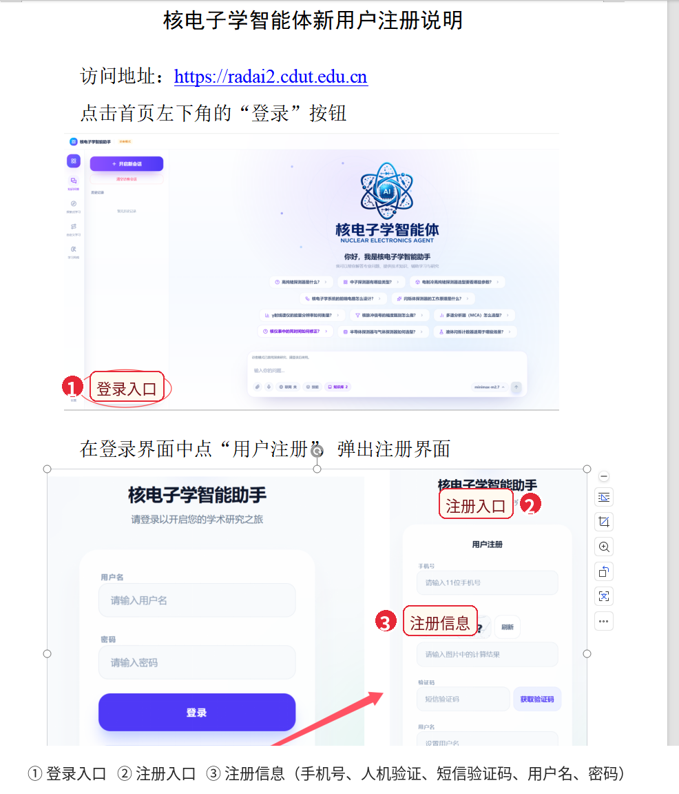

# 核电子学智能体新用户注册与完整使用说明

## 1. 访问、注册与登录

### 1.1 访问系统

在浏览器打开：<https://radai2.cdut.edu.cn>

建议使用最新版 Chrome、Edge 或 Chromium 浏览器。

### 1.2 注册新用户

1. 进入首页，点击左下角的“登录”。
2. 在登录页点击“用户注册”。
3. 按顺序填写：手机号、人机验证、短信验证码、用户名、设置密码、确认密码。
4. 人机验证看不清时点击“刷新”；填写手机号和算式结果后，点击“获取验证码”。
5. 输入短信验证码，设置用户名和不少于 6 位的密码，点击“注册”。
6. 注册成功后返回账号密码登录界面，用新用户名和密码登录。

> 短信验证码有时效限制。密码和短信验证码不要提供给他人。

### 1.3 使用已分配账号登录

在账号密码登录界面填写：

| 项目 | 内容 |
| --- | --- |
| 用户名 | `chenzhiqian` |
| 密码 | `czq@cdut+` |

点击“登录”，进入“核电子学智能助手”主界面。

## 2. 登录后的页面布局

登录后，页面通常由三部分组成：

- **左侧导航栏**：知识问答、探索式学习、自定义学习、学习风格。
- **左侧会话区**：新建会话、查看历史会话、继续已有对话；窗口较窄时先点击菜单按钮打开。
- **中间工作区**：显示欢迎页、问题回答、学习图谱或学习计划。

首次使用建议按下面顺序操作：先完成一次知识问答，再尝试上传文件；如果需要系统化学习，再使用探索式学习和自定义学习；最后完成学习风格测评。

## 3. 知识问答：从提问到查看结果

### 3.1 发起第一次问答

1. 登录后默认进入“知识问答”。
2. 点击底部的“输入你的问题……”输入问题。
3. 点击右下角发送按钮；也可以使用 `Ctrl+Enter`（若浏览器/页面支持）发送。
4. 等待系统生成回答。回答完成后，可以继续在同一会话中追问。

建议问题写清楚“对象、任务和输出格式”，例如：

> 请解释电荷灵敏前置放大器的工作原理，并列出反馈电容、反馈电阻对输出信号的影响。

### 3.2 继续追问和修改问题

- 直接在输入框输入下一步问题，可以围绕当前回答继续追问。
- 对历史问题可使用“复制问题”或“编辑后重发”。
- 对回答可使用“复制回答”。
- 需要提前停止时，点击生成过程中的“停止生成”。

### 3.3 联网搜索

点击输入框下方的“联网”按钮切换开关：

- **联网开**：适合需要近期资料、网页信息或外部公开资料的问题。
- **联网关**：适合只基于系统知识库或已有上下文回答的问题。

发送前确认按钮状态，避免把不需要联网的内部问题提交到外部搜索流程。

### 3.4 选择技能

1. 点击“技能”，打开“选择技能”窗口。
2. 可在“搜索技能名称或描述……”中查找技能。
3. 点击技能右侧开关进行选择；可同时选择多个技能。
4. 点击“完成”，再输入问题并发送。

技能用于改变任务处理方式，例如让系统按指定流程分析、整理或生成内容。若不确定是否需要，保持默认即可。

### 3.5 选择知识库

1. 点击“知识库”按钮。
2. 在列表中打开需要使用的知识库，可多选。
3. 返回输入框，写明希望系统“结合所选知识库”完成的任务。
4. 发送后，查看回答中的检索过程和参考来源。

如果没有选择知识库，系统仍可进行通用问答；需要引用项目资料、课程资料或上传文档时，建议选择对应知识库。

### 3.6 选择模型

点击输入框右侧显示当前模型名称的按钮，在下拉列表中选择可用模型。一般情况下使用默认模型即可；只有在需要更快响应或更复杂分析时，再根据页面提供的模型说明进行切换。

### 3.7 语音输入

1. 按住麦克风按钮开始说话。
2. 松开按钮结束录音并等待识别。
3. 识别结果出现后，可在编辑框中修改文字。
4. 确认无误后发送。

首次使用需要允许浏览器访问麦克风；环境嘈杂时建议改用键盘输入。

### 3.8 查看和导出回答

回答完成后，可使用回答区域的操作按钮：

- 复制回答：复制到剪贴板。
- 导出为 PDF：保存为 PDF 文件。
- 导出为 Word：保存为 Word 文件。
- 如果系统生成了文件或其他产物，可在右上角的产物面板中查看，并使用“下载文件”或“下载查看”。

## 4. 文件上传与个人文件库

### 4.1 在对话中上传文件

1. 点击输入框左侧的回形针按钮。
2. 选择“上传本地文件”。
3. 根据文件类型选择“自动解析”或“使用 MinerU”；论文图片较多时可优先选择 MinerU。
4. 等待附件状态变为上传完成。
5. 在输入框写明任务，例如“总结这篇论文的实验方法，并列出关键参数”。
6. 点击发送，等待系统完成文件解析和回答。

上传过程中可以在附件卡片上查看进度；不需要的附件可点击移除。文件较大或内容较复杂时，请等待解析完成再发送问题。

### 4.2 从“我的文件”添加文件

1. 点击回形针按钮，选择“从我的文件添加”。
2. 在个人文件库窗口中搜索文件名。
3. 选中需要的文件并确认。
4. 回到对话输入问题并发送。

这种方式适合复用已经上传或系统生成的文件，不需要重复解析。

### 4.3 管理个人文件

进入“我的文件”或“个人文件管理中心”后，可以：

1. 在“按照文件名检索文件……”中输入关键词，点击“查询”。
2. 通过文件类型和来源筛选结果。
3. 点击“上传新文件”上传并保存文件。
4. 对文件执行下载、重命名或删除。

删除文件前请确认不再需要；删除可能解除该文件与相关会话的关联。

## 5. 探索式学习：从主题生成知识图谱

### 5.1 输入主题

1. 点击左侧导航栏“探索式学习”。
2. 在“输入或选择学习主题……”中输入主题，例如“核电子学前置放大器设计”。
3. 也可以直接点击页面推荐主题气泡。
4. 点击发送/进入按钮，等待系统构建学习图谱。

### 5.2 查看知识图谱和节点

1. 在图谱中点击一个知识节点。
2. 右侧会打开知识面板，查看该节点的路径、详解和相关内容。
3. 可拖动面板边缘调整宽度；移动端会从底部弹出面板。
4. 点击其他节点可切换查看内容；点击“返回”回到主题页。
5. 点击“重新开始”可以换一个新主题。

如果页面提供知识库下拉框，可先选择知识库，再输入主题，以便让图谱更贴合指定资料。

### 5.3 深入学习和继续提问

在节点知识面板中阅读详解和参考资料；需要继续追问时，在面板底部的“继续追问这个知识点……”输入问题并发送。对资料感兴趣时，可打开或下载相关资源。

探索结果可以作为后续自定义学习计划的起点：明确主题后，进入“自定义学习”，把探索到的方向带入计划生成器。

## 6. 自定义学习：生成并执行学习计划

### 6.1 生成计划

1. 点击左侧导航栏“自定义学习”。
2. 点击“新建计划”或“生成计划”。
3. 在目标框中填写学习目标，例如：

   > 7 天掌握前置放大器原理，能画出电荷灵敏前放链路并完成参数估算。

4. 设置“当前基础”：按实际情况选择基础、入门、熟悉或不确定等选项。
5. 设置“学习深度”。
6. 设置学习“天数”和“分钟/天”。
7. 在“知识来源”中选择需要绑定的知识库；没有可选知识库时，系统仍会使用通用课程结构生成计划。
8. 如果已完成学习风格测评，可勾选“应用学习风格偏好”。
9. 点击“生成并预览计划”。

### 6.2 检查和启用计划

生成后先查看“计划预览”，重点检查：计划标题、目标、天数、每天学习时间、节点数量、各节点任务和是否应用学习风格。

- 需要修改时，点击“返回修改并重新生成”。
- 确认无误时，点击“确认并开始”。

计划启用后进入学习工作台，系统会解锁第一个节点并开始记录学习进度。

### 6.3 学习工作台中的节点流程

对每个开放节点，按以下顺序操作：

1. 选择节点，先阅读“明确目标”中的学习目标、通过标准和推荐任务。
2. 点击“进入详解”或“开始学习”，阅读节点详解。
3. 如果需要资料，进入“知识库”标签，点击“检索知识库”或“查找知识库资料”，查看知识图谱和相关文档。
4. 在“练习检测”标签点击“生成练习”，完成全部题目后点击“提交练习”。
5. 也可以在“提交学习产物”文本框中写学习小结、方案说明、计算过程或复盘结论，点击“提交产物”。建议包含关键概念、判断依据、一个例子和容易混淆点。
6. 练习达到 70 分后，系统更新掌握度并解锁后续节点。
7. 低于 70 分时，系统会插入复习节点；先完成复习，再回到原节点重新检测。

### 6.4 计划管理

在“我的学习计划”中：

- 点击“继续学习”进入进行中的计划。
- 有待复习节点时，点击“继续复习”优先处理薄弱节点。
- 点击编辑按钮可修改标题、目标、基础、深度、学习时长和知识库。
- 点击归档按钮可将计划移出当前列表。
- 计划进度、已完成节点和待复习节点会在列表中显示。

## 7. 学习风格测评

1. 点击左侧导航栏“学习风格”。
2. 点击“开始测评”。测评约 6 分钟，共 44 道题，分为 4 个维度，每个维度 11 题。
3. 每道题选择更符合自己大多数学习情境的选项。
4. 当前维度完成后点击“下一维度”；完成第四个维度后点击“查看结果”。
5. 查看四个维度的偏好、说明和建议。
6. 在“应用于智能助手”区域选择是否启用；登录后可点击开关保存。

测评结果反映当前自述偏好，不代表能力高低，也不会限制使用其他学习方式。启用后，系统可在后续回答、学习计划、练习和复盘提示中参考这些偏好，但不会改变检索范围和答案标准。

## 8. 用户设置与退出

进入用户设置后可以：

- 修改个人资料并点击“保存资料”。
- 在“安全设置”中填写当前密码、新密码和确认新密码，点击修改密码。
- 查看和调整学习风格应用偏好。
- 点击“退出登录”结束当前会话。

在公共电脑上使用完毕后务必退出登录，不要保存密码；如果登录状态过期，重新返回登录页登录即可。

## 9. 常见问题

**登录失败**：检查用户名、密码及大小写，确认没有复制进多余空格；必要时使用“忘记密码？”重置。

**收不到验证码**：确认手机号正确、短信未被拦截，不要连续频繁点击“获取验证码”。

**人机验证错误**：点击“刷新”获取新算式并重新填写结果。

**文件一直处理中**：保持页面打开，等待解析完成；论文图片较多时可尝试使用 MinerU。

**回答加载较慢**：联网搜索、知识库检索、文件解析和深度研究均可能增加处理时间；生成过程中可点击“停止生成”。

**计划后续节点没有解锁**：检查当前节点练习是否提交，是否达到 70 分；若未达标，先完成系统插入的复习节点。

## 10. 关键界面标记

下图中：**①** 为首页左下角“登录”入口，**②** 为登录页中的“用户注册”入口，**③** 为注册页信息填写区域。

