# RadAI 智能体平台项目介绍与系统架构

> 文档版本：2026-07-23（含 FMCA、拆分 API、双轨入库/检索、自定义学习、提示词管理、访客短信认证、Agent Runtime、Trace/Replay）
> 适用范围：当前仓库主干代码
> 项目名称：核电子学智能助手（RadAI）/ 成理水文地质智学助手（CSH-AI）/ 基础力学课程智能体（FMCA）/ 地下水项目分析助手

## 1. 项目概述

本项目是一个面向专业知识服务场景的 **RAG + 多智能体平台**。平台以统一的智能体运行时为核心，通过不同的 Agent Profile、Prompt、Skill、ToolPolicy 和知识库配置，支撑核电子学、水文地质、基础力学、地下水项目分析等业务。

项目不仅提供普通的知识问答，还覆盖专业文档入库、多知识库检索、深度研究、多智能体协作、探索式学习、表格分析、工件生成和管理后台等完整业务链路。

### 1.1 项目全景图

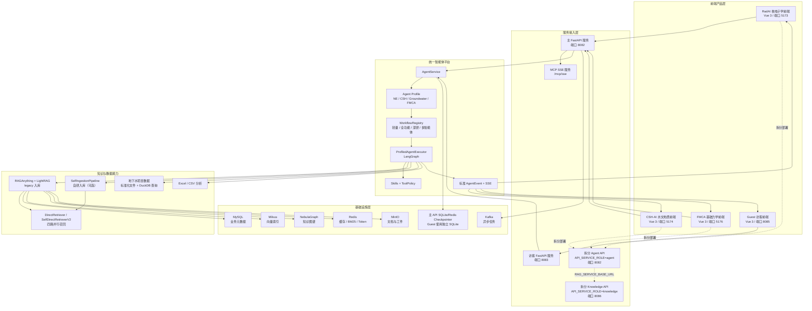

### 1.2 产品与服务

| 产品或服务 | 目录 | 默认端口 | 主要用途 |
| :--- | :--- | :--- | :--- |
| RadAI | `frontend/` | 5173 | 核电子学问答、深度研究、探索式学习和知识库管理 |
| CSH-AI | `frontend_csh_ai/` | 5174 | 水文地质问答，并扩展地下水项目分析 |
| FMCA | `frontend_fmca/` | 5176 | 基础力学课程问答与探索式学习（暂不绑定知识库） |
| Guest | `guest/` | 8085 | 精简访客问答和本地会话 |
| 主 API | `backend/api/http_server.py` | 8082 | 智能体、RAG、知识库、文件、管理和 MCP 接口 |
| 拆分 Agent API | `scripts/run_agent_api.sh` | 8082 | 轻量对话运行时，委托检索到 Knowledge API |
| 拆分 Knowledge API | `scripts/run_knowledge_api.sh` | 8086 | RAG/知识库预热、检索、索引同步 |
| 访客 API | `backend/api/guest_http_server.py` | 8083 | 精简认证、访客问答和会话接口 |
| Kafka Worker | `backend/worker/task_worker.py` | - | 异步文档解析任务 |
| 入库 Worker | `backend/worker/ingest_worker.py` | - | 将待入库文档写入 RAG 索引 |

### 1.3 主要技术栈

| 层级 | 技术 |
| :--- | :--- |
| 前端 | Vue 3、TypeScript、Vite、Tailwind CSS、Vue Router |
| 内容渲染 | Marked、KaTeX、DOMPurify |
| 后端 | Python 3.12–3.14（Docker 镜像使用 3.13）、FastAPI、Pydantic、SQLAlchemy |
| 智能体 | LangChain、LangGraph、SQLite/Redis Checkpointer（主 API 可选，Guest 固定 SQLite） |
| RAG | RAGAnything、LightRAG、自研 DirectRetriever |
| 数据基础设施 | MySQL、Milvus、NebulaGraph、Redis、MinIO、Kafka |
| 文档解析 | MinerU、Docling、Markdown 直入库 |
| 工具协议 | MCP SSE、ToolPolicy、Skills |

---

## 2. 智能体整体框架

### 2.1 平台化设计

当前智能体不再为每个领域复制一套独立执行类，而是采用以下统一模型：

```text
Agent Profile + Workflow + Executor + Prompt + Skill + ToolPolicy + AgentEvent
```

- **Agent Profile**：定义领域、默认知识库、默认 Skill、可用工作流和工具策略。
- **Workflow**：决定请求采用轻量问答、全功能 Agent、深度研究或多智能体协作。
- **Executor**：根据 Profile 和请求参数创建 LangGraph。
- **Prompt**：根据领域动态加载核电子学、水文地质或地下水项目 Prompt。
- **Skill**：提供领域方法、任务规范和可选工具声明。
- **ToolPolicy**：控制不同领域、工作流和 Skill 可以使用哪些工具。
- **AgentEvent**：统一输出正文、推理、工具过程、工作流状态、工件和追问建议。

### 2.2 智能体端到端框架图

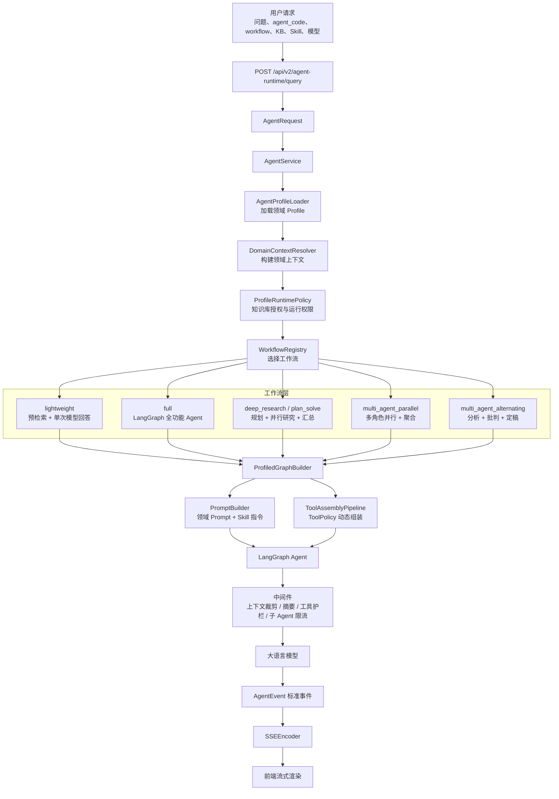

### 2.3 Agent Profile

平台当前配置了四类智能体：

| Profile | 领域 | 默认工作流 | 核心能力 |
| :--- | :--- | :--- | :--- |
| `ne` | 核电子学 | `lightweight` | 双知识库检索、专业问答、深度研究、表格分析 |
| `csh` | 水文地质与污染场地 | `lightweight` | 水文地质问答、联网研究、专业表格分析 |
| `groundwater` | 地下水项目分析 | `full` | 授权项目包读取、bootstrap 合同、DuckDB 项目表查询、水质分层核对、KML 汇总、质量检查与新井预测 |
| `fmca` | 基础力学课程 | `lightweight` | 概念讲解、公式推导、例题分析与学习答疑；`kb_policy: disabled`，暂不绑定知识库 |

Profile 配置位于 `backend/config/agents/`。领域差异主要通过配置表达，而不是复制后端智能体类。

地下水项目分析的当前实现详见 [groundwater_project_analysis.md](./groundwater_project_analysis.md)。该能力已从普通水文地质 RAG 问答调整为“项目实例包 + MySQL 授权 + bootstrap 合同 + DuckDB 只读查询 + 地下水标准知识库 + KML/预测/质量工具”的项目级分析链路。

### 2.4 工作流框架

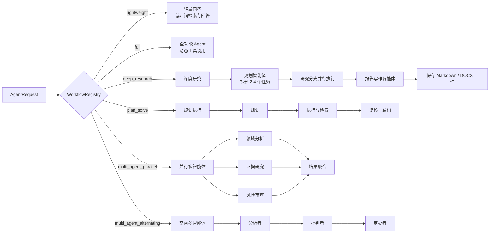

当前 `deep_research` 与 `plan_solve` 的底层均由 `CoordinatedAgentWorkflow` 完成规划、检索、并行研究、报告写作和工件归档。HTTP 层为长任务创建可重连的 `AgentTaskRegistry` 任务：`POST /api/v2/agent-runtime/query` 返回启动确认，之后通过 `/{agent_code}/task/{task_id}/status|stream|cancel` 查看、续接和取消；这是当前长任务恢复链路，而非遗留兼容桩。

### 2.5 工具与 Skill 体系

工具不是固定写死在 Agent 中，而是由 `ToolAssemblyPipeline` 根据领域、工作流、用户选择的 Skill、知识库和运行权限动态组装。

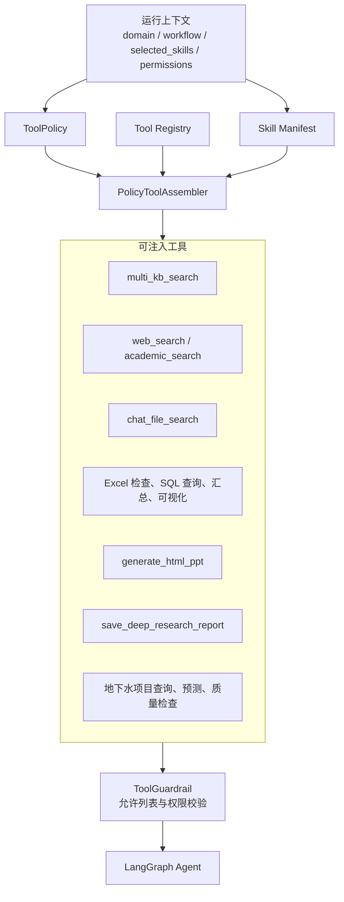

公开 Skill 位于 `backend/skills/public/`，当前包括：

- `nuclear-electronics`
- `csh-hydrogeology`
- `groundwater-project-analysis`
- `deep-research`
- `academic-search`
- `general-table-analysis`
- `excel-experiment-analysis`
- `html-ppt`

### 2.6 标准事件流

后端通过 `AgentEvent` 统一不同工作流的输出，前端不需要理解具体执行器。

| 事件 | 用途 |
| :--- | :--- |
| `workflow.started` | 工作流开始 |
| `plan.created` / `plan.updated` | 研究计划生成或更新 |
| `message.delta` | 回答正文增量 |
| `reasoning.delta` | 推理内容增量 |
| `workflow.step` | 检索、工具和子任务过程 |
| `coordination.unit.completed` | 协作单元完成 |
| `follow_up.created` | 回答后的追问建议 |
| `error` | 运行错误 |
| `done` | 流结束 |

---

## 3. 前端实现框架

### 3.1 前端总体框架图

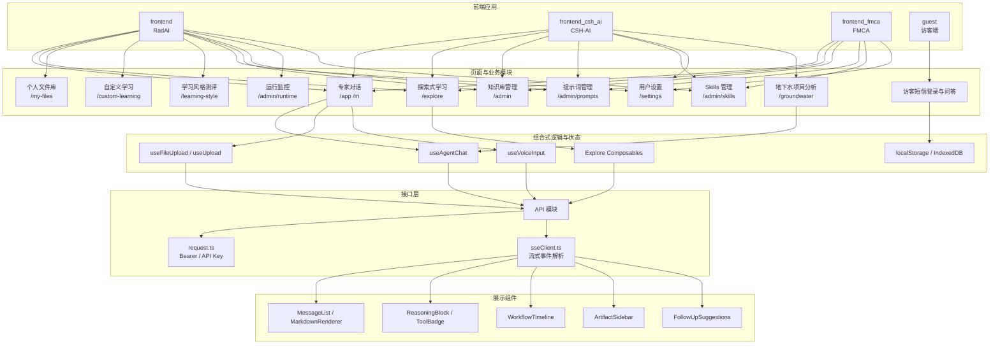

### 3.2 专家对话页面

RadAI 和 CSH-AI 共享相近的专家模式结构：

```text
index.vue
├── HistorySidebar              会话历史
├── MessageList                 消息列表
│   ├── MarkdownRenderer        Markdown、公式与安全过滤
│   ├── ReasoningBlock          推理过程
│   ├── ToolBadge               工具状态
│   ├── WorkflowTimeline        工作流过程
│   └── FollowUpSuggestions     追问建议
├── ChatBox                     输入、模型、知识库和 Skill 选择
├── ArtifactSidebar             报告、图表、PPT 等工件
└── useAgentChat                请求状态和 SSE 事件处理
```

对话数据流如下：

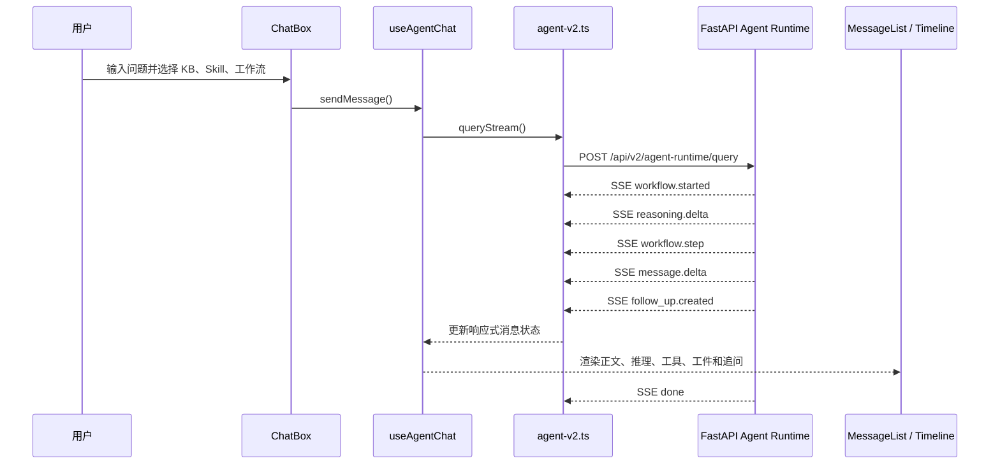

### 3.3 三套前端的差异

| 能力 | RadAI | CSH-AI | Guest |
| :--- | :---: | :---: | :---: |
| 专家问答 | 支持 | 支持 | 精简支持 |
| 核电子学 Profile | 默认 | 可通过平台调用 | 默认访客 Profile |
| 水文地质 Profile | - | 默认 | - |
| 地下水项目分析 | - | 支持 | - |
| 深度研究和多智能体 | 支持 | 支持 | 禁用 |
| 探索式学习 | 支持 | 支持 | - |
| 知识库管理后台 | 支持 | 支持 | - |
| 会话持久化 | MySQL + Checkpoint | MySQL + Checkpoint | IndexedDB + 独立 Checkpoint |

---

## 4. 后端实现框架

### 4.1 后端分层框架图

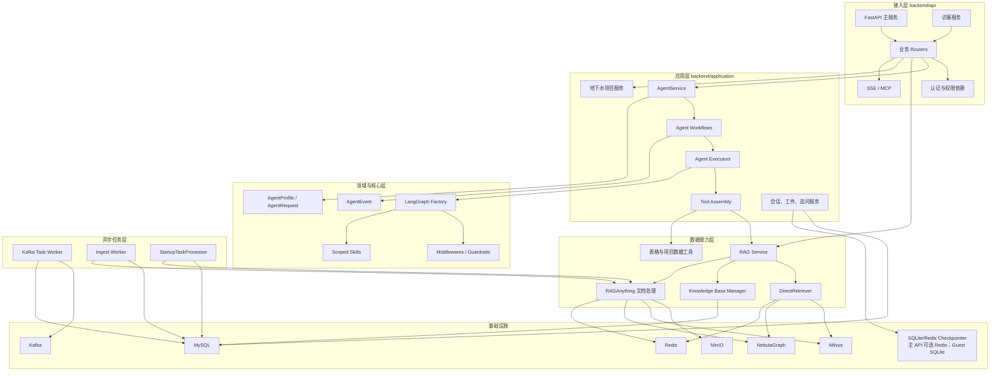

### 4.2 API 层

主 API 采用 FastAPI 路由拆分，主要接口族包括：

- `/api/v2/agent-runtime`：统一智能体运行时（含 `runs/{run_id}` Trace 调试）。
- `/api/v2/guest`：访客问答入口；访客专用 API 也会挂载该路由。
- `/api/v2/conversations`：会话列表、消息恢复、重命名、删除和回滚。
- `/api/v2/explore`：主题发现、思维导图、资源、详解和练习。
- `/api/v2/groundwater`：地下水项目和用户授权。
- `/api/v2/chat-files`：对话附件上传和索引。
- `/api/v2/files`：文件中心、MinIO 工件下载、KB 图片代理和 DOCX 导出。
- `/api/v2/threads`：线程工件安全访问。
- `/api/v1/auth` 与根路径短信接口：登录、CAS、Token 验证、用户资料、改密、短信注册/重置。
- `/api/v1/guest-sms`：访客图形验证码、短信验证码、注册和登录。
- `/api/v1/knowledge_bases`：知识库生命周期管理（含 `ingestion_backend` / `retrieval_backend`）。
- `/api/v1/knowledge_bases/{kb_id}/directories` 与 `/documents`：目录树、文档上传、排序、移动、删除、chunk 查看。
- `/api/v1/uploads`：普通上传、分块上传和异步入库。
- `/api/v1/rag`：检索、流式问答和索引维护（按 KB `retrieval_backend` 路由）。
- `/api/v1/admin/self-ingestion`：自研入库任务、健康检查与修复（管理员）。
- `/api/v1/prompts`：提示词模板与自研入库抽取 Schema 管理（管理员）。
- `/api/v1/custom-learning`：自定义学习计划与节点学习闭环。
- `/api/v1/learning-style`：学习偏好测评与 `apply_to_ai` 开关。
- `/api/v1/admin` 与 `/api/v1/admin/conversations`：用户、API Key、审计、任务、系统健康和跨用户会话管理。
- `/api/v1/models`：模型配置管理。
- `/api/v1/agents`：智能体与知识库绑定。
- `/api/v1/skills`：Skill 上传、版本、授权、启停和下载。
- `/api/v1/datasets`：实验数据集管理。
- `/api/v1/asr/transcribe`：语音转写。
- `/api/v1/mcp` 和 `/mcp/sse`：MCP 工具调用。

主 API Lifespan 由 `backend/api/startup.py` 编排，`API_SERVICE_ROLE=all|agent|knowledge` 决定是否初始化 Agent Checkpointer、模型缓存订阅、RAG 预热、关键词索引和索引同步。`STARTUP_TASK_PROCESSOR_ENABLED` 默认关闭，生产更常用独立 Ingest Worker。

### 4.3 RAG 检索框架

平台使用 **legacy LightRAG** 与 **自研 SelfIngestionPipeline** 双轨构建索引；在线检索经 `resolve_retrieval_backend()` 路由：

- **legacy**：自研 `DirectRetriever` 四路并行（`backend/rag/retriever/`）
- **self_ingestion**：`SelfDirectRetrieverV2`（`backend/rag/retriever_v2/`）
- **hybrid**（灰度）：`HybridRetriever` 合并两路结果

下图以 legacy DirectRetriever 为例；self 库 Path-A~D 实现与命名空间独立，算法思想一致。

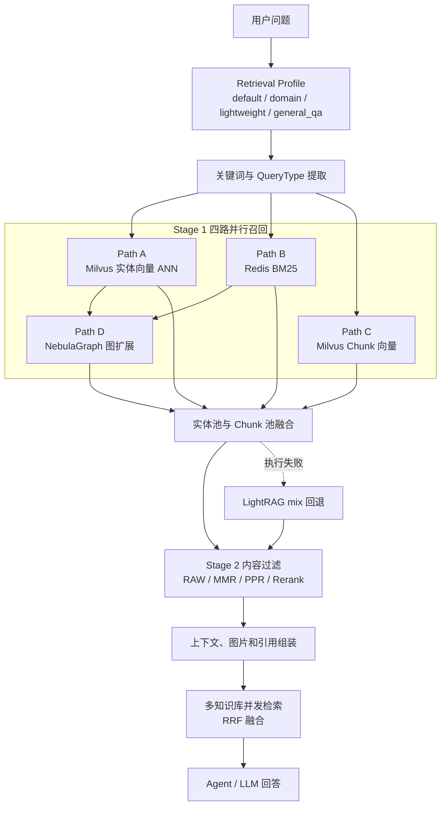

垂直领域知识库默认使用 `domain` Profile，Stage 2 采用 `MMR_ONLY`，用于减少重复内容并保持证据多样性。多知识库检索通过 RRF 合并不同知识库的排序结果。

### 4.4 文档上传与入库框架（双轨）

知识库入库长期保持 **legacy_lightrag** 与 **self_ingestion** 双轨并存。上传入口统一，Worker 按知识库级 `ingestion_backend` 分流。

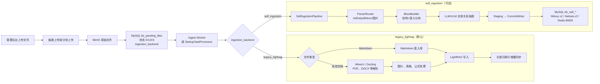

`kb_pending_files` 状态含义：

| 状态 | 含义 |
| :---: | :--- |
| `0` | 待入库 |
| `1` | 入库中 |
| `2` | 入库成功 |
| `3` | 入库失败或 blocked（如 self_ingestion 开关未满足） |

知识库级配置：

| 字段 | 取值 | 说明 |
| :--- | :--- | :--- |
| `ingestion_backend` | `legacy_lightrag` / `self_ingestion` | 入库链路选择；历史库默认 legacy |
| `retrieval_backend` | `legacy_lightrag` / `self_ingestion` / `hybrid` | 检索链路；hybrid 为灰度 |
| `self_ingestion_enabled` | bool | 与全局开关共同控制自研入库授权 |

完整设计见 [入库实现方案.md](./入库实现方案.md)；落地进度见 [入库实现方案审查.md](./入库实现方案审查.md)；运维上手见 [self_ingestion_quickstart.md](./self_ingestion_quickstart.md)。

---

## 5. 已实现功能

### 5.1 功能框架图

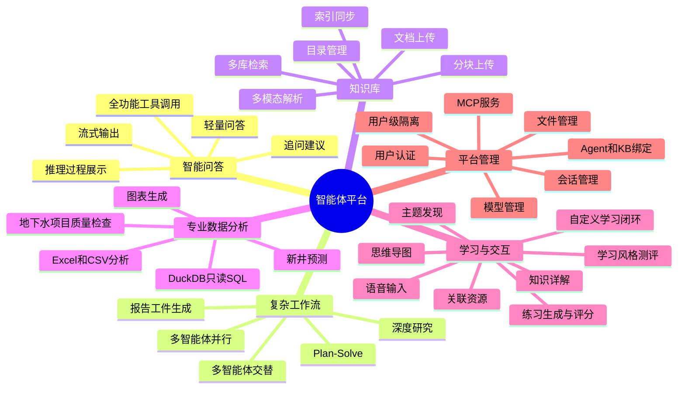

### 5.2 智能问答与研究

- 支持核电子学、水文地质、地下水项目和基础力学四类专业智能体。
- 支持知识库、联网搜索、会话附件和专业 Skill 组合调用。
- 支持 SSE 流式正文、推理过程、工具状态和工作流时间线。
- 支持轻量问答与全功能 Agent 两类执行路径。
- 支持深度研究：任务规划、并行证据收集、研究子 Agent、报告写作和文件归档。
- 支持 `plan_solve`、`multi_agent_parallel` 和 `multi_agent_alternating`。
- 子智能体通过 `runtime_agents.yaml` 声明；支持 Trace/Replay 调试与 Handoff V2 结构化交接。
- 支持回答后的相关追问建议。

### 5.3 知识库与 RAG

- 知识库创建、编辑、删除、切换和统计；创建时可选择 **legacy_lightrag** 或 **self_ingestion** 入库后端。
- 知识库多级目录与文档管理。
- 普通上传、大文件分块上传、批量上传和异步入库。
- **legacy 链路**：PDF、DOCX、Markdown 等经 RAGAnything + LightRAG 入库。
- **self_ingestion 链路**（可选）：`SelfIngestionPipeline` 支持学科 Schema、LLM/VLM 抽取、质量门控与版本化提交。
- 图片、表格和公式等多模态内容解析。
- Milvus 向量检索、Redis BM25 和 NebulaGraph 图扩展（legacy 与 v2 索引命名空间隔离）。
- 多知识库并发检索与 RRF 排名融合。
- 检索 Profile、MMR 去重、PPR/Rerank 可选过滤和 LightRAG 回退。
- 知识库索引预热、增量同步和定时同步。

### 5.4 文件、表格与工件

- 对话附件上传、图片访问和长文档会话内检索。
- 个人文件库、会话文件绑定和生成文件保存。
- Excel/CSV 数据集注册、预览、Schema 刷新和 Agent 绑定。
- 基于 DuckDB 的表结构检查、只读 SQL 查询、汇总和可视化。
- HTML/PPT 风格工件生成。
- 深度研究 Markdown/DOCX 报告生成。
- 工件通过用户和线程权限校验后下载或预览。

### 5.5 探索式学习

- 自动生成领域主题。
- 创建和展开知识思维导图。
- 对知识节点进行流式详解。
- 检索并下载相关知识库文档。
- 自动生成选择题、判断题和简答题。
- 对用户答案进行评分和反馈。

### 5.5.1 自定义学习闭环

- 用户可按目标或模板创建个人学习计划（`/api/v1/custom-learning`）。
- `CustomLearningAgentTeam` 多角色编排：课程规划、学习风格教练、探索桥接、练习评分与反馈调节。
- 节点级学习路径：开始/完成节点、掌握度计算、自动开放后续节点。
- 复用探索式学习的资源与习题，并固化到计划节点。
- 学习风格画像影响任务形态与详解建议（规则版，后续可升级 LLM 生成）。

详见 [custom_learning_closed_loop_design.md](./custom_learning_closed_loop_design.md)。

### 5.6 地下水项目分析

- 管理员创建、编辑、归档地下水项目。
- 上传标准 ZIP 项目数据包。
- 将项目授权给指定用户。
- 普通用户仅能访问被授权的项目。
- 读取项目清单、背景和标准化资源。
- 先读取项目 Skill 与 bootstrap 合同，再决定真实表与查询路径。
- 使用只读 DuckDB 查询项目表格。
- 汇总 KML 地物、分组和坐标范围。
- 检查坐标、记录和数据质量问题。
- 基于邻近井数据进行新井深度和水位范围初步预测。

### 5.7 平台管理与安全

- Bearer Token、API Key、CAS 和短信验证码相关认证接口。
- 普通用户与管理员角色控制。
- 模型配置持久化和 Redis 变更通知。
- 智能体与知识库动态绑定。
- 用户级、线程级存储和 Checkpoint 隔离。
- ToolPolicy 允许列表、领域权限和工具 Guardrail。
- MinIO 对象路径隔离与工件路径防穿越。
- 主服务与访客服务使用独立 Checkpoint 数据库。
- 提供 MCP SSE 工具接入能力。

---

## 6. 部署与运行关系

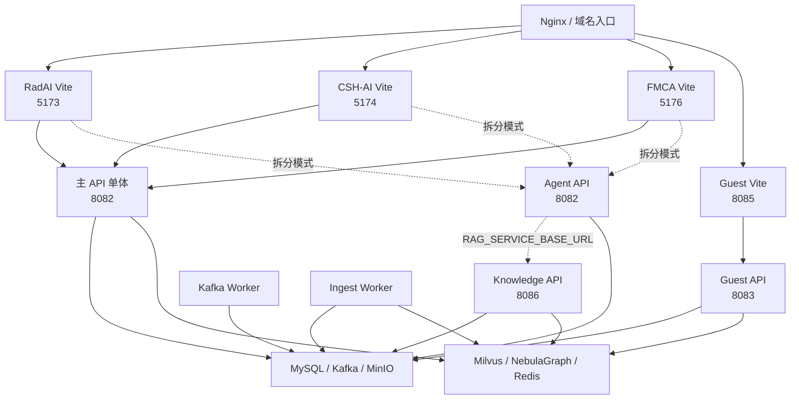

常用启动命令：

```bash
make install
make init-db
make run-api
bash run_frontends.sh

# 可选服务
make run-guest-api
make run-worker
make run-ingest-worker

# 拆分服务模式
scripts/run_knowledge_api.sh
scripts/run_agent_api.sh

# 守护式服务管理
bash scripts/agent_api_service.sh start
bash scripts/knowledge_api_service.sh start
bash scripts/guest_backend_service.sh start
bash scripts/ingest_worker_service.sh start
```

当前 `docker-compose.yml` 提供 API、Kafka Worker、Ingest Worker、MySQL、Redis、Zookeeper/Kafka、MinIO、Prometheus 和 Grafana 等服务定义；Milvus、NebulaGraph 仍需要根据实际环境单独配置或接入已有服务。

> Compose 使用根目录 `.env` 做变量插值（模板为 `.env.example`），并通过 `APP_ENV_FILE`（默认 `backend/.env`）加载应用配置。仓库已提供 `prometheus/prometheus.yml` 与 `grafana/provisioning/`，当前 compose 不再引用 `scripts/init.sql`。

---

## 7. 核心目录说明

```text
backend/
├── api/                 FastAPI 服务与路由
├── application/         智能体工作流、执行器、工具和应用服务
├── core/                LangGraph 工厂、中间件、安全与模型
├── config/              settings、Agent/Profile、ToolPolicy、MCP、Prompt 注册表
├── domain/              Agent、Workflow、Tool 等领域模型
├── rag/                 RAGAnything、LightRAG、ingestion/（自研入库）、retriever/、retriever_v2/、索引同步
├── skills/              公开和定制 Skill
├── db/                  SQLAlchemy 模型与 CRUD
├── storage/             MinIO 和用户隔离存储
├── kafka/               Kafka 客户端与消息模型
├── worker/              Kafka Worker 和入库 Worker（双轨路由）
└── services/            文件、目录、启动任务、custom_learning_agents 等

frontend/                RadAI 前端
frontend_csh_ai/         CSH-AI 与地下水项目前端
frontend_fmca/           FMCA 基础力学课程前端
guest/                   访客前端
deploy/                  部署辅助（firecrawl、systemd 等）
scripts/                 API/Worker 服务脚本、迁移、自研入库修复与一致性检查
docs/                    项目设计和模块文档
eval/                    RAG 与 GraphRAG 评测框架
docker-compose.yml       本地基础编排（部分依赖需外部接入）
```

## 8. 总结

本项目已经形成一个可复用的专业智能体平台。其核心特点是：

1. 使用统一的 Profile、Workflow、Executor 和 AgentEvent 支撑多个专业领域。
2. 将轻量问答、工具型 Agent、深度研究和多智能体协作统一到同一运行入口。
3. 使用 RAGAnything、LightRAG、自研 SelfIngestionPipeline 与四路检索（legacy DirectRetriever / self SelfDirectRetrieverV2）构建专业知识底座。
4. 前端完整呈现回答、推理、工具、子任务、工件和追问建议。
5. 同时具备知识库管理、双轨文档入库、表格分析、探索式学习、自定义学习闭环与专业项目分析能力。
6. 通过用户、线程、知识库、项目和工具策略实现多层权限与数据隔离。
